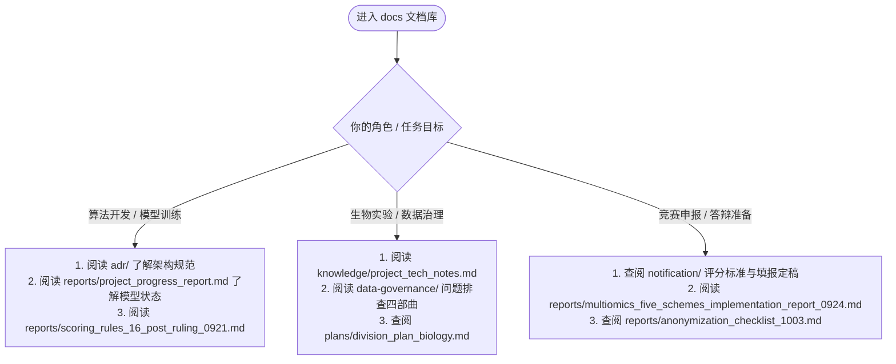

# 文件索引与文档知识库（cs_pipeline/docs）

> **归属项目**：第一届全球大学生生命科学挑战赛（赛道二：AI 基因编辑与核酸工具设计）——"菊科菊苣族 gRNA 设计工具"  
> **基准时点**：2026-09-25（P0~P2 卡点全数闭环，形态二模型定案，全量代码与基准冻结）；文档结构整理基准 2026-10-10  
> **存储约定**：Git 仓库严格收录代码与 Markdown 文档；二进制文件（PDF / docx / xlsx）由根 `.gitignore` 保护不入库，本地保留副本并同步团队网盘。

---

## 一、目录结构全景

```
docs/
├── adr/                         # 软件架构决策记录（Architecture Decision Records）
├── data-governance/             # 数据治理问题排查四部曲（problem.md 系列）
├── knowledge/                   # 跨学科领域知识与核心文献技术笔记
├── notification/                # 赛事官方通知、参赛申报填报定稿与评审标准
├── paper/                       # 参考文献原文库（核心模型 + 多组学/表观组学）
├── patent/                      # 专利申报技术交底书
├── plans/                       # 现行项目主方案、分工详案与全栈实施规格
├── ppt/                         # 参赛汇报 PPT 制作工程与成品
├── reports/                     # 全景审计、阶段验收、专项报告与教师反馈整理
├── survey/                      # 现有 CRISPR 设计工具前期横向对比表
├── _archive/                    # 历史被取代方案留档（警示：勿再引用）
│
├── README.md                    # 本索引
└── USER_MANUAL.md               # 系统用户使用手册（双轨系统完整操作指南）
```

---

## 二、核心报告、实施方案与数据治理专项

| 文档 | 类型 | 核心内容与决策 |
|---|---|---|
| [`reports/project_progress_report.md`](reports/project_progress_report.md) | **全景审计总报告** | **全项目最高统揽文档**。覆盖阶段 0~2 全链路审计，记录 9.18 扩表、9.19 老师裁决、形态二（分层选择性 Beta-Binomial GLMM）与 `noB879` 纯金标准定案，以及 9.24~9.25 P0/P1/P2 四项工程卡点全部结案过程。 |
| [`reports/multiomics_five_schemes_implementation_report_0924.md`](reports/multiomics_five_schemes_implementation_report_0924.md) | **多组学实施报告** | 通俗可读的实施全景：方案 1（Demo 看板）、方案 2（表达消融）、方案 3（组织优先重排）、方案 5（功能性脱靶危害轻量版）、方案 6（橡胶草产胶时相）实测结果与方案 4/5 降级论证。 |
| [`plans/multiomics_implementation_plan.md`](plans/multiomics_implementation_plan.md) | **多组学实施计划** | 转录组多组织表达矩阵在 gRNA 设计全流程中的六大应用方案蓝图、跨版本基因映射标准（`scripts/16`）及交付契约。 |
| [`reports/FULLSTACK_DELIVERY_ACCEPTANCE.md`](reports/FULLSTACK_DELIVERY_ACCEPTANCE.md) | **全栈交付验收** | PostgreSQL + FastAPI + React 生产级全栈交付与双轨验收报告（后端 17 项 / 前端 13 项自动化测试全通过、双轨数值比对 100% 吻合）。 |
| [`reports/teacher_feedback_offtarget_scoring_report.md`](reports/teacher_feedback_offtarget_scoring_report.md) | **教师反馈闭环** | 09-29 教师 5 大项新反馈（脱靶详情、表达指标、基因结构注释、算法透明性、参数说明）整理与可行性评估。 |
| [`reports/teacher_feedback_demo_ui_notes_0930.md`](reports/teacher_feedback_demo_ui_notes_0930.md) | **教师反馈原始记录** | 09-30 教师对 Demo UI 的原始反馈：导出/脱靶计算进度提示、"要计算脱靶吗"确认交互、脱靶明细抽屉疑问。 |
| [`data-governance/problem.md`](data-governance/problem.md) | **数据治理①** | `1_Hi-results-12-20260913.xlsx` 491 行原始数据全面质检报告：首尾空格清理、批次笔误更正、二倍体真实离散表型确认。*(代码与结果硬编码引用)* |
| [`data-governance/problem2.md`](data-governance/problem2.md) | **数据治理②** | 221 行链向与 PAM（ACT更正）自洽修复、5712 批 61 行右侧口径写回、487 行全量重跑记录与同源拷贝分析。*(代码硬编码引用)* |
| [`data-governance/problem3.md`](data-governance/problem3.md) | **数据治理③** | NEWdata 877 行新批次整理：事故块识别、批次效应锚定校正、未确认 guide 隔离与 17 批次分类处置。*(代码硬编码引用)* |
| [`data-governance/problem3_detailed_explanation.md`](data-governance/problem3_detailed_explanation.md) | **数据治理④** | NEWdata 质检深度生物学解读：向非生物背景成员通俗解释 Hi-TOM 测序原理、野生型/突变型读段比例失真的生化原因。 |
| [`USER_MANUAL.md`](USER_MANUAL.md) | **用户手册** | 双轨系统（全栈版 + Streamlit 版）完整使用手册：安装部署、操作流程、脱靶明细抽屉、API 说明与故障排查。 |

---

## 三、软件架构决策记录（[`adr/`](adr/README.md)）

基于深度模块设计（Deep Module）原则建立的核心代码架构防腐与解耦决策：

| 决策记录 | 标题 | 核心决策 |
|---|---|---|
| [`adr/0001-inference-client-seam.md`](adr/0001-inference-client-seam.md) | 推理客户端抽象缝隙 | 解耦顶层推理调用与底层 DeepSpCas9 / WSL CRISPRon 执行环境，支持优雅降级与可测试性。 |
| [`adr/0002-candidate-ranking-engine.md`](adr/0002-candidate-ranking-engine.md) | 候选推荐重排引擎 | 将多组学加权、脱靶过滤与 tie-break 业务逻辑从 UI (`app.py`) 中彻底解耦为独立领域服务。 |
| [`adr/0003-sequence-spec.md`](adr/0003-sequence-spec.md) | 统一序列规范契约 | 确立 30nt 上下文、正负链坐标换算与 PAM（NGG）方向强校验的值对象规范。 |
| [`adr/0004-fullstack-postgres-fastapi-react.md`](adr/0004-fullstack-postgres-fastapi-react.md) | 全栈架构重构 | 确立 PostgreSQL 分层存储与任务状态机、FastAPI 异步接口、React 19 + ECharts 前端的生产级全栈形态。 |

---

## 四、现行方案与跨学科分工（[`plans/`](plans/README.md)）

| 文档 | 作用与层级 | 维护职责 |
|---|---|---|
| [`plans/project_plan_v3_condensed_0907.md`](plans/project_plan_v3_condensed_0907.md) | **主方案（最高依据）** | 全体成员共同准则。双预训练模型 + 自有数据集成，莴苣 T2T 基因组实证。出现口径冲突时以本文件为准。 |
| [`plans/division_plan_master.md`](plans/division_plan_master.md) | **全员甘特与接口规范** | 生D 维护。全员进度网络图、跨学科 F1~F7 交付接口定义、风险预案与提交前检查清单。 |
| [`plans/division_plan_biology.md`](plans/division_plan_biology.md) | **生物系分工详案** | 生A~生D 逐日工作卡、F1 表 12 列权威定义、引物设计与实验验证流程。 |
| [`plans/division_plan_cs.md`](plans/division_plan_cs.md) | **计算机系分工详案** | 计A/计B 实施详案。数据清洗→特征提取→模型训练→脱靶扫描→Streamlit Demo 脚本验收标准。 |
| [`plans/multiomics_implementation_plan.md`](plans/multiomics_implementation_plan.md) | **多组学拓展实施计划** | 转录表达数据六大应用方案实施规范与交付契约。 |
| [`plans/fullstack_postgres_fastapi_react_spec.md`](plans/fullstack_postgres_fastapi_react_spec.md) | **全栈实施规格（SPEC-0001）** | PostgreSQL + FastAPI + React 生产级全栈实施规格说明书（对应 ADR 0004）。 |

---

## 五、阶段工作与排查报告（[`reports/`](reports/README.md)）

收录 09-08 至 10-03 期间全部里程碑验收报告与专项技术报告（含全景审计、多组学专项、全栈交付验收与教师反馈整理），完整时间线与分类导航见 [`reports/README.md`](reports/README.md)。数据治理"问题排查四部曲"见 [`data-governance/`](data-governance/README.md)。

---

## 六、领域知识与核心算法笔记（[`knowledge/`](knowledge/README.md)）

| 文档 | 核心受众 | 内容亮点 |
|---|---|---|
| [`knowledge/project_tech_notes.md`](knowledge/project_tech_notes.md) | 计算机/算法组 | 面向程序员的分子生物学与实验决策指南：CRISPR 原理、PAM 识别机制、Hi-TOM 测序深度的统计学含义、批次效应消除。 |
| [`knowledge/CRISPR_core_papers_notes.md`](knowledge/CRISPR_core_papers_notes.md) | 全体成员 | Chen2022（算法横评）与 Kim2019（DeepSpCas9）两篇核心文献中文深度解读与特征工程剖析。 |
| [`knowledge/defense_01~06`](knowledge/README.md) | 答辩准备 / 全体成员 | **答辩学习系列**：项目全景与科学问题、数据集与数据治理、效率预测模型与评估、多组学时空决策与脱靶、软件系统与工程实现、答辩问答手册（28 个高频 Q&A + 防雷数字总表）。 |

---

## 七、文献库索引（[`paper/`](paper/README.md)）

本地存放 PDF 原文（受 gitignore 保护），网盘永久备份：

1. **CRISPR 活性预测与测序方法（[`paper/crispr_grna_core/`](paper/crispr_grna_core/README.md)）**：
   - `Kim2019`（DeepSpCas9 原文与中文翻译）、`Xiang2021`（CRISPRon 原文）
   - `Chen2022`（算法横评原文与中文翻译）、`Wang2024`（莴苣 T2T 基因组）
   - `Liu2019`（Hi-TOM 突变检测及详细解读笔记）
   - 前沿文献：`Du2026`（CRISPR深度学习综述）、`Gong2026`（植物专用工具评测）、`Li2025`（CRISPR-HNN）、`Zhang2023`（CRISPR-AIDIT）
2. **植物表观组学与基础大模型（`paper/` 根目录）**：
   - `Avsec2025_AlphaGenome.pdf`（AlphaGenome 基因组统一模型）
   - `Cao2024_lettuce_domestication_DNA_methylation.pdf`（莴苣甲基化动态）
   - `Guo2023_LettuceGDB_database.pdf`（LettuceGDB 多组学数据库）
   - `He2026_CLAMP_chromatin_loop_LM.pdf`（染色质环语言模型）
   - `Lv2026_SeiPlant_histone_cross_species.pdf`（植物组蛋白跨物种预测）
   - `Wrightsman2022_cross_species_chromatin_state.pdf`（染色质状态跨物种迁移）
   - `Zhao2021_PlantDeepSEA.pdf`（植物非编码变异效应）

---

## 八、赛事官方通知与参赛申报材料（[`notification/`](notification/README.md)）

| 类别 | 文件 | 作用与状态 |
|---|---|---|
| **官方通知** | [`notification/LSC_round1_notice.pdf`](notification/LSC_round1_notice.pdf)<br>[`notification/第一届全球大学生生命科学挑战赛第二轮通知-定稿.pdf`](notification/第一届全球大学生生命科学挑战赛第二轮通知-定稿.pdf) | 第一轮/第二轮官方通知（赛程、提交节点、答辩须知）。 |
| **申报定稿** | [`notification/附件1-参赛项目原创性声明-定稿.docx`](notification/附件1-参赛项目原创性声明-定稿.docx)<br>[`notification/附件2-参赛项目摘要说明-定稿.docx`](notification/附件2-参赛项目摘要说明-定稿.docx)<br>[`notification/附件3-项目评审表（区赛、总决赛）-定稿.docx`](notification/附件3-项目评审表（区赛、总决赛）-定稿.docx) | **团队填报交付定稿**：原创性声明、300~500字中文摘要（赛道二）、申报书全文（背景、模型、验证、效益）。 |
| **规则与标准** | [`notification/附件4~10`](notification/README.md) | 包含 PPT 格式规范（附件4）、代码规范（附件5）、录屏规范（附件6）、区赛评分标准（附件7）、答辩须知（附件8）、总决赛评分标准（附件9）、单项奖评分标准（附件10）。 |
| **汇报与立项材料** | [`notification/口播稿-代码运行录屏.md`](notification/口播稿-代码运行录屏.md)、`8min稿.doc`、`立项依据*.doc` | 录屏口播稿、8 分钟汇报稿与立项依据。 |
| **归档备份** | `notification/_backup/` | 原始空白模板与编辑前历史备份。 |

---

## 九、汇报 PPT、专利与前期调研

- **汇报 PPT 工程（[`ppt/`](ppt/README.md)）**：区赛"参赛项目介绍"PPT 的完整制作工程（`.pptd` 源稿、`pages/` 分页定义、`media/` 素材、构建/质检脚本）与多版本导出成品。
- **专利申报材料（[`patent/`](patent/README.md)）**：技术交底书 v1（2026-10-09），面向专利代理人。
- **现有工具调研（[`survey/`](survey/README.md)）**：
  - [`survey/CRISPR_tools_general_comparison.docx`](survey/CRISPR_tools_general_comparison.docx)：通用 CRISPR 预测工具横向对比表。
  - [`survey/CRISPR_tools_plant_specific.docx`](survey/CRISPR_tools_plant_specific.docx)：植物专用 CRISPR 预测工具对比（论证本项目填补菊科工具空白的重要素材）。
- **废弃方案留档（[`_archive/`](_archive/README.md)）**：收录已被 v3 方案取代的历史方案（v2 方案、早期迁移学习设想等），**警示：切勿在当前研发中引用**。

---

## 十、面向不同角色的快速阅读路径



---

## 附：历史重构对照表（备查）

<details>
<summary>展开查看 2026-10-10 文档归位映射表</summary>

| 原路径 | 新路径 |
|---|---|
| `problem.md` / `problem2.md` / `problem3.md` / `problem3_detailed_explanation.md` | `data-governance/problem.md` 等（文件名不变） |
| `problem4.md` | `reports/teacher_feedback_demo_ui_notes_0930.md`（内容为 09-30 教师 Demo UI 反馈，更名归位） |
| `multiomics_implementation_plan.md` | `plans/multiomics_implementation_plan.md` |
| `multiomics_five_schemes_implementation_report_0924.md` | `reports/multiomics_five_schemes_implementation_report_0924.md` |
| `project_progress_report.md` | `reports/project_progress_report.md` |
| `teacher_feedback_offtarget_scoring_report.md` | `reports/teacher_feedback_offtarget_scoring_report.md` |
| `FULLSTACK_DELIVERY_ACCEPTANCE.md` | `reports/FULLSTACK_DELIVERY_ACCEPTANCE.md` |

> 注：多份脚本注释与数据表"备注"列中的历史文字仍写作 `docs/problem.md` 等旧路径，指向同一文件（现位于 `docs/data-governance/`）。

</details>

<details>
<summary>展开查看 2026-09-13 文档与数据重构新旧名称映射表</summary>

### docs/ 文档映射
| 原文件名 | 新文件名 |
|---|---|
| ImplementationScheme/项目执行方案_v3压缩版_0907.md | plans/project_plan_v3_condensed_0907.md |
| ImplementationScheme/分工详案_总控.md | plans/division_plan_master.md |
| ImplementationScheme/分工详案_生物系.md | plans/division_plan_biology.md |
| ImplementationScheme/分工详案_计算机系.md | plans/division_plan_cs.md |
| A0_工作报告_0909.md | reports/A0_work_report_0909.md |
| B2_工作报告_0922_0923.md | reports/B2_work_report_0922_0923.md |
| B4_工作报告_0925.md / B4_工作报告_0926.md | reports/B4_work_report_0925.md / reports/B4_work_report_0926.md |
| 环境搭建与工具链报告_0908.md | reports/env_setup_toolchain_report_0908.md |
| demo_使用说明_0925.md | reports/demo_user_guide_0925.md |
| 匿名化检查清单_1003.md | reports/anonymization_checklist_1003.md |
| report/NLR_ID映射排查报告_0908最终.md | reports/NLR_ID_mapping_report_0908.md |
| report/测序数据问题排查与修复报告_0913.md | reports/sequencing_data_QA_report_0913.md |
| knowledge/两篇CRISPR文献详细解读.md | knowledge/CRISPR_core_papers_notes.md |
| knowledge/项目技术要点笔记.md | knowledge/project_tech_notes.md |
| paper/Liu2019_HiTOM高通量突变检测.md | paper/crispr_grna_core/Liu2019_HiTOM_mutation_detection_notes.md |
| notification/第一届全球大学生生命科学挑战赛_第一轮通知.pdf | notification/LSC_round1_notice.pdf |
| data/ 两份工具对比表 docx | survey/CRISPR_tools_general_comparison.docx、survey/CRISPR_tools_plant_specific.docx |
| _archive/回复老师_莴苣多组学数据情况反馈.md | _archive/reply_teacher_lettuce_multiomics.md |
| _archive/新方案可行性报告.md | _archive/new_plan_feasibility_report.md |
| _archive/老师发的新方案.md | _archive/teacher_new_plan.md |
| _archive/迁移学习项目执行大纲.md | _archive/transfer_learning_outline.md |
| _archive/项目执行计划_融合版v2_0907.md | _archive/project_plan_merged_v2_0907.md |

</details>
