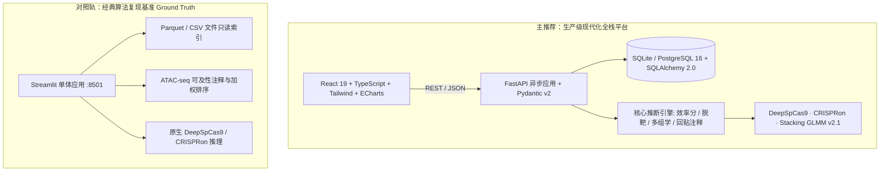
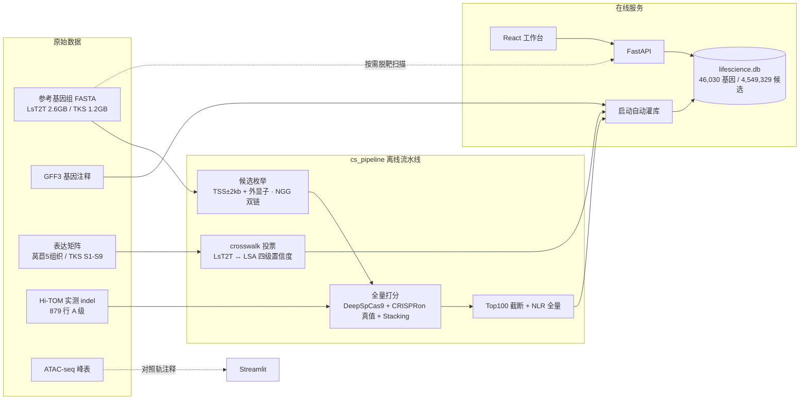

# 菊科 CRISPR/Cas9 基因编辑与多组学决策系统 —— 用户操作手册

> **版本**：`v4.0`（2026-09-29 全量对齐多组学决策体系 · 真实 CRISPRon 打分 · 基因组回贴与参考包体系 · 教师反馈五项闭环）
> **适用对象**：湿实验科研人员、植物育种研究员、课题评审老师、全栈工程审阅者
> **系统定位**：面向菊科植物（莴苣/生菜 *Lactuca sativa*、橡胶草 *Taraxacum kok-saghyz*）的 gRNA 智能设计与多组学决策平台——从全基因组扫描候选 guide RNA，经模型打分（"切得动"）与脱靶评估（"切不错"），叠加表达证据与组织特异性多组学证据（"切了有表型、切了不误伤"），输出可直接下单的湿实验靶点方案。

---

## 本手册的三重用途（阅读指引）

本手册不仅是"操作说明"，同时是**方法白皮书**与**功能完整性审核清单**：

| 读者 | 建议阅读路径 |
| :--- | :--- |
| **操作用户（湿实验）** | 第 2 章（启动）→ 第 3 章（逐模块操作）→ 第 8 章 FAQ |
| **课题评审老师（审核）** | 第 1 章（设计意图）→ 第 4 章（方法原理）→ **第 7 章（功能完整性审核清单）** |
| **工程审阅者** | 第 2 章（架构与数据底座）→ 第 6 章（诚实标注与降级机制）→ 第 7.3 节（测试覆盖） |

**贯穿全手册的三条口径纪律**（详见第 6 章），任何界面与导出均遵守：

1. **未计算 ≠ 0**——没算过的指标写"未计算/—"，绝不用 0 冒充；
2. **缺啥写啥**——数据缺失时逐行标注"缺失原因 + 所需数据"，绝不编造数值；
3. **来源如实标注**——模型近似降级逐条标注 `approximated`，真跑标注 `wsl_real`，绝不以近似冒充真值。

---

## 目录

- [第 1 章 项目总览与设计意图](#第-1-章-项目总览与设计意图)
  - [1.1 要解决的科学与工程问题](#11-要解决的科学与工程问题)
  - [1.2 系统能力矩阵](#12-系统能力矩阵)
  - [1.3 设计意图（五条核心立场）](#13-设计意图五条核心立场)
  - [1.4 名词约定](#14-名词约定)
- [第 2 章 系统架构与数据底座](#第-2-章-系统架构与数据底座)
  - [2.1 双轨架构矩阵](#21-双轨架构矩阵)
  - [2.2 数据流全景](#22-数据流全景)
  - [2.3 数据资产清单](#23-数据资产清单)
  - [2.4 数据库表结构](#24-数据库表结构)
  - [2.5 极速启动指南](#25-极速启动指南)
  - [2.6 服务访问端点速查](#26-服务访问端点速查)
- [第 3 章 功能模块操作详解（操作 · 作用 · 原理）](#第-3-章-功能模块操作详解操作--作用--原理)
  - [3.0 页面布局总览](#30-页面布局总览)
  - [3.1 系统健康卡片](#31-系统健康卡片)
  - [3.2 Tab「候选靶点检索」](#32-tab候选靶点检索)
  - [3.3 Tab「实时与批量打分」](#33-tab实时与批量打分)
  - [3.4 Tab「历史与导出批次」](#34-tab历史与导出批次)
- [第 4 章 方法与算法原理（深读）](#第-4-章-方法与算法原理深读)
  - [4.1 30nt 靶位点序列契约](#41-30nt-靶位点序列契约)
  - [4.2 on-target 效率分模型（v2.1 / noB879）](#42-on-target-效率分模型v21--nob879)
  - [4.3 全基因组脱靶扫描](#43-全基因组脱靶扫描)
  - [4.4 脱靶位点评分与 guide 级特异性](#44-脱靶位点评分与-guide-级特异性)
  - [4.5 表达适配度（U6 启动子背景）](#45-表达适配度u6-启动子背景)
  - [4.6 多组学证据体系（方案 1–6）](#46-多组学证据体系方案-16)
  - [4.7 基因结构与 NLR 蛋白功能域注释](#47-基因结构与-nlr-蛋白功能域注释)
  - [4.8 候选生成与库内口径](#48-候选生成与库内口径)
  - [4.9 LsT2T ↔ LSA crosswalk（表达证据的桥梁）](#49-lst2t--lsa-crosswalk表达证据的桥梁)
- [第 5 章 参数设置详解（算法口径速查表）](#第-5-章-参数设置详解算法口径速查表)
- [第 6 章 诚实标注与降级机制](#第-6-章-诚实标注与降级机制)
- [第 7 章 功能完整性审核清单](#第-7-章-功能完整性审核清单)
  - [7.1 教师反馈五项闭环核对表](#71-教师反馈五项闭环核对表)
  - [7.2 全功能清单矩阵](#72-全功能清单矩阵)
  - [7.3 测试与基准对账](#73-测试与基准对账)
  - [7.4 已知边界与如实声明的未实施项](#74-已知边界与如实声明的未实施项)
- [第 8 章 常见问题排查与专家建议 (FAQ)](#第-8-章-常见问题排查与专家建议-faq)
- [附录 A 术语表](#附录-a-术语表)
- [附录 B 版本演进与冻结口径](#附录-b-版本演进与冻结口径)
- [附录 C 文件与目录导航](#附录-c-文件与目录导航)

---

# 第 1 章 项目总览与设计意图

## 1.1 要解决的科学与工程问题

**问题一句话**：给定一个目标基因，从基因组里扫描出成千上万条候选 guide RNA，用模型预测哪几条"切得动"（on-target 效率），排除"切错地方"（off-target 脱靶）的候选，再叠加表达与组织特异性证据，推荐最优的几条送湿实验验证。

评审这类工作看两件事：**推荐排序准不准**（留一基因交叉验证 Spearman ρ，达标线 0.50）、**工具有没有真科学含量**。本项目围绕这两点做了以下工作：

1. **真实的模型训练与验证**：以橡胶草 **Hi-TOM 实测 indel 金标准**（879 行纯 A 级数据）训练自研 **Stacking 元模型 v2.1（形态二分层选择性 Beta-Binomial GLMM）**，验证指标如实公开（见 4.2），不夸大；
2. **真实的全基因组计算**：45,981 个莴苣基因区全量 NGG 枚举（千万级候选）、全基因组脱靶扫描（Cas-OFFinder 口径）、真实 CRISPRon 模型批量打分回填；
3. **多组学决策层**：把"切得动"扩展为"切了有表型、切了不误伤"——表达证据（5 组织 / S1–S9 时相）、组织优先指数、功能性脱靶危害指数、ATAC 染色质可及性（对照轨）、NLR 抗病基因结构域注释；
4. **可审计的工程交付**：双轨对照（现代全栈 + 经典基准）、算法透明性接口、导出逐行口径标注、18 个后端测试文件 + 前端测试套件固化行为。

**数据纪律背景**（驱动上述设计的历史教训）：Hi-TOM 实测表曾暴露"indel 数字是真的，但数字绑定的序列可能是错的"（seq 前导空格、strand 整列填错、guide 窗口移位、批次张冠李戴等记录事故）。因此本项目把**"如实标注、不编造、可追溯"**作为高于一切的产品纪律（见 1.3 与第 6 章）。

**服务对象**：莴苣（NLR 抗病基因 demo）与橡胶草（产胶性状，模型训练物种），并支持任意物种 30bp 靶位点的序列级打分通道。

## 1.2 系统能力矩阵

| # | 能力 | 一句话说明 | 详见 |
| :--- | :--- | :--- | :--- |
| ① | **候选靶点检索与过滤** | 全基因组 + 49 NLR 基因、454 万候选库内秒级检索；功能元件 / 效率 / 着丝粒多维过滤 | 3.2 |
| ② | **基因组物理拓扑可视化** | ECharts 正负链双轨图 + 基因结构轨道 + 蛋白功能域轨道，图表表格双向联动 | 3.2.7 |
| ③ | **单序列实时打分与分子解构** | 30nt 序列即时校验 → 效率分/双模型分/GC/Tm/区段解构/特征向量，<100ms | 3.3.1 |
| ④ | **基因组回贴注释与按需多组学** | 自定义序列回贴参考基因组三态注释；按需计算脱靶 + 优先指数；参考包可导入 | 3.3.2 / 3.3.3 |
| ⑤ | **高通量批量打分流水线** | 百至千条序列异步并发打分、进度轮询、择优视图、三图可视化、逐行口径导出 | 3.3.4 |
| ⑥ | **多组学决策指标** | 表达证据（crosswalk 四级置信度）、组织优先指数（方案3）、功能脱靶危害（方案5）、产胶时相（方案6）、ATAC 可及性（对照轨） | 4.6 |
| ⑦ | **脱靶评估体系** | 全基因组 ≤3 错配扫描 + CFD/MIT 位点评分 + CRISPOR guide 级特异性 + 位点明细抽屉 | 3.2.10 / 4.3–4.4 |
| ⑧ | **湿实验交付与归档** | 勾选即导出 CSV/Excel（29 列标准清单 + 指标方法说明 + 数据需求模板），历史批次可重下载 | 3.2.9 / 3.4 |

## 1.3 设计意图（五条核心立场）

审核本项目时，可以用以下五条立场对照每一项功能"为什么存在、为什么这样实现"：

**立场一：模型有效性优先于功能开放性。**
本平台**固定 SpCas9（PAM=NGG、guide=20nt、序列表示=30nt）**，不开放 PAM 类型与 gRNA 长度调节。原因：效率预测模型以 20nt+NGG 规格的实测数据训练校准，偏离规格即脱离模型有效域。宁可少给选项，不给无效选项。（对比：Cas12a 系统识别 TTTV 且产生黏性末端，部分工具提供 15–22nt 可调长度——本平台不做，是刻意取舍。）

**立场二：预测排序服务于"同基因内择优"，不承诺绝对 indel%。**
生物学突变率强烈依赖外植体生理状态、农杆菌效价、培养温度等批次环境因素。模型输出的效率分是**剥离批次扰动的纯内在活性相对排序量度**，量程 0–100，用于同一基因内候选的相对比较。任何把它读作"实测 indel 百分比"的用法都是误用（见 FAQ Q3）。

**立场三：诚实标注高于"看起来完整"。**（全项目最高纪律）
- 表达证据拿不到 → 显示"表达证据缺失"并写明原因，**不显示假定 TPM**（"表达证据缺失"≠"转录静默"，两者生物学含义完全不同）；
- 脱靶没算 → 显示"未计算"并提示"不能读作已验证无脱靶"；
- CRISPRon 是近似式 → 逐条标注 `approximated`（近似值实测偏高 +8.66 分/14.5%，必须提示）；
- 基因映射不了（crosswalk tier4）→ 如实标注不可映射及原因，不硬猜基因 ID。

**立场四：双轨可审计。**
生产级全栈（React 19 + FastAPI + PostgreSQL/SQLite）负责高并发交互；经典 Streamlit 轨保留为**黄金基准**，算法与数据的对账以基准轨为准，自动化一致性测试固化在测试套件（误差容限 Δ<10⁻⁶）。

**立场五：交付导向——输出直接可下单。**
导出不是"把表格下载下来"，而是**湿实验交付清单**：29 列标准字段（含合成用 20bp guide、PAM 方向说明、推荐序号）、《指标方法说明》sheet（逐列口径、全部公式常数）、《数据需求模板》sheet（缺什么数据、补什么数据、缺失时的如实行为）。老师/合作者拿到 Excel 即可独立复核每一条推荐的依据。

## 1.4 名词约定

| 名词 | 含义 | 易混淆点 |
| :--- | :--- | :--- |
| **效率分 (v2.1)** | 自研 Stacking 元模型输出的 0–100 在靶活性相对分 | ≠ 实测 indel%；≠ Rule Set 2/3；≠ DeepCRISPR |
| **DeepSpCas9 / CRISPRon 活性分** | 两个业界深度学习模型的 0–1 活性分，是效率分的**组成成分** | 它们不是本平台效率分本身 |
| **脱靶数 (≤3)** | 全基因组错配 1–3 累计的潜在脱靶位点数（不含完全匹配行） | 0 不等于"已验证无脱靶"，未扫描时显示"未计算" |
| **组织优先指数（方案3）** | 效率百分位 − 脱靶罚分 + 表达项的综合排序指标（按组织） | 与效率分互相独立，可重排候选 |
| **功能危害指数（方案5）** | 面板内功能性基因（49 NLR）被误切的加权危害，**越小越安全** | 与"脱靶数"不同：它按命中基因的表达加权 |
| **表达证据** | 基因经 crosswalk 映射到 LSA 注释后取得的组织 TPM | "缺失"≠"静默"；tier4 不可映射即缺失 |
| **seq30 / guide(20nt) / PAM(NGG)** | 4nt 侧翼 + 20nt guide + 3nt PAM + 3nt 侧翼的统一序列表示 | 种子区 = guide 中紧邻 PAM 的 6nt |
| **未计算** | 该指标需要的数据/计算条件不满足，系统拒绝输出假值 | 绝不读作 0 或"无风险" |

---

# 第 2 章 系统架构与数据底座

## 2.1 双轨架构矩阵

系统遵循 [ADR 0004: 生产级全栈架构升级](file:///d:/lifesciencechallenge/cs_pipeline/docs/adr/0004-fullstack-postgres-fastapi-react.md)，采用清晰的**双轨（Dual-Track）体系**：



| 系统维度 | 生产级全栈主轨（本手册重点） | 经典基准对照轨 |
| :--- | :--- | :--- |
| 前端 | **React 19 + TypeScript + Vite + Tailwind CSS** | Streamlit 1.32+ Python 单体 |
| 后端 | **FastAPI (ASGI) + Pydantic v2 + 异步并发** | 无独立后端 |
| 持久化 | **SQLite（默认）/ PostgreSQL 16 + SQLAlchemy 2.0** | Parquet / CSV 只读 |
| 可视化 | **ECharts 基因组正负链双轨 + 基因结构/功能域轨道** | Altair / Plotly 静态图表 |
| 计算模式 | **异步任务队列 + 1.5s 智能轮询** | 阻塞式同步 |
| 特色能力 | 参考包导入、基因组回贴三态、按需脱靶、导出口径标注 | **ATAC-seq 可及性注释与 ATAC 加权排序**、原始数据对账 |
| 适用场景 | 实验设计、批量处理、历史追溯 | 算法单点复现、基准验证 |

> **ATAC-seq 染色质开放峰注释**（`cs_pipeline/core/atac_annotator.py`）目前提供在基准轨：候选表可追加「ATAC状态 / 峰ID / 距峰中心 / 峰强度FC / 可及性分」列，并支持「组织优先指数+ATAC加权」排序（见 4.6 方案 5/ATAC 延伸）。全栈轨的多组学列为表达证据 / 优先指数 / 危害指数。

## 2.2 数据流全景



**设计意图**：把"亿级碱基 + 千万级候选"的重计算留在**离线流水线**（一次性产物固化为 CSV/Parquet），把"毫秒级检索 + 按需计算"留给**在线服务**。全基因组脱靶这类分钟级计算不预先全量铺开，而是在用户真正需要时**按需计算**（如导出前对勾选的靶点逐条扫描），既诚实（算过的才标数）又实用（不阻塞日常浏览）。

## 2.3 数据资产清单

| 数据 | 文件 / 位置 | 规模与用途 |
| :--- | :--- | :--- |
| 莴苣 T2T 基因组 | `cs_pipeline/data/reference_genomes/3-1_LsT2T.genome.fa` | 2.6GB；预置参考包 `lettuce` |
| 莴苣基因注释 | `3-1_LsT2T.annotation.gff3` | 55MB；基因结构/TSS/外显子 |
| 橡胶草基因组 + 注释 | `2-1_TKS.genome.fasta` + `2-2_TKS.genome.gff3` | 预置参考包 `tks` |
| 莴苣 5 组织表达矩阵 | `cs_pipeline/data/expression/1-3_lettuce_5tissue_expression_matrix.csv` | 40,267 基因 × Root/Stem/Leaf/Flower/Seed TPM |
| 橡胶草时相表达矩阵 | `2-3_TKS_Tiss-Dev-Expression(1).xlsx` | 36,239 基因 × 79 样本列（根/叶 S1–S9、胶乳 S4–S9、花/花葶 S6） |
| Hi-TOM 训练集 | `cs_pipeline/data/1_Hi-results-16.1-efficiency-20260921.xlsx` | 1,368 行交付版；建模用 879 行纯 A 级（noB879） |
| 基因目录 | `cs_pipeline/results/lettuce_all_genes_catalog.csv` | 45,981 基因坐标与注释 |
| 全基因组 Top100 候选 | `cs_pipeline/results/lettuce_all_genes_top100_candidates.csv` | 4,529,490 行（每基因效率分 Top100） |
| 真实 CRISPRon 真值 | `results/real_crispron_top100_0927.csv` | 0927 对 Top100 补跑真实 CRISPRon 后回填 |
| 全量候选（未截断） | `results/grna_candidates_lettuce_0923.csv` 等 | 13,867,270 条（0923 冻结口径；0927 重跑 10,928,676 条并存，两版均有记录） |
| crosswalk | `results/crosswalk_lsa_t2t_genome.csv` | 45,982 行；可映射 78.0%（详见 4.9） |
| crosswalk 投票缓存 | `results/_votes_genome.parquet`（48MB） | 每条 guide 对 v1.1c 基因座的投票缓存，tier 规则调参秒级重跑 |
| NLR 结构域注释 | `data/reference_genomes/domain_annotations.csv` | 96 个结构域区块（LRR 29/NBS 26/TIR 15/CC 5/LINKER 21），覆盖 20 个 NLR 基因 |
| NLR 坐标重定位表 | `data/reference_genomes/nlr_gene_loci.csv` | 49 个 demo 基因 → LsT2T 坐标重定位（48/49 成功） |
| ATAC 峰表 | `data/reference_genomes/1-3_Stem_lettuce_ATAC_peaks.xlsx` | LettuceGDB 口径；对照轨可及性注释 |
| 效率分模型 | `results/meta_model_hier_bb_nob879_0921.joblib` | Stacking GLMM v2.1 序列化模型 |
| 模型卡 | `results/model_card_hier_bb_nob879_0921.md` | 训练口径、验证指标、局限声明 |

**库内规模（灌库后）**：**46,030 个基因**（45,981 个 `LsT2T*` 全基因组基因 + 49 个 NLR 代表基因 `LsaT2T*`，两套 ID 命名空间并存）；**4,549,329 条候选 gRNA**（全基因组每基因 Top100 共 4,529,490 条 + 49 个 NLR 全量 19,839 条）。

## 2.4 数据库表结构

默认 SQLite（`lifescience.db`，启动自动建表 + 灌库），可通过 `DATABASE_URL` 切换 PostgreSQL 16：

| 表 | 关键字段 | 用途 |
| :--- | :--- | :--- |
| `genes` | gene_id、chrom、start/end、strand、nlr_type、candidate_count | 基因主索引 |
| `gene_expressions` | lsa_id、tier、tpm_root/stem/leaf/flower/seed、top_tissue、tau、is_mappable、unmappable_reason | crosswalk + 5 组织表达证据 |
| `target_candidates` | seq30/seq20/pam、region_type、is_centromere、is_exon、gc_pct、tm_c、efficiency_score、deepspcas9_score、crispron_score、offtarget_count_mis3、priority_score_{组织}、hazard_{组织}、expression_status、n_intra_panel_sites | 候选库（多组学列齐全；`offtarget_count_mis3=NULL` 表示**未计算**） |
| `reference_bundles` | id、display_name、fasta/gff/expression_path、expression_layout、expression_id_rule、tissue_columns | 预置 + 导入的参考包注册表 |
| `scoring_jobs` / `scoring_job_items` | status(pending→running→completed/failed)、crispron_source、各项打分列 | 打分任务与逐条结果 |
| `export_batches` | name、format、gene_id、candidate_count、candidate_ids | 导出批次归档 |

## 2.5 极速启动指南

### 方式 A：Windows 双击一键启动（强烈推荐）

1. 打开项目根目录 `D:\lifesciencechallenge\`；
2. 双击 [`一键启动全栈系统.bat`](file:///d:/lifesciencechallenge/%E4%B8%80%E9%94%AF%E5%8A%A8%E5%85%A8%E6%A0%88%E7%B3%BB%E7%BB%9F.bat)；
3. 系统自动：探测 `D:\Miniconda\envs\grna-demo\python.exe` 科学计算环境 → **秒级缓存探测**（`lifescience.db` 已完整存在则跳过重复灌库，冷启动约 1 秒）→ 启动 FastAPI（:8000）→ 启动 Vite 前端并在就绪瞬间自动打开浏览器（`http://localhost:5173`）。

### 方式 B：PowerShell 终端启动

```powershell
Set-Location D:\lifesciencechallenge
.\run_fullstack.ps1
```

可选参数：
- `-SeedOnly`：仅建表灌库后退出，不拉起 Web 服务；
- `-NoBrowser`：启动服务但不自动开浏览器；
- `-ForceSeed`：强制重新扫描原始 CSV 全量刷库。

### 方式 C：Docker Compose 容器化编排

```bash
docker-compose up --build -d
```

一键拉起 `db`（PostgreSQL 16）、`backend`（FastAPI Uvicorn）、`frontend`（Nginx + React 静态编译）三容器。另有 `一键启动Docker.bat` / `一键停止Docker.bat` / `一键部署_国内源.bat` / `制作离线交付包.bat`（离线交付打包，双 venv 镜像）。

### 基准对照轨启动

双击 [`一键启动Demo.bat`](file:///d:/lifesciencechallenge/%E4%B8%80%E9%94%AF%E5%90%AF%E5%8A%A8Demo.bat) 启动 Streamlit 基准轨（:8501），用于算法对照与 ATAC 注释（见 2.1）。

## 2.6 服务访问端点速查

| 服务 | 地址 | 说明 |
| :--- | :--- | :--- |
| **前端工作台** | [http://localhost:5173](http://localhost:5173) | React 19 主操作界面 |
| **API 文档** | [http://localhost:8000/docs](http://localhost:8000/docs) | Swagger UI 交互式接口文档 |
| **健康诊断** | [http://localhost:8000/api/v1/health](http://localhost:8000/api/v1/health) | 数据库连通性与服务版本 |
| **算法透明性** | `GET /api/v1/meta/methods` | 效率分模型/脱靶口径/表达适配度/参考基因组声明（界面「方法与版本」弹窗的数据源） |
| **基准轨 (Streamlit)** | [http://localhost:8501](http://localhost:8501) | 双轨对照 |

---

# 第 3 章 功能模块操作详解（操作 · 作用 · 原理）

> 本章每个模块按 **【作用】**（这个功能解决什么问题）→ **【操作】**（怎么用，界面文案逐字校对）→ **【原理】**（背后怎么算）→ **【设计意图】**（为什么这样设计）四段展开。

## 3.0 页面布局总览

**顶部吸顶导航栏**：
- 主标题：**"菊科 CRISPR/Cas9 基因编辑与多组学决策系统"**；
- 副标题：**"莴苣 / 橡胶草 · 分层选择性 Beta-Binomial GLMM (v2.1 / noB879) · 生产级全栈工作台"**；
- 一级导航三个选项卡：**"候选靶点检索"**、**"实时与批量打分"**、**"历史与导出批次"**。

## 3.1 系统健康卡片

**【作用】** 让用户确认前后端与数据库处于可用状态，避免在服务异常时误判"数据丢了"。

**【操作】** 页面顶部常驻卡片（所有 Tab 之上）：
- 正常时：**"服务运行正常"** + 版本徽标 **`v{version}`**，副行 **"全栈服务就绪 · 检查时间: {本地时间}"**；
- 两个状态灯块：**"FastAPI 后端引擎"** → **"在线活跃 (Active)"**；**"数据库持久层"** → 绿点 **"数据库连接正常"**；
- 异常时（红卡）：**"服务连接异常"** + **"无法连通后端 API 或数据库服务"**，点击 **"重试"**；
- **"刷新"** 按钮可手动复检（每 30 秒自动刷新一次）。

**【原理】** 前端定时请求 `GET /api/v1/health`，后端以 `SELECT 1` 探活数据库，返回 `status/version/database/timestamp`。

## 3.2 Tab「候选靶点检索」

**【作用】** 本系统的核心工作台：选定目标基因后，从库内候选中多维筛选 gRNA 靶位点，结合表达证据、优先指数、危害指数与脱靶信息，勾选导出湿实验方案。

工作台自上而下四个区块：**控制面板卡 → 多组织表达看板 → 染色体物理分布交互图谱 → 候选 gRNA 靶位点推荐清单**。

### 3.2.1 选择靶基因（即输即搜 Combobox）

**【作用】** 在 46,030 个基因（莴苣全基因组 + 49 个 NLR 代表基因）中快速定位目标基因。

**【操作】**
- 标签：**"选择靶基因 (即输即搜 · 莴苣全基因组 + 49 NLR)"**，右侧徽标 **"当前: {gene_id}"**；
- 输入框提示：**"输入基因号或关键字 (如 019420, Chr06, CC)..."**——支持按基因编号片段（`019420`）、染色体（`Chr06`）、NLR 结构域类型（`CC`/`TIR`）模糊过滤，不区分大小写；
- 快捷键：**Enter** 选中首个匹配项；**Esc** 收起下拉；点击外部自动收起；
- 右侧 **✕**（title "清空输入"）与 **▾**（title "展开下拉/收起下拉"）；
- 下拉浮层：无搜索词显示 **"莴苣全基因组 + 49 NLR"**，有词显示 **"匹配结果 (N)"**，右上角提示 **"按回车快速选中首项"**；选项副行格式 `{chrom} · {NLR 专项注释|全基因组注释} · {nlr_type} · {N} 候选位点`；
- 结果超 200 条时提示 **"仅显示前 200 条（共 N 条），请输入关键字缩小范围"**；无匹配显示 **"未找到匹配的基因 (关键字: "{输入}")"**。

**【原理】** 后端 `GET /api/v1/genes?q=` 对 gene_id / chrom / nlr_type 做模糊匹配；`Lsa` 开头为 NLR 专项注释基因（49 个代表基因全量候选），`LsT2T` 为全基因组注释（Top100 截断候选）。

**【设计意图】** NLR（核苷酸结合富含亮氨酸重复）抗病基因是本课题 demo 的重点靶标，独立标注便于优先处理。

### 3.2.2 目标组织切换器（方案3联动）

**【作用】** 表达证据与多组学指数都是**组织特异**的——同一个基因在根和叶里的表达可能天差地别，靶向价值也随之改变。此开关决定整个工作台"站在哪个组织的视角"排序与诊断。

**【操作】** 标签 **"目标组织 (方案3联动)"**（小字 **"重排与诊断跟随此选择"**），五个分段按钮：**"叶 (Leaf)"、"根 (Root)"、"茎 (Stem)"、"花 (Flower)"、"种子 (Seed)"**，**默认 Leaf**。切换后：候选表回到第 1 页、排序推荐方向自动调整、**"组织优先 ({叶})" / "功能危害 ({叶})"** 两列列头实时跟随、表达看板诊断横幅重新判定。

### 3.2.3 排序依据（六种排序）

**【作用】** 不同实验目的需要不同的"最优"——追求切得动看效率分，追求干净看脱靶数，追求表型看组织优先指数。

**【操作】** 标签 **"排序依据:"**，下拉六项（切换时自动套用推荐方向，`⇅` 按钮仍可手动切换升降序）：

| 选项（界面文案） | 排序键 | 推荐方向 | 适用场景 |
| :--- | :--- | :--- | :--- |
| **on-target 效率分 (v2.1 推荐排序)**【默认】 | efficiency_score | 降序 | 常规敲除首选：内在活性优先 |
| **组织优先指数（{叶}）降序 · 方案3推荐** | priority_score | 降序 | 要"切了有表型"：效率+脱靶+表达综合 |
| **功能性脱靶危害（{叶}）升序** | hazard_score | 升序 | 要"切了不误伤"：危害越小越安全 |
| **基因物理起始坐标** | start | 升序 | 按位点先后浏览 |
| **潜在脱靶位点数 (升序优先)** | offtarget_count_mis3 | 升序 | 比"谁最干净" |
| **GC 含量 (%)** | gc_pct | 保持手动 | 检查序列组成 |

- ℹ 按钮（title **"查看各排序方式的详细排名方法"**）打开 **"排序方式说明 · 各指标详细排名方法"** 弹窗：每个指标的排名方式与公式（如 `PriorityScore = 0.50×效率百分位 − 0.25×脱靶罚分 + 0.25×表达项`），并注明 **"「未计算」的候选在任何排序下都排在最后"**；底部提示口径详情见导出 Excel《指标方法说明》sheet；
- 排序规则细节：**"未计算"** 的候选（如脱靶数 NULL）在任何排序下恒排最后，绝不冒充 0 分参与排名。

### 3.2.4 功能元件过滤（Functional Region）

**【作用】** 按实验目的筛选靶位点所在的功能区段：**外显子**靶向用于破坏编码框实现基因敲除（Knockout）；**启动子**靶向用于转录起始区调控干涉（CRISPRi/a）。

**【操作】** 组标题 **"功能元件过滤 (Functional Region)"**，说明 **"按植物基因组功能区段筛选 gRNA 候选位点（支持多选、单选或全不选）"**：
- **☑️ 外显子 (Exon)**（蓝色徽标，灰字 **"基因敲除 (Knockout)"**）；
- **☑️ 启动子 (Promoter)**（紫色徽标，灰字 **"调控干涉 (CRISPRi/a)"**）；
- 快捷按钮 **"全选"**（title "同时勾选外显子与启动子"）/ **"清空"**（title "取消勾选全部功能元件"）；
- 默认两者均勾选；支持单选、多选或**全不选**（全不选时表格显示空状态引导：**"当前未勾选任何功能元件"** + 按钮 **"一键恢复全选 (外显子 + 启动子)"**，绝不卡死）。

**【原理】** 候选生成阶段只扫描**基因功能区**（全部外显子 + TSS 上游 2000bp 启动子窗口），每条候选都带 `region_type` 标记（exon / promoter），过滤即按该列筛选。

### 3.2.5 最低效率分过滤与着丝粒过滤

**【作用】** 前者剔除模型预测低活性的位点；后者剔除落在着丝粒异染色质高危区、切割可及性差的位点。

**【操作】**
- **"最低效率分过滤:"** 滑块：`0 ~ 90 分`，步长 5，**默认 0 分**（不拦截）；拖至如 60 分即实时剔除低于 60 的候选；
- **"排除着丝粒不稳定区靶点 (Centromere Filter)"** 复选框：**默认不勾选**；勾选后剔除着丝粒区候选（表内"着丝粒"列显示红色 **"着丝粒区"** 警示徽标，否则 **"否"**）。

**【原理】** 着丝粒标记来自 `data/lettuce/centromere_regions.bed` 坐标集（已固化进库表 `is_centromere` 列）；0927 已修复 Chr1/Chr01 染色体命名归一问题，并验证 49 个 demo 基因与着丝粒区间零交集。

### 3.2.6 多组织表达看板与靶向适宜性诊断（方案1 + crosswalk）

**【作用】** 回答"这个基因在目标组织里到底转不转录"——**转录静默的基因敲了也不一定有表型**。这是从"切得动"走向"切了有效果"的第一层多组学证据。

**【操作】** 卡片标题 **"多组织表达看板与靶向适宜性诊断"**（副标注 **"(莴苣 v1.1c 表达矩阵 · 根/茎/叶/花/种子)"**），包含：
1. **三个元数据块**：
   - **"v1.1c 注释映射"**：显示 crosswalk 映射到的 LSA 基因号 + `(tier {n} · 票比 {x}%)`，未映射显示 **"无对应注释"**；
   - **"最高表达组织"**：表达量最高的组织及 TPM；
   - **"组织特异性 τ"**（提示 **"(τ→1特异, τ→0泛表达)"**）：Yanai 2005 组织特异性指数；
2. **"5 组织转录丰度对比 (TPM)"** 柱状图（提示 **"当前选中的目标组织高亮突出"**）：五条横向条形（根/茎/叶/花/种子），当前目标组织为绿色渐变并带 **"目标组织"** 徽标；
3. **靶向适宜性诊断横幅**（按所选组织 TPM 三档判定）：
   - TPM < 0.5：**"⚠️ 弱表型警示：该基因在所选组织（{叶}）中转录静默（TPM {x} < 0.5），CRISPR 敲除可能无法诱导明显生物学表型。"**；
   - 0.5 ≤ TPM < 10：**"ℹ️ 中等表达：……表型预期中等，建议结合蛋白水平验证。"**；
   - TPM ≥ 10：**"✅ 适宜靶向：该基因在所选组织（{叶}）中高度转录（TPM {x} ≥ 10.0），染色质处于开放状态，预期编辑响应好。"**；
4. **证据溯源说明**（出现时）：**"ℹ️ 该基因座为 NLR 串联重复簇：主映射 {lsa_id}（投票占比 {x}%），簇成员 {lsa_cluster}；看板展示主映射基因的表达。"** / **"ℹ️ 映射证据来自未挂载 scaffold（{...}）：该基因座在 v1.1c 中未挂载到染色体上。"**；
5. **不可映射时**：**"⚠️ 表达证据缺失：{原因}"**（默认原因 **"该基因座在莴苣 v1.1c 表达矩阵中无对应注释，不展示假定表达值。"**）——注意这是**"表达证据缺失"而非"转录静默"**，两者生物学含义完全不同，系统绝不混淆。

**【原理】** 莴苣基因组 ID（`LsT2T*`）与表达矩阵 ID（`LSA*`）分属不同命名空间，须经 **LsT2T↔LSA crosswalk**（四级置信度投票映射，见 4.9）取得 LSA 注释后才能取 5 组织 TPM。τ 指数 = Σ(1−TPMᵢ/max)/(n−1)。

**【设计意图】** 与方案 2 表达消融的科学结论呼应：高表达≠高效率（表达是基因级常量，不影响同基因内 guide 排序），因此表达证据**放在基因层做"表型适宜性"诊断**，而不是混进 guide 级效率分。

### 3.2.7 染色体物理分布交互图谱（ECharts）

**【作用】** 解决传统工具"只看数据表、缺乏空间感"的问题——把候选位点、基因结构、蛋白功能域放在真实物理坐标上，一眼看出靶点分布与功能域的空间关系（例如希望 guide 落在 LRR 结构域内）。

**【操作】**
- 标题：**"染色体物理分布交互图谱 ({chrom} : {start} - {end})"**，副标题 **"正反链双轨渲染 · 基因骨架长度: {N} bp · 当前匹配靶点: {N} 条"**；
- **五条轨道（自上而下）**：`+ 正向链`（候选散点）→ `基因模型`（蓝色基因骨架线，标签 `{gene_id} ({strand}) [{N} bp]`，端点箭头示链向）→ `基因结构`（外显子/内含子/TSS）→ `蛋白功能域`（CC/TIR/NBS/LRR）→ `- 反向链`（候选散点）；
- **X 轴**：真实物理坐标（刻度 `{x.x} kb`），底部滑块 + 滚轮/拖拽缩放；图例 **"高活性 (≥70)"**（绿）/ **"中等 (40-70)"**（琥珀）/ **"较低 (<40)"**（灰）/ **"滚轮/下方滑块缩放"**；
- **基因结构轨道**：外显子=**青色独立色块**（逐段一块，CDS 标注 "(CDS)"）、内含子=**灰色细横线**连接相邻外显子、TSS=**琥珀三角箭头**（链感知方向）+ 虚线定位——三种视觉元素与下方图例逐一对应；**蛋白功能域轨道**：色块按域类型着色 **CC 蓝 / TIR 紫 / NBS 红 / LRR 绿 / Other 灰**，图例域色卡仅在该基因有功能域注释时显示（无注释时图例显示 **"该基因无功能域注释（图中无域色块）"**，不承诺图中没有的颜色）；
- **双向联动**：点击散点 → 下方表格定位高亮该行，图下方出现 **"已聚焦靶点：{guide_id}"** + **"取消聚焦"** 按钮；点击表格行 → 图上对应散点放大高亮；
- **Tooltip** 逐项展示：guide_id、物理坐标、PAM（区域类型）、Guide 20nt、**"效率分 (v2.1):"**、**"脱靶数 (≤3 mis):"**、**"GC:"**，末行提示 **"点击图上锚点可定位联动表格"**；
- 图下方图例区：**"基因结构："** 外显子/TSS/转录本胶囊明细；**"蛋白功能域："** 各域胶囊 `{type} · {name} · {s}-{e}`，无注释时 **"暂无蛋白功能域注释"**；
- **降级状态**（如实标注）：加载中 **"正在加载基因结构与蛋白功能域注释…"**；失败 **"基因结构注释加载失败（接口不可用或缺 GFF 注释），已降级为基础基因图谱"**；缺 GFF **"基因结构注释暂不可用：该参考包缺少 GFF 基因结构注释"**。

**【原理】** 基因结构来自 GFF3 解析（gene→mRNA→exon/CDS 层级，TSS 链感知：+ 链取基因 start、− 链取 end）；功能域来自 NLR-Annotator v2.1b 离线注释表（见 4.7）；API：`GET /api/v1/annotation/gene-structure`。

### 3.2.8 候选 gRNA 靶位点推荐清单（18 列大表）

**【作用】** 全部决策信息的汇总表，也是导出方案的直接来源。

**【操作】** 标题 **"候选 gRNA 靶位点推荐清单"**；右侧 **"共匹配到 {N} 条符合条件的靶点"**；若启用 poly-T 硬过滤另有琥珀徽标 **"另有 {N} 条含 TTTT poly-T 终止信号已过滤"**（title：**"U6 启动子（RNA Pol III）转录遇 TTTT 提前终止，含 poly-T 信号的候选已在枚举阶段硬过滤，不参与列表与排序"**）；标题右侧 **"方法与版本"** 按钮（见 3.2.11）。每页 20 条，分页条 **"显示第 X - Y 条，共 N 条"** + **"上一页" / "下一页"**。

**18 列逐列说明**（列名逐字校对）：

| 列名 | 内容与语义 | 背后口径 |
| :--- | :--- | :--- |
| `[ ]` | 行复选框（表头 **"全选当前页"**，跨页勾选保持） | 勾选触发浮动导出工具条 |
| `#` | 排序序号 | 当前排序下序号 |
| **靶点 ID** | 唯一编码（如 `Lsat_675191`） | guide_id |
| **方向** | `+` 蓝底 / `-` 玫红底 | gRNA 所在链 |
| **基因组物理坐标** | guide+PAM 的 23nt 区间（1-based 闭区间） | 导出的起止坐标同口径 |
| **区域** | **"外显子 (exon)"** 蓝徽标 / **"启动子 (promoter)"** 紫徽标 | region_type |
| **30nt 靶位点序列 (Guide + PAM)** | 四段式高亮：灰 4nt 侧翼 + **琥珀底 20nt Guide** + **绿底 3nt PAM** + 灰 3nt 侧翼（title：**"序列为 gRNA 方向 5'→3'：4nt 侧翼 + 20nt Guide + 3nt PAM + 3nt 侧翼"**） | seq30 契约 |
| **PAM** | 绿色粗体（title：**"PAM 按 gRNA 方向 5'→3' 恒写作 NGG；负链靶点在基因组正链对应位置读作 CCN"**） | 恒为 NGG |
| **GC %** | guide 区 GC 碱基占比 | 软提示区间 40–70% |
| **表达适配** | MFE 数值（**ΔG < −5 标红 + ⚠**，title **"ΔG < -5 kcal/mol：自折叠可能抑制靶向活性"**）+ **"G-start"** 徽标（有 G 绿底/无 G 灰底）；不可用显示 **"— ViennaRNA 不可用"** | 见 4.5 |
| **DeepSpCas9 活性** | 3 位小数（title：业界常用基准，0–1，越高预期切割效率越高） | 深度学习模型 |
| **CRISPRon 活性** | 2 位小数（title：真实模型不可用时降级为经验近似式） | 逐条标注来源 |
| **脱靶数 (≤3)** | 可点击数字（虚线下划线）：**=0 绿 / >0 琥珀**；未扫描显示可点击灰字 **"未计算"**（title：**"未计算：未对该 guide 做全基因组脱靶扫描，不能读作'已验证无脱靶'；点击可计算脱靶并查看位点明细"**）；计算中显示 **转圈动画 + "计算中"** | 点击数字开脱靶明细抽屉；点击"未计算"弹确认框计算（见 3.2.10） |
| **组织优先 ({叶})** | 绿徽标 3 位小数 | 方案3 公式 |
| **功能危害 ({叶})** | >0 玫红徽标 / =0 灰字 | 方案5 公式，越小越安全 |
| **表达证据** | 状态徽标：已映射绿 / 已映射（串联簇）靛蓝 / 已映射（未挂载 scaffold）青 / 未评估灰 / **表达证据缺失**琥珀（title 为完整证据说明） | crosswalk 四级置信度 |
| **着丝粒** | **"着丝粒"** 玫红徽标 / **"否"** | is_centromere |
| **on-target 效率分 (v2.1)** | 2 位小数，分档底色 **≥70 绿 / 40–70 琥珀 / <40 灰**；悬停显示成分分（title：**"on-target 效率分（Stacking 元模型 v2.1，0–100）\n成分：DeepSpCas9 x.xxx · CRISPRon x.xx\n预测的是在靶切割活性，与脱靶数互相独立，需两者综合评价"**） | 见 4.2 |

**【设计意图】** 把"效率、脱靶、表达、区域、序列"放在同一行，正是为了支撑 5.6 节的**多指标联合判断原则**；每个"未计算/缺失"标注都指向一条可补齐的数据（见《数据需求模板》）。

### 3.2.9 浮动批量导出工具条与导出批次

**【作用】** 把筛选结果固化为**可下单的湿实验方案**，并留档可追溯。

**【操作】**
- 勾选任意行后，屏幕底部升起浮动工具条：**"{N} 个靶点已勾选"** + 输入框 **"自定义方案名称..."**（默认 `{gene_id 或 gRNA}_优选方案`）；
- 若有靶点脱靶未计算，显示琥珀警告 **"{N} 个靶点脱靶数未计算，首次导出需全基因组扫描（约 1 分钟/条)"**；
- 点击 **"导出 CSV"** / **"导出 Excel"**；✕（title "清空已选"）。

**【导出进度】**（导出含分钟级全基因组脱靶扫描，全程可见进度）：
- 导出开始后工具条显示**进度面板**：**旋转圈圈 + 进度条** + 阶段文案——扫描阶段 **"脱靶扫描中 {n}/{N}…约 1 分钟/条"**（逐条按需扫描，已计算的秒过，进度条随 n/N 前进），生成阶段 **"正在生成导出文件…"**；
- 导出按钮同步显示 **"脱靶扫描中…请稍候"** / **"生成中..."** 并禁用，完成后复位为 **"导出 CSV" / "导出 Excel"**；
- 导出完成后表格中原本 **"未计算"** 的脱靶数自动回填为数字（与导出表同源同值）。

**【导出内容】**（导出前自动对未计算脱靶的靶点**按需全基因组扫描**并回填）：
- **29 列标准清单**：实验优选推荐序（按综合排序效率分降序）、靶点唯一ID、目标基因、染色体、基因组起始/终止、链向、30bp完整靶位点、20bp_Guide序列、`3bp_PAM(gRNA链方向，恒为NGG；负链靶点在基因组正链读作CCN)`、GC含量(%)、解链温度_Tm(C)、综合排序效率分、组织优先指数(叶)/(根)、功能性脱靶危害(叶)/(根)、表达证据状态、表达证据说明、百分位口径、所用参考包、所需数据、缺失原因、面板内位点数(49NLR面板)、DeepSpCas9活性分、CRISPRon活性分、潜在脱靶位点数(<=3)、是否外显子、是否着丝粒区；
- **Excel 三个 sheet**：**`gRNA实验设计优选清单`** / **`指标方法说明`**（逐列口径 + 全部公式常数）/ **`数据需求模板`**（参考基因组/GFF/表达矩阵格式要求、提供方式、缺失时的如实行为）；CSV 仅数据表；
- 文件编码 **UTF-8 with BOM**（Excel 打开 100% 无乱码）；缺失值写 **"未计算"** 或 **"—"**，绝不以 0 冒充。

**【归档与重下载】** 每次导出生成一条导出批次记录，可在 Tab「历史与导出批次」（3.4）随时重新 **"下载文件"**。

### 3.2.10 脱靶位点明细抽屉

**【作用】**（教师反馈 P0 项）脱靶不能只给一个数字——湿实验人员需要知道**脱靶在哪里、有几个错配、错配在第几位、风险多大**，才能判断是否可接受。

**【操作】** 点击候选表 **"脱靶数 (≤3)"** 打开抽屉：
- **已计算**：点击数字（虚线下划线）直接打开；
- **未计算**：点击灰字 **"未计算"** 弹出确认框 **"要计算脱靶吗？"**（说明单条约 1 分钟），点 **"计算脱靶"** 确认后该行显示转圈 **"计算中"**，服务端全基因组扫描并回填；完成后数字就地显示并**自动打开本抽屉**（Esc/点 **"取消"** 可放弃）。计算只做一次，结果持久化，之后点击数字随时重看；
- 标题 **"脱靶位点明细（全基因组 ≤3 错配扫描）"**，副行 `{guide_id} {seq20} 按 Esc 或点击左侧空白关闭`；
- 加载提示：**"正在扫描全基因组脱靶位点（Cas-OFFinder 口径，≤3 错配、PAM=NGG）…首次查询可能需要数秒到数分钟，请稍候"**（同一 guide 的扫描结果进程内缓存：**先"计算脱靶"或导出预计算过再打开抽屉即秒开**，重复打开不再重扫全基因组）；
- **错配分档四宫格**：**"完全匹配"、"1 错配"、"2 错配"、"3 错配"**（注意计数口径：mis2/mis3 为累计档）；
- **guide 级特异性汇总**（标题 **"guide 级特异性汇总（CRISPOR 口径）"**）：**"MIT Sguide："、"CFD 特异性："、"计分脱靶位点：N 个"、"Σ MIT hit："、"Σ CFD site："**，口径行 **"口径：MIT Sguide = 100/(100+ΣhitScore)×100；CFD 特异性 = 100/Σcfd_site"**（+ **"已排除候选自身在靶位点，不计入脱靶风险汇总"**）；
- **位点明细表**（标题 **"位点明细（N 行，正负链分行计数）"**，提示 **"错配位置为 gRNA 方向 1-based（PAM 远端为 1）；错配碱基以红色高亮"**）：列 **"风险"、"染色体:坐标"、"链"、"错配数"、"错配位置"、"比对序列"、"PAM"、"CFD"、"MIT"、"所在区域"**；风险徽标：**"在靶"** 灰 / **"致命"** 红（0 错配）/ **"高危"** 橙（1 错配）/ **"中"** 黄（2 错配）/ **"低"** 绿（3 错配）；
- 明细截断时提示 **"明细已截断，计数仍为全量（位点表格仅展示前 N 行）"**；无结果 **"未发现 ≤3 错配的脱靶位点（含完全匹配行）。"**；底部 **"搜索与评分口径"** 框展示完整方法说明。

**【原理】** 见 4.3–4.4（扫描实现、CFD/MIT 公式、风险分档）。API：`GET /api/v1/offtarget/sites?seq20=...`（位点明细）；`POST /api/v1/offtarget/compute`（按需计算并回填，body `{"candidate_ids": [id, ...]}`，与导出预计算同一口径与缓存）。

### 3.2.11 「方法与版本」与「排序方式说明」弹窗

**【作用】** 算法透明性（教师反馈 P0 项）——任何用户不看代码、不看论文，也能核对"这个分数是怎么来的、参考基因组是哪一版"。

**【操作】** 候选表标题右侧 **"方法与版本"** 按钮（title **"查看算法、版本、参数与参考基因组口径说明"**）打开弹窗，五个小节：
1. **"效率分模型（on-target 效率分）"**：名称/类型/组成成分/验证指标/模型卡路径/模型谱系；
2. **"脱靶检测（全基因组扫描与位点评分）"**：搜索方法、PAM、gRNA 长度、最大错配数、链处理、位点评分、guide 级特异性、风险分档；
3. **"表达适配度（poly-T / 5'G / MFE / GC）"**：四项口径；
4. **"基因结构注释"**：GFF 来源、蛋白功能域来源；
5. **"参考基因组（N 个参考包）"**：每个参考包的 **"FASTA 可用/缺失"**、**"GFF 可用/缺失"** 徽标；
底部 **"免责声明："** 框。数据源 `GET /api/v1/meta/methods`。

---

## 3.3 Tab「实时与批量打分」

二级切换条：**"单序列实时打分与结构解构"** / **"批量文件上传分析 (CSV / Excel)"**，右侧常驻 **"历史打分抽屉"** 按钮。

### 3.3.1 单序列实时打分与结构解构

**【作用】** 手头有一条 30bp 序列（自己设计的、文献里的、或任意物种的），快速获得分子合规性检查 + 模型打分 + 特征解构，无需走候选检索。

**【操作】**

**(1) 输入与即时校验**
- 标题 **"30nt 靶位点序列实时打分"**；说明 **"规范：4nt 5'侧翼 + 20nt 间隔识别序列 + 3nt NGG PAM + 3nt 3'侧翼 · 严格校验并持久化入库"**；
- 绿字物种声明：**"支持任意物种 30bp 靶位点（橡胶草 / 莴苣等）：v2.1 生产模型以橡胶草 Hi-TOM 实测金标准训练，橡胶草序列属同物种对口预测 · 效率分为同一基因内候选的相对排序参考，非绝对 indel% 承诺"**；
- 输入框 **"靶位点全长序列 (30bp)"**（placeholder **"例如：TTTGTGGATTCCGGTAGAATCTGATGGAAT"**），右侧计数 **"{n} / 30 nt"**；输入自动转大写、剔除非字母；
- **依次即时校验**（任一不过即红字提示并禁用提交）：
  1. 长度 ≠ 30：**"序列长度为 {n} nt，须精确为 30bp (4nt 上游 + 20nt Guide + 3nt PAM + 3nt 下游)"**；
  2. 非法字符：**"含非法字符，仅支持 A / C / G / T 碱基"**；
  3. PAM 合规：第 25–27 位须为 NGG，否则 **"第 25-27 位须为 NGG PAM 基序（即第 26、27 位须为 GG）"**；
  4. 合规时绿字 **"序列规格合规：20nt 引导区 + {实际 PAM 三碱基} PAM 基序"**；
- **示例按钮**（点击填入序列 + 标题）：**"填入示例 1"**（`TTTGTGGATTCCGGTAGAATCTGATGGAAT`，Lsat_675191 代表靶位点）、**"填入示例 2"**（`TGACAGCGTCTCGTTTCACGCTCAAGGTGG`，外显子高活性靶点）、**"橡胶草示例"**（`ATATGAAAATGTCAGGATGCCTGAAGGACA`，橡胶草 LG07.3296 Hi-TOM 实测靶点）；
- **"回贴参考包:"** 分段按钮（预置 **莴苣 (LsT2T)** / **橡胶草 TKS** + 导入的自定义包）；**"导入参考包"** 按钮展开导入面板（见 3.3.3）；参考包基因组缺失时琥珀提示 **"该参考包基因组文件缺失，回贴不可用"**；
- 可选任务备注（placeholder **"自定义任务备注名称（可选）"**）→ 点击 **"开始实时打分"**（推理 <100ms；等待时 **"正在调用模型推理..."**）。

**(2) 结果展示**
- 头部：任务标题、**"任务编号: {job_id} · 已持久化保存至数据库"**、**"计算耗时: {N} 秒"**；
- **三张核心指标卡**：
  1. **"预测相对效率分 (v2.1 / noB879)"**：大数字 + **"/ 100 分"**，注 **"基于形态二分层选择性 GLMM 金标准排序参考"**；
  2. **"DeepSpCas9 预测分"**，注 **"序列物理特征与深度 CNN 活性打分"**；
  3. **"CRISPRon 预测分与来源"**：数值 + 来源徽标（`wsl_real` 绿底 **"真实模型实跑（WSL/容器原生）"** / `approximated` 琥珀底 **"管线物理经验公式近似式降级值"**）；
- **"30bp 靶位点分子区段解构"**：**"5' 侧翼 (4nt)"**（灰）- **"引导序列 Guide (20nt)"**（琥珀加粗）- **"PAM (3nt NGG)"**（绿加粗）- **"3' 侧翼 (3nt)"**（灰）；下方 **"GC 含量:"**、**"退火温度 Tm:"**（°C）、**"种子区 (Seed):"**（guide 第 15–20 位，紧邻 PAM 的 6nt）、**"PAM 首位 (N):"**；
- **"表达适配度（U6 表达）"** 三卡：**"Poly-T（U6 终止信号）"**（含则红字 **"含 TTTT（U6 转录终止，应避免）"**，否则绿字 **"无 TTTT ✓"**）、**"5' 端碱基（U6 起始偏好）"**（**"G-start ✓（U6 起始偏好）"** / **"5' 非 G"**）、**"MFE（spacer 自折叠）"**（数值 + kcal/mol；风险 **"ΔG < -5 kcal/mol 自折叠风险"** / **"自折叠风险可接受"**；不可用 **"ViennaRNA 不可用"**）；脚注 **"-5 kcal/mol 为风险警示线（参考阈值，非绝对判据）"**；
- **"10 维模型特征向量（单一来源：features_common.seq_features）"**：展示 8 个序列特征字段 **"GC 总量"、"GC 种子区"、"Tm (NN, °C)"、"poly-T (0/1)"、"PAM N=A"、"PAM N=C"、"PAM N=G"、"PAM N=T"**（3 位小数）。
  > 命名说明：模型特征共 10 维 = 2 个深度模型活性分 + 上述 8 个序列特征；界面展开展示的是 8 个序列特征字段，与训练/推理同一来源 `features_common.seq_features`，杜绝训练-推理特征口径漂移。

### 3.3.2 基因组回贴注释（三态）与按需多组学计算

**【作用】** 自定义序列不止要打分，还要回答"它到底落在基因组哪里、是外显子还是启动子、脱靶干不干净、在同基因候选里排第几"。系统对打分完成的序列自动做**基因组回贴注释**，并按数据完备程度分三种状态**如实区分**。

**【操作】** 打分完成或切换参考包后自动发起回贴（`compute_offtarget=false` 轻量版）；区块标题 **"基因组回贴注释（{参考包名}）"**。

| 状态徽标 | 触发条件 | 展示内容 | 可做什么 |
| :--- | :--- | :--- | :--- |
| **"命中预计算候选"**（绿） | seq30 与库内候选位点**精确一致** | 说明 **"命中预计算候选表：以下多组学列与 Tab 1 同源同值，直接复用。"**；五宫格：**"脱靶 mis≤3"、"优先指数(叶)"、"危害指数(叶)"、"表达证据"、"面板内位点"** | 直接读数，与候选检索模块同源同值 |
| **"基因组回贴命中"**（蓝） | 未入候选表，但**精确匹配参考包基因组** | 后端生成注释：`精确匹配{参考包名}基因组：{chrom}:{start}-{end} ({strand}链)；命中基因 {gene_id}…。区域类型按基因跨度/TSS±2kb 近似判定。` | 点击 **"计算脱靶 + 优先指数"** 按需计算 |
| **"自定义序列（未锚定）"**（琥珀） | 未匹配任何参考包基因组 | **"该序列未精确匹配{参考包名}基因组，也未命中预计算候选表：无法锚定基因座，基因内百分位与表达证据不适用，不硬算。效率分等序列级结果仍然有效。"** | 序列级结果不受影响；参考包基因组可用时仍可按需算脱靶 |

**按需计算按钮**（annotated/custom 态显示）：**"计算脱靶 + 优先指数"**（pending 时 **"脱靶扫描中…"**；提示 **"正在运行基因组回贴与按需脱靶扫描（全基因组比对，约 1 分钟）…"**），结果展示：
- **"按需脱靶分档（口径同 Cas-OFFinder 聚合）"**：`exact` / `mis≤1` / `mis≤2` / `mis≤3` 四格；
- **"按需组织优先指数（方案3 公式与 Tab 1 同源；组织键随参考包表达口径）"**：各组织数值 + 口径说明（莴苣参考包 = 5 组织单点 TPM；橡胶草 tks 包 = 根/胶乳/叶/花/花葶、表达项取 S1–S9 时相峰值 TPM）；
- **效率百分位** + 百分位口径标注；缺数据时 **"缺数据说明：补齐以下数据后可计算对应指标："** 逐条列出。

**效率百分位三档口径（逐次取先可用者，界面与导出逐行标注）**：
1. **库内该基因预计算候选分布**——`库内该基因预计算候选分布（rank(pct=True) Tab 1 同口径）`；
2. **现场枚举同基因候选分布**——`现场枚举同基因候选分布（…，rank(pct=True) 同口径）`：对锚定基因在基因体+TSS 上游 2kb 窗口双链枚举全部 NGG 候选（poly-T 硬过滤，上限 2,000 条）并批量打分后排名（同基因缓存）；
3. **贴入集合百分位（批内排名口径）**——`贴入集合百分位（批内排名口径，同批 N 条，非基因内排名）`：同批提交序列内排名，**非基因内口径，显著标注**；单条无集合不排名：`单条/有效分数不足，无贴入集合可排名：百分位不适用`。

**橡胶草 S1–S9 时相表达**（命中 tks 参考包时）：标题 **"橡胶草 S1–S9 时相表达（{matched_id} · 方案6）"**，徽标 **"胶乳峰值 {S}"** / **"根峰值 {S}"** / **"推荐转化窗口 S4（方案6 产胶通路推荐转化窗口）"**；表格首列 **"阶段"** + **S1…S9** 九列，行 **"根"、"胶乳"、"叶"、"花"、"花葶"**（重复均值，1 位小数；源矩阵中胶乳仅 S4–S9、花/花葶仅 S6 有时相数据，缺值格如实显示 **"—"**）。ID 映射用 `evm.TU.X ↔ evm.model.X` 规则（36,239/36,239 一一对应）。方案3 组织优先指数为 **TKS 口径**：组织键随参考包（根/胶乳/叶/花/花葶），表达项取各组织 **S1–S9 时相峰值 TPM**（不加权、非单点 TPM），与莴苣单点 TPM 口径不可互比；无该组织时相证据时表达项按 0 计（无证据不加分、也不倒扣）。

### 3.3.3 导入参考包（参考基因组 + 表达矩阵）

**【作用】** 让平台支持**任意物种**：导入自己的参考基因组后，自定义序列即可获得脱靶/表达/优先指数等多组学计算；未导入时导出表逐行如实标注缺失原因与所需数据。

**【操作】** 面板标题 **"导入参考包（参考基因组 + 可选 GFF + 可选表达矩阵）"**，说明 **"两条路：① 把文件放到服务端 cs_pipeline/data/reference_genomes/ 后直接填路径（大基因组推荐）；② ≤50MB 小文件点「上传」直传后自动填路径。注册成功后即可在「回贴基因组」中选用，多组学按需计算。"**

| 字段 | 必填 | 说明 |
| :--- | :--- | :--- |
| **"参考包 ID（小写/数字/下划线）"** | ✅ | 如 `rubber_dandelion_v2`；不得与预置 ID（lettuce/tks）冲突 |
| **"展示名"** | ✅ | 如 `橡胶草自定义参考 v2` |
| **"参考基因组 FASTA *"** | ✅ | 多序列 FASTA；`.fai` 缺失自动构建（免 samtools） |
| **"基因注释 GFF3（可选）"** | — | 含 gene 特征行；缺省则基因不可定位（如实标注） |
| **"表达矩阵 CSV/XLSX（可选）"** | — | 首列基因 ID，其余列为组织表达量 |
| **"组织列映射（…影响优先指数表达项）"** | — | **"加一行"** 填 `组织名 如 叶` → `表达矩阵列名 如 Leaf_tpm`；空时提示 **"未映射任何组织：优先指数表达项将按 0 并如实标注。"** |
| **"基因 ID 匹配规则"** | ✅ | `same（GFF/矩阵基因 ID 直接一致）`（默认）/ `evm_tu_to_model（evm.TU.X ↔ evm.model.X 规则映射）` |
| **"备注（口径/来源）"** | — | 如 `表达量为 TPM，3 重复均值` |
| **"同 ID 已存在时覆盖"** | — | 复选框，默认不勾选（重复 ID 需显式确认） |

- 文件字段右侧 **"上传 (≤50MB)"** 按钮（超限提示 **"直传仅支持 ≤50MB 小文件。大基因组请放到服务端 cs_pipeline/data/reference_genomes/ 后直接填路径。"**）；
- 点击 **"注册参考包"**（pending **"校验并注册中…"**）→ 成功提示 **"已注册参考包 {id}（{display_name}），已自动切换选用。"**。

**【原理】** 后端 `POST /api/v1/sequence/bundles` 校验路径存在性、FASTA 可建 .fai、表达矩阵可解析且映射列存在，注册进 `reference_bundles` 表；导入包与预置包在「回贴参考包」按钮组中即点即用。

### 3.3.4 批量 gRNA 序列上传与异步打分流水线

**【作用】** 上百至千条自定义序列的一次性非阻塞批量处理（文献候选集、文库设计初筛等）。

**【操作】**
1. **模板下载**：**"下载 CSV 模板"** / **"下载 Excel 模板"**；
2. **上传**：拖拽框 **"点击选择文件 或 将表格拖拽至此处"**（**"支持标准 UTF-8 CSV、Excel 2007+ (.xlsx) 或 Excel 97-2003 (.xls)"**）→ 选中文件后 **"启动批处理流水线"**；
3. **异步进度**：任务卡状态徽标 **"任务排队中" / "模型并发打分中" / "计算全部完成" / "执行失败"** + **"Job ID: {id}"**；进度条 **"处理进度"** + **"{done} / {total} ({pct}%)"**（TanStack Query 1.5s 智能轮询，**完全非阻塞**，可切去其他模块）；统计四卡 **"总序列数"、"合规有效序列"、"格式异常过滤"、"耗时"**；
4. **结果明细**（标题 **"检测结果明细清单"** + 徽标 **"共 N 条"**）：
   - 表 7 列：**"编号 / ID"、"30bp 靶点序列 (5'上游 - Guide - PAM - 3'下游)"、"GC%"、"Tm (°C)"、"预测效率分"、"DeepSpCas9"、"状态 / 备注"**；序列四段式高亮（Guide 绿底、PAM 玫红底）；效率分徽标分档 ≥80 绿 / ≥60 蓝 / 其余琥珀；状态列 **✓ "真实模型"/"标准"** 或 **✗ 错误原因**；
   - **行级展开**（title **"点击展开/收起 10 维特征向量"**）：展示该序列特征向量（标题 **"10 维模型特征向量（单一来源：features_common.seq_features，与训练/推理同口径）"**）；
   - **过滤与择优**：搜索框 **"搜索 ID 或序列..."**；合规性下拉 **"全部条目 / 仅合规条目 / 仅异常条目"**；**"最低效率分"** 数字过滤；排序下拉 **"按效率分排序 / 按 DeepSpCas9 排序 / 按 GC 含量排序 / 按编号排序"**；Top-N 下拉 **"全部显示 / Top 5 / Top 10 / Top 20"**（title **"仅显示排序最优先的 N 条（Top-N 择优）"**）；
5. **三张可视化图**（有效条目 >0 时）：**"预测效率分分布"** 直方图（X 轴 0-10…90-100 十档）、**"DeepSpCas9 vs 集成效率分"** 散点、**"GC 含量 vs 集成效率分"** 散点——三图联动判读序列质量与模型一致性；
6. **导出**：**"导出结果 (xlsx)"**（title **"导出打分结果与多组学注释（缺啥写啥：缺失原因/所需数据/所用参考包/百分位口径）"**）/ **"CSV"**（仅数据表）。xlsx 三个 sheet：**`数据表`、`指标方法说明`、`数据需求模板`**；数据表逐行携带：**效率百分位 + 百分位口径**（同批多条自动按贴入集合排名；单条不排名）、**多组学证据状态**（四态：`序列不合法（未计算）` / `命中预计算候选（与 Tab 1 同源复用）` / `基因组回贴命中（{chrom}:{start}-{end} {strand}链，按需计算）` / `未锚定（未命中参考包基因组，多组学不适用）`）、**缺失原因 / 所需数据 / 所用参考包**。

**【原理】** 上传后 `POST /api/v1/scoring/upload` 建 Job（pending）+ Items，`BackgroundTasks` 异步并发跑模型；每条独立标注 `crispron_source`。批量导出的贴入集合优先指数 = `0.50×pct − 0.25×Penalty`（表达项 0，因无基因锚定）。

## 3.4 Tab「历史与导出批次」

**【作用】** 实验方案与计算作业的集中归档——老师审核时可核对"每一批下单清单是什么时候、按什么口径生成的"。

**【操作】** 页标题 **"实验设计成果导出批次与任务历史"**，说明 **"集中追踪所有筛选并固化的湿实验靶点方案、历史计算作业以及即时下载下单规格清单。"**；按钮 **"刷新记录"**：
- **概览四卡**：**"累计导出批次"、"累计打分任务"、"计算成功率"**（无任务显示 100%）、**"平均计算耗时"**；
- **二级 Tab**：**"实验方案导出批次 (N)"**（列：**"批次自定义名称"、"关联基因"、"文件格式"、"包含靶点数"、"创建时间"、"下载操作"**，操作按钮 **"下载文件"**）与 **"算法计算作业履历 (N)"**（列：**"任务标题 / 序列标识"、"作业类型"**（**"批量表格"/"单序列"**）、**"状态"**（**"已完成"/"运行中"/"排队中"/"失败"**）、**"序列条数"、"执行耗时"、"创建时间"**）；
- **"历史打分抽屉"**（Tab2 右侧按钮打开）：标题 **"模型打分历史任务抽屉"**，集中浏览过往打分任务（序列数、耗时、状态），空态 **"暂无历史打分任务记录，可先在工作台提交单序列或批量序列打分。"**。

---

# 第 4 章 方法与算法原理（深读）

> 本章是方法白皮书。所有公式与常数与代码/导出《指标方法说明》逐一对应，可独立复核。

## 4.1 30nt 靶位点序列契约

平台统一使用 30nt 靶位点表示（`cs_pipeline/core/sequence_spec.py`，ADR 0003）：

$$\underbrace{\text{4nt 5'侧翼}}_{\text{灰底}} + \underbrace{\text{20nt Guide (spacer)}}_{\text{黄底}} + \underbrace{\text{3nt PAM (NGG)}}_{\text{绿底}} + \underbrace{\text{3nt 3'侧翼}}_{\text{灰底}}$$

- 切片契约：`[0:4]` 侧翼、`[4:24]` guide、`[24:27]` PAM（校验 `s[25:27]=="GG"`）、`[27:30]` 侧翼；仅允许 A/T/C/G；
- **种子区（Seed）** = guide 中紧邻 PAM 的 6nt（guide 第 15–20 位）——脱靶错配发生在种子区的危害权重最高（位置罚分向 PAM 近端递增，见 4.4）；
- **Tm 计算**：Biopython `Tm_NN`（最近邻法）；无 Biopython 时降级 SantaLucia 1998 纯 Python：`Tm = 1000ΔH/(ΔS + R·ln(c/4)) − 273.15`（R=1.9872，c=50nM）。ADR 0003 将该口径单点化，杜绝 Wallace 公式与 NN 公式混用漂移；
- **坐标口径**：导出的"基因组起始/终止" = guide+PAM 的 **23nt 区间**（1-based 闭区间）；30bp 序列 = 23nt + 4nt 上游 + 3nt 下游侧翼。

**为什么固定 20nt+NGG（SpCas9）**：效率模型以该规格实测数据训练；Cas12a（TTTV PAM、黏性末端）等其他系统不适用本模型。开放长度/PAM 调节会产生"看似能算、实则无效"的结果——这是 1.3 立场一的具体体现。

## 4.2 on-target 效率分模型（v2.1 / noB879）

**【模型形态】** 自研 **Stacking 元模型 v2.1** = **分层选择性 Beta-Binomial GLMM（广义线性混合模型）**，序列化于 `results/meta_model_hier_bb_nob879_0921.joblib`。输出：

$$\text{效率分} = \frac{100}{1 + \exp\left(-\left(\beta_0 + \sum_j \beta_j \cdot z_j\right)\right)}, \quad \beta_0 = -0.5096$$

其中 $z_j$ 为标准化后的 **10 维特征**：2 个深度模型活性分 + 8 个序列特征。标准化系数（可与导出《指标方法说明》核对）：

| 特征 | β | 特征 | β |
| :--- | :--- | :--- | :--- |
| deepspcas9_score | −0.2112 | tm | **+0.8453** |
| crispron_score | −0.2315 | poly_t | −0.1617 |
| gc_total | **−0.6411** | pam_n_A | +0.4246 |
| gc_seed | +0.2438 | pam_n_C | −0.3057 |
| pam_n_G | +0.1092 | pam_n_T | −0.1407 |

**【必须如实说明的两点】**：
1. **两个深度活性分的系数为负且绝对值小**（|β| 合计 0.4427，占 |β| 总量 3.3148 的 13.4%）——原因是两者在测试集上近乎完全共线（ρ≈0.998），GLMM 给出的系数存在多重共线性 artifact。系统**不人为改成 50/50 权重**，而是如实呈现模型输出；
2. **效率分 ≠ 业界模型的换皮**：本平台效率分**不是 Rule Set 2 / Rule Set 3，也不是 DeepCRISPR**。业界模型在本体系中的位置：

| 模型 | 出处 | 与本平台关系 |
| :--- | :--- | :--- |
| Rule Set 2 | Doench 2016 | 背景对照，非本平台效率分来源 |
| Rule Set 3 | Doench 2022（47,000 gRNA 训练） | 背景对照 |
| **DeepSpCas9** | 深度学习活性预测 | **本平台 Stacking 元模型的组成成分** |
| **CRISPRon** | 深度学习活性预测 | **组成成分**（真实模型实跑优先，见下） |

**【训练与验证】** 训练集：橡胶草 Hi-TOM 实测 indel **879 行纯 A 级数据**（noB879）；indel 统一口径 = 切割侧非 WT reads / 总 reads。验证指标如实标注、不夸大：

| 指标 | 数值 | 说明 |
| :--- | :--- | :--- |
| 留出测试集 Spearman ρ | **+0.342**（p=7.89e-7） | 留出仅 7 条 distinct guide，p 值伪重复夸大，不得单独引用 |
| LOGO（留一基因交叉验证）中位 ρ | **+0.364**（9/16 折） | 跨基因泛化 |
| Class A / 低混杂核心折中位 ρ | **+0.464** | 评审对标线 0.50，如实呈现差距 |

**【CRISPRon 真实打分与降级近似】**：
- `crispron_source = "wsl_real"`：WSL/原生 CRISPRon 管线真实运行（0927 已对 Top100 候选补跑真实 CRISPRon 回填，唯一 seq30 3,998,591 条）；
- `crispron_source = "approximated"`：管线不可用或该条无精确 30mer 匹配时，降级经验近似式 `deepspcas9×0.95 + (Tm−50)×0.25`——实测近似值偏高 **+8.66 分（14.5%）**，故**逐条标注来源**，绝不以近似冒充真值；
- 整体推理不可用时的效率分兜底：`round(max(10, min(95, 50+(GC−50)×0.5)), 2)` 并标注 `approximated`。

**【量程与用法】** 0–100 模型相对分；**同一基因内候选的相对排序参考**，非绝对 indel% 承诺（见 FAQ Q3）。

## 4.3 全基因组脱靶扫描

**【搜索口径】** Cas-OFFinder 式全基因组扫描：20-mer 窗口滑动、**错配 ≤3**、**PAM=NGG**、**正负链分行计数**（同一基因组位点双链均合格计两行，与 Cas-OFFinder 输出习惯一致）。

**【实现（性能设计）】**（`backend/app/services/offtarget_service.py`）
1. **鸽笼原理种子筛（pigeonhole）**：≤3 错配的 20-mer 比对中，把 20nt 切成 4 个不重叠 5-mer 块，必有一块**完全匹配**——先用 3bit×5 编码块过滤掉绝大多数不可能的窗口；
2. **PAM 预筛**：正链窗口后 2bp=GG、负链窗口前 2bp=CC；
3. **向量化 Hamming 精确验证**；分块 8,000,000 窗口/批，验证批 500,000；
4. 真实基因组单 guide 全扫描实测约 **66 秒**（教师反馈验收数据）；结果**进程内按 (基因组, seq20) 缓存，计数与位点明细共享同一次扫描**——"未计算"格计算、导出前预计算、位点明细抽屉三条入口互相复用，同一 guide 全程只扫一次全基因组（缓存返回副本，各处就地补注释互不污染）。

**【计数分档】**（界面"脱靶数 (≤3)"= mis3 档）：

| 档 | 定义 |
| :--- | :--- |
| `exact` | 完全匹配行数（**最危险**——等同另一个真实靶点；单列不计入 mis≤3） |
| `mis1` | 恰 1 错配 |
| `mis2` | 1–2 错配**累计** |
| `mis3` | 1–3 错配**累计**（= 潜在脱靶位点数 (≤3)） |

**【风险解读】** 0 错配"致命"、1 错配"高危"、2–3 错配"中/低"；CFD 分越高风险越大。**已知近似约定**（如实标注）：含 N 的 5-mer 块必不匹配，N 密集窗口可能漏计；明细截断不影响计数全量精确。

## 4.4 脱靶位点评分与 guide 级特异性

**CFD score（Doench 2016 官方矩阵）**——单位点脱靶活性估计（0–1，完全匹配=1.0）：

$$\text{CFD} = \prod_{\text{错配位}} \text{MM\_SCORES}[\text{guide碱基}:\text{靶碱基},\text{位置}] \times \text{PAM\_SCORES}[\text{PAM末2nt}]$$

本平台只扫 NGG，故 PAM 罚分恒为 1.0（矩阵其余项：AG≈0.259、CG≈0.107、GA≈0.069、GC≈0.022、GT≈0.016、TG≈0.039）。矩阵移植自 CFD_score_calculator，与官方 doctest 逐位一致（测试固化）。

**MIT/Hsu 2013 单位点 hit score（0–100，完全匹配=100）**（CRISPOR calcHitScore 口径）：

$$\text{hit} = \text{score}_1 \times \text{score}_2 \times \text{score}_3 \times 100$$

- $\text{score}_1 = \prod (1 - M[\text{pos}])$：错配位置权重罚分连乘（0-based，PAM 远端为 0；权重向量 `[0, 0, 0.014, 0, 0, 0.395, 0.317, 0, 0.389, 0.079, 0.445, 0.508, 0.613, 0.851, 0.732, 0.828, 0.615, 0.804, 0.685, 0.583]`——PAM 近端错配罚分重，即种子区错配更危险）；
- $\text{score}_2 = 1/\left(\frac{19-\text{avg\_dist}}{19}\times 4+1\right)$：≥2 错配时的错配间距因子（错配挨得越近越危险）；
- $\text{score}_3 = 1/\text{mismatch\_count}^2$：错配数因子。

**guide 级特异性（CRISPOR 口径）**：

- MIT Sguide = `100 / (100 + Σ hitScore) × 100`（0–100 整数）；
- CFD 特异性 = `100 / Σ cfd_site`；
- 合计口径：除被标记的自身在靶行外全部位点计入（含多拷贝完全匹配的高危伪靶点）。

## 4.5 表达适配度（U6 启动子背景）

植物表达载体中 gRNA 由 **U6 启动子（RNA Pol III）** 驱动，其转录特性直接决定以下规则：

| 项目 | 规则 | 性质 | 生物学依据 |
| :--- | :--- | :--- | :--- |
| **Poly-T** | 不得含 `TTTT` | **硬过滤（候选枚举阶段剔除）** | Pol III 遇 TTTT 提前终止转录，含 TTTT 的 spacer 无法完整表达 |
| **5' 端碱基** | G 为加分（G-start 徽标） | 加分标记，不拦截 | U6 转录起始偏好 G |
| **GC 含量** | 40%–70% | 软提示区间 | 过高/过低影响结合稳定性，仅提示不剔除 |
| **MFE 自折叠** | ΔG ≥ −5 kcal/mol | 参考维度 | gRNA 文库筛选荟萃分析：ΔG < −5 很可能抑制靶向活性 |

**MFE 口径要点**（界面与导出一致声明）：
- **只折叠 20nt spacer 自身**，**不拼接** scaffold 骨架序列（常用骨架参考：`GTTTTAGAGCTAGAAATAGCAAGTTAAAATAAGGCTAGTCCGTTATCAACTTGAAAAAGTGGCACCGAGTCGGTGCTTTTTTT`，**不纳入计算**）；
- 工具：本地 **ViennaRNA RNAfold**（Python 绑定优先，PATH 上 `RNAfold --noPS` 兜底）；均不可用时返回"ViennaRNA 不可用"，**不编造数值**；
- 优先选 MFE 负值更小（更接近 0）的候选；但 **MFE 只是参考维度**，须与 GC、脱靶、染色质状态综合判断，不是绝对判据。

**poly-T 双保险**：候选枚举阶段硬过滤 TTTT 之外，`poly_t` 仍是模型特征（β=−0.1617）——即使个别路径绕过过滤，模型本身也会惩罚它。

## 4.6 多组学证据体系（方案 1–6）

多组学层回答的是效率分回答不了的问题：**"切了有没有表型"（表达）、"切了会不会误伤要害"（功能危害）、"什么时候切"（时相）、"切不切得到"（染色质可及性）**。统一表达特征：$E_t(g) = \log_2(\text{TPM}+1)$。

### 方案 1：多组织表达看板（已交付）
5 组织 TPM 对比 + 靶向适宜性诊断（TPM<0.5 弱表型警示 / 0.5–10 中等 / ≥10 适宜靶向）。**作用**：在 guide 层工作之前先判断"这个基因在这个组织值不值得打"。实现位置：Tab1 表达看板（3.2.6）。

### 方案 2：表达消融（已交付 · 阴性结论）
检验"高表达基因是否更容易被高效编辑"。重设计三 Block（基因级 Spearman、嵌套 GLMM + 基因聚类自助 100 次 95% CI、方法学负对照）后结论：**高表达 ≠ 高效率**（16 基因 ρ∈[−0.344, −0.127] 全不显著；γ 全负但 CI 全跨 0）。
**设计意图（重要）**：这是一个**如实报告的阴性结果**——它解释了为什么表达证据**不进入 guide 级效率分**，而作为基因层表型诊断与组织优先指数的表达项。科学含量不仅在"做出正结果"，也在"证伪并调整架构"。

### 方案 3：组织优先指数（已交付）

$$\text{PriorityScore}(i,t) = 0.50 \cdot \text{Pct}(\text{Eff}_i) - 0.25 \cdot \text{Penalty}(\text{Off}_i) + 0.25 \cdot S(E_t(g))$$

- $S(E) = \dfrac{1}{1 + e^{-(E - 2.0)}}$（sigmoid 中心 2.0，$E=\log_2(\text{TPM}+1)$）；**无表达证据 → 表达项记 0**（无证据即无加分，不冒充）；
- $\text{Penalty} = \min\left(1, \dfrac{\text{exact}\times1.0 + \text{mis1}\times0.5 + \text{mis2}\times0.2 + \text{mis3}\times0.05}{10}\right)$；
- Pct = 效率分的**基因内**百分位（`rank(pct=True)`，与 Tab1 同口径）；
- **参考包口径**：莴苣（LsT2T，db 布局）= 5 组织**单点 TPM**；橡胶草（tks，时相布局）= 组织键随参考包（**根/胶乳/叶/花/花葶**），表达项取各组织 **S1–S9 时相峰值 TPM**（不加权、非单点 TPM，与莴苣单点 TPM 不可互比）；无该组织时相证据 → 表达项 0（不加分不倒扣）；
- **实测效果**：Leaf top50 与纯效率分 top50 **仅重叠 1 条**——多组学视角确实改变推荐结果，不是装饰性指标。

### 方案 4：多组学重训（正式降级 · 不实施，如实声明）
原计划把 ATAC/链冲突等多组学特征加入效率模型重训，经评估**不实施**，两个理由：①物种错配（ATAC/链冲突数据只有莴苣有，进不了橡胶草训练集）；②方案 2 已证伪 RNA 表达路径。**这是刻意的范围控制，不是遗漏。**

### 方案 5：组织功能性脱靶危害（已交付）

$$\text{Hazard}_t(g) = \sum_{k \in \text{面板内命中}} \omega(\text{mis}_k) \cdot w_t(\text{gene}(k))$$

- $\omega = \{0:10,\ 1:3,\ 2:1,\ 3:0.2\}$（错配越少危害权重越大）；
- $w_t = 1 + 0.5 \cdot \log_2(\text{TPM}_t(\text{gene}(k)) + 1)$（命中基因在目标组织表达越高，误切代价越大）；命中基因不可映射时取 0.1（背景常数）；
- **面板 = 49 个 NLR 抗病基因 ±20kb**（功能性要害区）；guide 自身 on-target 行不计；**数值越小越安全**；
- 实测（19,839 条 NLR 候选）：10,120 个面板内位点（mis 阶梯 1164/2601/2909/3446），14,575 条 guide 危害为 0，P95=6.4，max=166.9（`Lsat_10968423` 带 13 个 mis0 旁系 collateral 位点——串联重复簇基因的真实风险）。

**与"脱靶数"的区别**：脱靶数是**全基因组计数**（哪里都算），危害指数是**功能性面板的表达加权**（切到要害才算重）——这就是"切不错"与"切了不误伤"两个层次。

### 方案 6：产胶时相表达（已交付 · 橡胶草）
SRPP / REF / CPT 三个产胶通路基因家族（橡胶树参考蛋白 9 条，5-mer 词筛 + Smith-Waterman identity≥0.30、coverage≥0.50 鉴定；成员 SRPP 8 / REF 2 / CPT 4）；对 S1–S9 时相表达做三次样条 + 一阶导数定爆发期。**结论：三家族统一推荐 S4 期（胶乳初生）启动诱导**，根爆发期 S4–S7。界面呈现见 3.3.2（"推荐转化窗口 S4"）。

### ATAC-seq 染色质开放延伸（对照轨已交付）
`cs_pipeline/core/atac_annotator.py`（LettuceGDB 峰表口径）为候选追加可及性注释：

$$\text{atac\_score} = \begin{cases} 0.6 + 0.4 \cdot \min(1, \text{FC}/10) & \text{峰内} \\ 0.3 \cdot (1 - d/5000) & \text{峰近端} \le 5000\text{bp} \\ 0 & \text{其余} \end{cases}$$

状态标签：`ATAC开放峰内 / ATAC峰近端 / 远离ATAC峰 / 无ATAC证据`；对照轨支持「组织优先指数+ATAC加权」排序：`0.45·EffPct − 0.25·OffPen + 0.20·Expr + 0.10·Atac`。**生物学动机**：异染色质区 Cas9 切割可及性差——与着丝粒过滤、MFE 同属"切不切得到"维度。

## 4.7 基因结构与 NLR 蛋白功能域注释

**基因结构**（`gene_structure_service.py`）：解析 GFF3 `gene → mRNA/transcript → exon/CDS` 层级（兼容 GFF2 属性）；外显子/CDS 按基因并集去重排序（1-based 闭区间）；**TSS 链感知**（+ 链取基因 start，− 链取 end）；位点区域判定优先级 `exon > intron > promoter > intergenic`，**启动子 = TSS 上游 2000bp 链感知窗口**。区域中文标签：外显子/内含子/启动子/TSS 上游/基因间区。

**NLR 蛋白功能域**（教师反馈 P0/P1 项）：对 49 个 NLR 代表基因（±2kb 侧翼）运行 **NLR-Annotator v2.1b**（Steuernagel et al., Plant Physiology 2020；`cs_pipeline/tools/nlr-annotator/`），把 CC/TIR/NBS/LRR 结构域命中映射回基因组坐标，产出 `domain_annotations.csv`——**96 个结构域区块（LRR 29 / NBS 26 / TIR 15 / CC 5 / LINKER 21），覆盖 20 个 NLR 基因**。缺表/未覆盖时如实返回 **"暂无蛋白功能域注释"**。

**坐标重定位**：49 个 demo 基因坐标与 LsT2T 参考存在 **270–339kb 系统性偏移**，用 seq30 全基因组重定位（**48/49 成功**，`nlr_gene_loci.csv` 映射表 + `coordinate_note` 说明外部组装版本偏移）——这是"数据纪律"立场的又一体现：坐标对不上就承认对不上、给出重定位证据，而不是悄悄用错坐标。

## 4.8 候选生成与库内口径

**枚举规则**（离线 `scripts/07_scan_lettuce.py` + 在线 `gene_candidate_service.py` 同口径）：
- **只扫基因功能区**：全部外显子 + **TSS 上游 2000bp** 启动子窗口——不做全基因组暴力扫描（设计意图：候选的价值密度集中在功能区，且扫描成本可控）；
- 双链 NGG：正链找 NGG 取上游 20nt，负链找 CCN 取下游 20nt 反向互补；seq30 去重；
- **poly-T 硬过滤**：含 TTTT 的 spacer 在枚举阶段剔除（计数 `poly_t_filtered_count` 供界面提示）；
- 扫描规模：45,981 基因 / **13,867,270 候选**（0923 冻结口径）；0927 重跑 10,928,676 条（启动子占 54.1%，均值 237.7 条/基因），两版数字均有记录（见附录 B）。

**Top100 截断与 NLR 全量**：
- 全基因组基因（`LsT2T*`）：全量打分后按 `gene_id + efficiency_score 降序` 每基因截 **Top100** 入库（4,529,490 条）——库内检索毫秒级响应的前提；0927 用真实 CRISPRon 重算效率分后**只重排、成员不变**；
- 49 个 NLR 代表基因（`LsaT2T*`）：**全量 19,839 条候选入库**（demo 重点靶标，不截断）；
- **着丝粒标记**：`is_centromere`（源自 centromere regions BED，已固化入库；Chr1/chr1 命名归一修复于 0927）。

**现场枚举**（自定义序列回贴后按需算百分位时）：同口径枚举基因体+TSS 2kb 双链全部 NGG 30-mer，poly-T 硬过滤，上限 2,000 条去重保序，批量打分（超时 600s）后排名，同基因缓存。

## 4.9 LsT2T ↔ LSA crosswalk（表达证据的桥梁）

**问题**：表达数据与基因组注释分属四套互不兼容的 ID 命名空间（表达矩阵 `LSA*` / 本地 GFF `LsT2T{n}G*` / demo 交付表 `LsaT2T{nn}G*` / 补充表 `lettuce_v2_*`），且 `LsaT2T01G023690` 与 `LsT2T1G023690` **并非同一基因**、demo 坐标与本地 T2T 差 270–339kb。不解决映射，方案 1/3/5 全部无法落地。全基因组 liftover 方案被实验否证，最终采用**"逐基因座精确锚点 + guide 投票"**：

每条 guide 对其 20-mer 命中的 v1.1c 基因座投票（contained 优先、近距离次之），基因级多数票决定 LSA 映射。投票缓存落盘 `results/_votes_genome.parquet`，tier 规则调参可秒级重跑（"投票"指**基因级多数票映射**，不是模型集成）。

**四级置信度**（不硬猜、不编造）：

| Tier | 状态 | 判定规则（全基因组版） | 中文展示 |
| :--- | :--- | :--- | :--- |
| tier1 | mapped | 本染色体 ±20kb 窗口精配/≤2 错配；主映射票 ≥50% + 共线偏移一致性 ≥60% | 已映射 |
| tier2 | mapped_cluster | 串联簇票分裂；簇覆盖（主映射+≥10% 票簇成员）≥50% | 已映射（串联簇） |
| tier3 | mapped_scaffold | v1.1c 未挂载 scaffold 精配（≥3 票共识） | 已映射（未挂载 scaffold） |
| tier4 | unmappable | 解析占比 <20% 或覆盖不足 | **表达证据缺失**（附原因） |

**覆盖率（全基因组 45,981 基因）**：tier1 27,661（60.2%）/ tier2 7,272（15.8%）/ tier3 922（2.0%）/ tier4 10,126（22.0%）；**可映射 35,855（78.0%）**，其中 35,783 收录于 5 组织表达矩阵。demo 49 基因金标准回归：35 个可映射基因**零误杀**。tier4 基因在界面上显示"表达证据缺失 + 原因"（如"该基因座在莴苣 v1.1c 表达矩阵中无对应注释（crosswalk tier 4，guide 解析占比 X%）"），**绝不展示假定表达值**。

---

# 第 5 章 参数设置详解（算法口径速查表)

> 各指标完整口径亦可在界面「方法与版本」弹窗与导出 Excel《指标方法说明》sheet 逐项核对。

### 5.1 核心序列参数

| 参数 | 值 / 阈值 | 性质 | 依据与口径 |
| :--- | :--- | :--- | :--- |
| 目标物种参考包 | 莴苣 LsT2T / 橡胶草 TKS / 自定义导入 | 配置项 | 参考基因组版本随参考包显示 |
| PAM 基序 | `NGG`（SpCas9） | 硬过滤 | 第 25–27 位须 NGG（26、27 位为 GG），不合规即时拦截 |
| gRNA（spacer）长度 | 20 nt | 硬过滤 | 与模型训练/推理规格一致（模型有效域） |
| 序列表示 | 30 nt（4+20+3+3 四段式） | 表示口径 | 侧翼供语境判读；导出坐标用 23nt（guide+PAM） |
| 种子区 | guide 第 15–20 位（紧邻 PAM 6nt） | 参考 | 脱靶罚分向 PAM 近端递增 |

### 5.2 效率分

| 参数 | 值 | 性质 | 口径 |
| :--- | :--- | :--- | :--- |
| 模型 | Stacking 元模型 v2.1 / noB879（分层选择性 Beta-Binomial GLMM） | 排序量度 | 自研；非 Rule Set 2/3、非 DeepCRISPR |
| 量程 | 0–100 | 相对排序 | 同基因内比较；非实测 indel% |
| 验证 | ρ=+0.342（留出）/ +0.364（LOGO 中位）/ +0.464（Class A 中位） | 如实标注 | 对标线 0.50 |
| 最低效率分过滤 | 0~90 分滑块，默认 0 | 软过滤 | 默认不拦截 |
| CRISPRon 来源 | `wsl_real` / `approximated` | 逐条标注 | 近似式 `deepspcas9×0.95+(Tm−50)×0.25`（偏高约 +8.66 分） |

### 5.3 脱靶

| 参数 | 值 | 性质 | 口径 |
| :--- | :--- | :--- | :--- |
| 错配上限 | ≤3 mismatch | 搜索口径 | Cas-OFFinder 式；鸽笼筛 + PAM 预筛 + 向量化验证 |
| PAM 约束 | NGG | 搜索口径 | 与在靶一致 |
| 链计数 | 正负链分行（双链合格计两行） | 计数口径 | Cas-OFFinder 习惯 |
| 计数分档 | exact / mis1 / mis2(累计) / mis3(累计) | 计数口径 | 展示列"脱靶数 (≤3)"= mis3 |
| CFD | 位置×碱基对罚分连乘 × PAM 罚分（NGG 下恒 1） | 位点评分 | Doench 2016 官方矩阵 |
| MIT hit score | 位置权重 × 错配间距 × 错配数因子（0–100） | 位点评分 | Hsu 2013 / CRISPOR |
| guide 级特异性 | MIT Sguide=100/(100+Σhit)×100；CFD 特异性=100/Σcfd | 汇总口径 | CRISPOR |
| 风险分档 | 0 错配"致命" / 1"高危" / 2"中" / 3"低" | 软提示 | 0 错配=另一个真实靶点 |

### 5.4 表达适配度（U6）

| 参数 | 值 | 性质 | 口径 |
| :--- | :--- | :--- | :--- |
| Poly-T | 不含 `TTTT` | **硬过滤** | Pol III 终止信号；枚举阶段剔除 + 模型特征 β=−0.1617 双保险 |
| 5' 端 G | G-start 加分徽标 | 加分标记 | U6 转录起始偏好 |
| GC 含量 | 40%–70% | 软提示 | 超出仅提示不剔除 |
| MFE | ΔG ≥ −5 kcal/mol | 参考维度 | 仅 20nt spacer 自折叠（不含 scaffold）；ViennaRNA |

### 5.5 多组学指标

| 指标 | 公式/常数 | 口径备注 |
| :--- | :--- | :--- |
| 表达变换 | $E = \log_2(\text{TPM}+1)$ | 统一口径 |
| 表达项 $S(E)$ | $1/(1+e^{-(E-2.0)})$ | 无证据 → 0 |
| 组织优先指数 | $0.50\cdot\text{Pct} - 0.25\cdot\text{Penalty} + 0.25\cdot S(E)$ | Pct 为基因内百分位（Tab1 同口径） |
| 脱靶罚分 | $\min(1, (1.0\,\text{exact} + 0.5\,\text{mis1} + 0.2\,\text{mis2} + 0.05\,\text{mis3})/10)$ | 封顶 10 |
| 功能危害 | $\sum \omega(\text{mis})\cdot w_t$，$\omega=\{0{:}10,1{:}3,2{:}1,3{:}0.2\}$，$w_t = 1+0.5\log_2(\text{TPM}_t+1)$ | 49 NLR 面板 ±20kb；越小越安全；不可映射命中取 0.1 |
| τ 组织特异性 | $\sum(1-\text{TPM}_i/\max)/(n-1)$ | Yanai 2005；τ→1 特异 |
| ATAC 可及性分 | 峰内 $0.6+0.4\min(1,\text{FC}/10)$；近端 $0.3(1-d/5000)$；其余 0 | 对照轨 |
| ATAC 加权排序 | $0.45\,\text{EffPct} - 0.25\,\text{OffPen} + 0.20\,\text{Expr} + 0.10\,\text{Atac}$ | 对照轨 |

### 5.6 综合判断原则（湿实验取舍）

**候选位点的取舍必须多指标联合判断，任何单一指标都不构成绝对判据。**
- **效率分与脱靶风险互相独立**——高效率分不意味着低脱靶，脱靶干净也不意味着高活性；实战建议：同一靶基因内优先挑**效率分排名 Top 3~5 且脱靶评分最低**的序列（无 0/1 mismatch 高危脱靶）；
- **表达诊断决定"值不值得打"**——目标组织转录静默（TPM<0.5）的基因敲除可能无表型；
- **MFE、GC、5'G 是参考维度/软提示**，仅 **TTTT 是硬红线**；MFE 理想也不能豁免高危脱靶排查；
- **启动子 vs 外显子**按实验目的选：敲除选外显子（破坏编码框），调控干涉（CRISPRi/a）选启动子；
- 染色质可及性（着丝粒过滤、ATAC 证据）影响"切不切得到"，需一并考虑。

---

# 第 6 章 诚实标注与降级机制

本章汇总"缺啥写啥"的全部触发条件——**这是审核本项目科学诚信度的直接依据**。

| 场景 | 系统行为 | 界面/导出标注 |
| :--- | :--- | :--- |
| 脱靶未扫描 | 不输出 0，显示"未计算" | title：**"不能读作'已验证无脱靶'"**；导出列写"未计算" |
| 表达证据不可映射（tier4） | 不展示假定 TPM | **"⚠️ 表达证据缺失：{原因}"**（≠ 转录静默） |
| crosswalk 未找到记录 | 不编造映射 | **"未评估：未找到该基因的 crosswalk 映射或表达图谱记录。"** |
| CRISPRon 真实模型不可用 | 降级近似式并逐条标注 | `crispron_source=approximated`（琥珀徽标 + 偏高提示） |
| 效率分推理不可用 | GC 线性兜底并标注 | `approximated` |
| ViennaRNA 缺失 | MFE 返回空 | **"— ViennaRNA 不可用"** |
| 参考包无 GFF | 基因结构不可用 | **"参考包 {id} 无基因注释 GFF，基因结构不可用（如实标注，不编造）"** |
| 序列未锚定基因组 | 多组学不适用 | **"未锚定（未命中参考包基因组，多组学不适用）"** + 缺失原因/所需数据 |
| 百分位无法定义 | 不排名不硬猜 | **"单条无贴入集合，百分位不适用"** / 写明所需数据 |
| 导出数据缺失 | 逐行标注 | **"缺失原因"** / **"所需数据"** / **"所用参考包"** 三列；《数据需求模板》给出补齐路径 |
| 数值未计算 | 绝不写 0 | 《指标方法说明》明文约定：**"未计算"≠0** |

---

# 第 7 章 功能完整性审核清单

## 7.1 教师反馈五项闭环核对表

2026-09-29 教师反馈五项**全部实施完毕**（后端 65/65、前端 25/25 测试通过）：

| # | 反馈内容 | 优先级 | 实现位置 | 验收方式 |
| :--- | :--- | :--- | :--- | :--- |
| 1 | **脱靶只有数量没详情**——要有位点明细与位点评分 | P0 | `GET /api/v1/offtarget/sites` + 前端脱靶明细抽屉（3.2.10）；CFD（官方矩阵）+ MIT/Hsu 2013 位点评分 + CRISPOR guide 级特异性 | `test_cfd_score.py`（与官方 doctest 逐位一致）、`test_offtarget_service.py`（鸽笼扫描=暴力枚举）、真实基因组单 guide 66 秒实测 |
| 2 | **表达适配度缺失**——poly-T、MFE、5'G | P1 | `expression_fitness_service.py` + 打分结果三卡 + 候选表"表达适配"列（4.5） | `test_expression_fitness_service.py`；poly-T 另有枚举阶段硬过滤 |
| 3 | **基因结构注释轨道** | P1 | GFF 解析（exon/CDS/TSS）+ 基因组图轨道 + NLR-Annotator v2.1b 功能域（4.7） | `test_gene_structure_service.py`；96 结构域区块 / 20 基因；NLR 坐标重定位 48/49 |
| 4 | **算法透明性** | P0 | `GET /api/v1/meta/methods` + 「方法与版本」弹窗（3.2.11）+ 导出《指标方法说明》 | 含效率分模型声明（明确非 Rule Set 2/3）、脱靶口径、参考基因组版本 |
| 5 | **参数详解** | P1 | 本手册第 5 章 + 界面「排序方式说明」「方法与版本」 | 全参数表格含性质（硬过滤/软提示/参考维度）与依据 |

## 7.2 全功能清单矩阵

| 模块 | 功能点 | 状态 | 验证 |
| :--- | :--- | :--- | :--- |
| 候选检索 | 46,030 基因即输即搜（Enter/Esc/清空/200 条截断提示） | ✅ | `test_candidates_api.py` |
| | 目标组织 5 档联动（列头/排序/诊断跟随） | ✅ | 同上 |
| | 6 种排序 + 推荐方向 + "未计算恒排最后" | ✅ | 同上 |
| | 功能元件过滤（多选/单选/全不选/一键恢复） | ✅ | 前端测试 |
| | 效率分滑块 + 着丝粒过滤 | ✅ | `test_candidates_api.py` |
| | poly-T 硬过滤计数提示 | ✅ | `test_gene_candidate_service.py` |
| 表达看板 | crosswalk 元数据 / 5 组织 TPM / τ / 三档诊断 / 缺失标注 | ✅ | `test_seed.py`（四种映射情形） |
| 基因组图 | 正负链双轨 + 效率热力 + 缩放 + 图表联动 | ✅ | 前端测试 |
| | 基因结构轨道（外显子/内含子/TSS）+ 功能域轨道（CC/TIR/NBS/LRR） | ✅ | `test_gene_structure_service.py` |
| | 降级状态如实标注 | ✅ | 前端测试 |
| 候选表 | 18 列 + 列头 tooltip + 四段式序列高亮 + 分页 | ✅ | 前端测试 |
| | 脱靶明细抽屉（分档/特异性/位点表/截断提示） | ✅ | `test_offtarget_api.py` |
| | 浮动导出工具条（未计算警告/自定义名/CSV+Excel） | ✅ | `test_export_api.py` |
| 导出 | 29 列清单 + 3 sheet + UTF-8 BOM + 按需脱靶回填 | ✅ | `test_export_api.py`、`test_scoring_job_export.py` |
| | 导出批次归档与重下载 | ✅ | `test_export_api.py` |
| 单序列打分 | 30nt 校验三规则 + 示例 + <100ms 推理 | ✅ | `test_single_scoring_api.py` |
| | 结果卡（效率分/双模型分/GC/Tm/解构/特征向量） | ✅ | 同上 |
| | 表达适配度三卡（poly-T/5'G/MFE） | ✅ | `test_expression_fitness_service.py` |
| 基因组回贴 | 三态注释（precomputed/annotated/custom） | ✅ | `test_annotation_service.py` |
| | 三档效率百分位（库内→现场枚举→贴入集合） | ✅ | 同上 |
| | 按需"计算脱靶 + 优先指数" | ✅ | 同上 |
| | 橡胶草 S1–S9 时相 + evm.TU↔evm.model 映射 | ✅ | 同上（36,239 一一对应） |
| 参考包 | 服务端路径注册 + ≤50MB 上传 + 组织列映射 + ID 规则 + 覆盖确认 | ✅ | `test_reference_bundle_service.py` |
| 批量打分 | 模板下载 + 三格式上传 + 异步任务机 + 1.5s 轮询 | ✅ | `test_batch_scoring_api.py` |
| | 过滤/排序/Top-N 择优 + 三图可视化 + 行级特征展开 | ✅ | 前端测试 |
| | 导出（含多组学证据状态四态 + 缺啥写啥列） | ✅ | `test_scoring_job_export.py` |
| 历史 | 打分历史抽屉 + 导出批次页（概览四卡/双 Tab） | ✅ | 前端测试 |
| 多组学 | 方案1 表达看板 / 方案3 优先指数 / 方案5 危害指数 / 方案6 时相 | ✅ | `test_multiomics_service.py` |
| | 方案2 消融（阴性结论）/ 方案4 重训（正式降级不实施） | ✅ 如实声明 | `results/ablation_expression_report_0923.md` |
| | ATAC 可及性注释 + 加权排序 | ✅ 对照轨 | `core/atac_annotator.py` |
| 透明性 | meta/methods + 方法与版本弹窗 + 《指标方法说明》 | ✅ | `test_export_api.py` |

## 7.3 测试与基准对账

**后端 18 个测试文件**（`backend/tests/`）：健康检查、单序列/批量 API、候选 API、CFD 官方一致性、脱靶服务（鸽笼=暴力枚举、分档、负链错配方向、截断不截计数）、脱靶 API、表达适配度、多组学公式、基因结构、现场枚举 poly-T、注释三态、参考包注册、导出 API、任务导出、种子灌库、**基准一致性**。

**双轨对账**：`test_parity_verification.py` 校验全栈接口输出与 Streamlit 基准（49 基因目录、候选打分排序、单序列解构）数值一致，误差容限 Δ<10⁻⁶：

```powershell
& "D:\Miniconda\envs\grna-demo\python.exe" -m pytest backend/tests/test_parity_verification.py
```

**前端测试**：`frontend/src/components/*.test.tsx`（CandidateSearchPanel、GenomicTargetMap、SingleScoringCard 等 25 项）覆盖交互与文案。

## 7.4 已知边界与如实声明的未实施项

1. **方案 4（多组学重训）正式降级不实施**——物种错配 + 方案 2 证伪 RNA 路径（见 4.6），是范围控制决策非遗漏；
2. **效率分验证指标 ρ=0.342/0.464 低于评审线 0.50**——如实公开，不四舍五入、不挑好看的口径；留出测试集 p 值受伪重复夸大，不单独引用；
3. **深度活性分系数为负**属共线性 artifact，如实呈现（4.2）；
4. **扫描候选数两个版本并存**（0923 冻结 13,867,270 / 0927 重跑 10,928,676）——引用时注明版本（附录 B）；
5. **N 基因密集区脱靶可能漏计**（鸽笼筛对含 N 块的近似约定）——代码内标注；
6. **ATAC 注释目前在对照轨**，全栈轨多组学列为表达/优先指数/危害指数；
7. **tier4 基因（22.0%）无表达证据**——属于数据现实（v1.1c 注释缺口），系统如实标注而非填充假值。

---

# 第 8 章 常见问题排查与专家建议 (FAQ)

**Q1：为什么双击 `一键启动全栈系统.bat` 很快，它到底灌库了吗？**
系统有**秒级缓存加速**：检测到 `lifescience.db` 已完整存在（46,030 基因 + 454 万候选）即跳过重复灌库，约 1 秒拉起。需要强制刷库：`.\run_fullstack.ps1 -ForceSeed`。

**Q2：功能元件过滤全部取消勾选会怎样？**
表格显示空状态引导（**"当前未勾选任何功能元件"** + **"一键恢复全选 (外显子 + 启动子)"** 按钮），可自由单选/多选/全不选，绝不卡死。

**Q3：为什么效率分不等于实测 Indel 突变率？**
突变率强烈依赖外植体分化状态、农杆菌效价、培养温度等批次环境因素，跨批次波动极大。效率分是**剥离批次扰动的纯内在活性相对排序量度**。实操：同基因内挑**效率分 Top 3~5 且脱靶最低**的序列，成功率最高。

**Q4：为什么有些基因显示"⚠️ 表达证据缺失"？**
组织表达图谱来自莴苣 v1.1c (LSA) 转录组，须经 crosswalk 映射。tier4 不可映射基因（22.0%）系统**如实标注缺失并说明原因，绝不编造 TPM**。此时以序列与效率分排序，表达维度仅对可映射基因生效。注意：**"表达证据缺失"≠"转录静默"**。

**Q5：CRISPRon 列的"来源"徽标是什么意思？**
`wsl_real` = 真实 CRISPRon 模型实跑；`approximated` = 模型不可用时的经验近似式（`deepspcas9×0.95+(Tm−50)×0.25`，实测偏高约 +8.66 分）。近似值仅供排序参考，系统逐条标注绝不冒充真值。

**Q6：脱靶数显示"未计算"是不是代表没有脱靶？**
**绝不是。**"未计算"= 尚未做全基因组扫描（首次导出或点击数字时会按需扫描，约 1 分钟/条）。全基因组扫描后 0 也只能读作"≤3 错配范围内未发现脱靶"，而非绝对安全。

**Q7：组织优先指数和效率分排序不一致，听谁的？**
两者独立：效率分回答"切得动吗"，优先指数综合"切得动 + 切不错 + 切了有表型"。**以实验目的定**：单纯敲除看效率分；要表型、要安全（尤其 NLR 抗病基因编辑）用组织优先指数（方案3）与功能危害（方案5）。实测 Leaf top50 两榜仅重叠 1 条——排序差异是真实的生物学信息。

**Q8：自定义序列打分结果没有百分位/表达证据？**
未锚定基因组的序列只有序列级结果（效率分、GC、Tm、特征等）有效；基因内百分位需要基因锚定（导入该物种参考包），批内百分位需要同批多条序列提交。系统逐项标注"缺失原因 + 所需数据"，不硬猜。

**Q9：可以设计 Cas12a 或其他 PAM 的 gRNA 吗？**
不可以，这是刻意取舍（1.3 立场一）：效率模型以 SpCas9 20nt+NGG 实测数据训练，开放其他规格会脱离模型有效域。

**Q10：如何核对手册里的公式没有说谎？**
三处交叉核对：①界面「方法与版本」弹窗（`GET /api/v1/meta/methods`）；②任意导出 Excel 的《指标方法说明》sheet（逐列口径+全部常数）；③测试套件（如 `test_cfd_score.py` 与 CFD 官方 doctest 逐位一致）。

---

# 附录 A 术语表

| 术语 | 解释 |
| :--- | :--- |
| **gRNA / spacer / guide** | 向导 RNA 的 20nt 识别序列，决定 Cas9 切哪里 |
| **PAM** | 前间隔序列邻近基序，SpCas9 识别 NGG；无 PAM 不切割 |
| **seed 区** | guide 中紧邻 PAM 的 6nt，错配在此最影响切割、也最影响脱靶 |
| **on-target / off-target** | 预期靶点切割效率 / 非预期位点误切 |
| **indel** | 切割后非同源末端连接造成的插入缺失，是编辑成功的读出 |
| **Hi-TOM** | 高通量靶点测序鉴定 indel 的实验方法（本项目金标准数据来源） |
| **DeepSpCas9 / CRISPRon** | 业界两个深度学习 on-target 活性预测模型 |
| **Stacking 元模型** | 组合多个基模型与特征的元层模型（本项目 v2.1 为 GLMM 形态） |
| **Beta-Binomial GLMM** | 广义线性混合模型，处理带层级/过离散的计数比例数据 |
| **Spearman ρ / LOGO CV** | 秩相关系数 / 留一（基因）交叉验证，评估排序一致性与泛化 |
| **CFD / MIT hit score** | 两种脱靶位点活性/风险评分（Doench 2016 / Hsu 2013） |
| **Tm** | 退火/解链温度，最近邻法计算 |
| **MFE** | 最小自由能，衡量 spacer 自折叠倾向 |
| **U6 启动子** | RNA Pol III 启动子，植物 gRNA 表达常用；遇 TTTT 终止 |
| **NLR（CC/TIR/NBS/LRR）** | 核苷酸结合富含亮氨酸重复抗病蛋白及其结构域 |
| **TPM / τ** | 转录本每百万 / 组织特异性指数 |
| **crosswalk** | 不同基因 ID 命名空间间的映射表 |
| **CRISPRi/a** | 催化失活 Cas9 介导的转录抑制/激活（靶启动子） |
| **着丝粒区** | 异染色质化、切割可及性差的高危区 |

# 附录 B 版本演进与冻结口径

**冻结口径文件**（对外引用以此为准）：`scan_stats_0923.md`（候选扫描）、`model_card_hier_bb_nob879_0921.md`（模型）、`crosswalk_lsa_t2t_genome_report.md`（映射覆盖率）。

**关键版本节点**（摘自 `results/CHANGELOG_0927.md`）：
- **9.13**：撤回与磁盘产物不符的指标记录（数据诚信更正）；
- **9.16**：数据表 4 项更正 + 全量重打分，LOGO 中位 ρ −0.225 → **+0.414**；
- **9.17**：公开数据混合无增量，`v2.0-freeze` 封存，建模终止；
- **9.19–9.21**：NEWdata 并入、教师裁决剔 360 行、16.1 版定案；**noB879 + 形态二 GLMM v2.1 会签定案**；
- **9.24–9.25**：接 WSL 真实 CRISPRon（`crispron_source` 逐条标注）；双 gRNA 归属定案；
- **9.27**：Top100 补跑真实 CRISPRon 并回填重排；着丝粒命名修复；
- **9.28**：全基因组 LsT2T↔LSA crosswalk（78.0% 覆盖率）；seed 接线真实 TPM/tau/tier；
- **9.29**：A/B/C/D 工单（46,030 基因入库、任意物种通道、序列三态注释 + TKS 时相、参考包导入 + 三档百分位 + "缺啥写啥"导出）；**教师反馈五项全部闭环**。

# 附录 C 文件与目录导航

| 用途 | 位置 |
| :--- | :--- |
| 一键启动（全栈） | [`一键启动全栈系统.bat`](file:///d:/lifesciencechallenge/%E4%B8%80%E9%94%AF%E5%8A%A8%E5%85%A8%E6%A0%88%E7%B3%BB%E7%BB%9F.bat) / [`run_fullstack.ps1`](file:///d:/lifesciencechallenge/run_fullstack.ps1) |
| 一键启动（基准轨） | [`一键启动Demo.bat`](file:///d:/lifesciencechallenge/%E4%B8%80%E9%94%AF%E5%8A%A8Demo.bat) |
| 前端工程 | [`frontend/`](file:///d:/lifesciencechallenge/frontend/) |
| 后端工程 | [`backend/`](file:///d:/lifesciencechallenge/backend/) |
| 离线流水线与核心模块 | [`cs_pipeline/`](file:///d:/lifesciencechallenge/cs_pipeline/)（`core/`、`scripts/`、`results/`、`data/`） |
| 架构决策记录 | [`ADR 0001–0004`](file:///d:/lifesciencechallenge/cs_pipeline/docs/adr/) |
| 教师反馈闭环报告 | [`teacher_feedback_offtarget_scoring_report.md`](file:///d:/lifesciencechallenge/cs_pipeline/docs/teacher_feedback_offtarget_scoring_report.md) |
| 多组学实施报告 | [`multiomics_five_schemes_implementation_report_0924.md`](file:///d:/lifesciencechallenge/cs_pipeline/docs/multiomics_five_schemes_implementation_report_0924.md) |
| 模型卡 | `cs_pipeline/results/model_card_hier_bb_nob879_0921.md` |
| 版本变更 | `cs_pipeline/results/CHANGELOG_0927.md` |

---

> **手册维护约定**：界面文案以实际 UI 为准（后端动态生成的 `annotation_note` / `priority_note` / `percentile_basis` / `evidence_note` / `method_note` / `risk_note` 等文本由代码给出，手册只固定结构性文案）；公式与常数变更时须同步更新本手册第 4/5 章、`meta/methods` 接口与导出《指标方法说明》三处。
