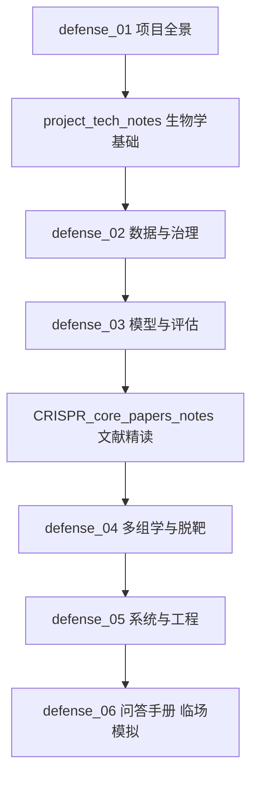

# 领域知识与答辩学习库（docs/knowledge）

> **说明**：本目录收录两类材料——① 面向跨学科协作的技术要点与核心算法深度解读笔记；② **答辩学习系列**（defense_01–06），覆盖项目涉及的全部知识点（生物学、数据治理、模型、多组学、系统工程、问答演练），供答辩准备与整体学习使用。
> **基准时点**：v2.1 冻结（2026-09-25）+ 09-26~10-10 全栈交付、收尾与评估协议自查（10-10 批次先验泄漏/过离散度敏感性诊断）；指标口径以 `results/CHANGELOG_0927.md` 为准（含 2026-10-10 更正条目，冻结指标不改）。

---

## 一、答辩学习系列（推荐按序阅读）

| 文件 | 核心内容 | 解决的问题 |
|---|---|---|
| [`defense_01_项目全景与科学问题.md`](defense_01_项目全景与科学问题.md) | 一句话定位、五项交付、科学问题与三体系迁移答案、关键数字速览、演进时间线、术语速查 | "你们做了什么？为什么做？" |
| [`defense_02_数据集与数据治理.md`](defense_02_数据集与数据治理.md) | Hi-TOM 标签定义、1368→879 治理链、七类问题修复、批次效应与锚定校正、A/B 分级裁决、防泄漏设计、口径陷阱 | "数据哪来的？可信吗？" |
| [`defense_03_效率预测模型与评估.md`](defense_03_效率预测模型与评估.md) | 双预训练模型、10 维特征、形态二 GLMM 三层数学、落盘权重、LOGO/Class A/测试集口径与伪重复告警、10-10 敏感性自查、三体系对照、模型演进史、局限性 | "模型怎么设计的？0.34 什么水平？" |
| [`defense_04_多组学时空决策与脱靶.md`](defense_04_多组学时空决策与脱靶.md) | 三张表达表、六大方案全景（含阴性结论）、LSA↔T2T crosswalk tier 语义、排序公式精确形式、S4 产胶窗口、Cas-OFFinder 与危害评估 | "多组学体现在哪？脱靶怎么算？" |
| [`defense_05_软件系统与工程实现.md`](defense_05_软件系统与工程实现.md) | 全栈架构与双轨验收、四个深度模块（ADR 0001–0003 + ranking_semantics 单点）、诚实标注与降级机制、批量打分生命周期、部署与离线交付、工程事故教训 | "工具怎么用/怎么部署？工程能力如何？" |
| [`defense_06_答辩问答手册.md`](defense_06_答辩问答手册.md) | 29 个高频答辩 Q&A（含 Q25b 自查追问；30 秒版 + 展开 + 出处）、防雷数字总表、上场表述规范 | 临场模拟与防翻车 |

---

## 二、跨学科技术笔记（原有）

| 文件 | 适用读者 | 核心内容 |
|---|---|---|
| [`project_tech_notes.md`](project_tech_notes.md) | 计算机/算法背景同学 | **生物学基础与工程决策指南**：以计算机视角拆解 CRISPR/Cas9 机制、PAM（NGG）作用、Hi-TOM 测序、批次效应成因及迁移学习在植物基因组上的局限与应对。 |
| [`CRISPR_core_papers_notes.md`](CRISPR_core_papers_notes.md) | 全体成员 | **核心文献深度解读**：Chen et al. 2022 与 Kim et al. 2019 两篇核心论文的中文精读，含 10 余种 gRNA 预测算法指标排名横向对比、特征空间构成与模型集成设计细节。 |

---

## 三、学习路径建议

- **时间紧（1~2 天）**：defense_01 → defense_06 → defense_03 §4（指标口径）；
- **系统学习（3~5 天）**：按上图全序，配合 `docs/reports/project_progress_report.md`（全景审计）与 `results/model_card_hier_bb_nob879_0921.md`（权威模型卡）；
- **随时速查**：defense_01 §4 关键数字 + §6 术语速查；defense_06 §G 防雷数字总表。

---

## 四、权威出处对照（被追问时的最终依据）

| 主题 | 权威文件 |
|---|---|
| 指标与冻结数字 | `results/CHANGELOG_0927.md`、`results/metrics_hier_bb_nob879_0921.csv` |
| 模型架构与局限 | `results/model_card_hier_bb_nob879_0921.md` |
| 评估协议自查与敏感性（10-10） | `results/sensitivity_glmm_1010.md`、`results/CHANGELOG_0927.md` 2026-10-10 条目 |
| 同口径对比与可比性告警 | `results/model_comparison_nob879_report_0924.md` |
| 数据溯源与防泄漏 | `data/README.md`、`docs/data-governance/` |
| 裁决口径 | `docs/reports/scoring_rules_16_post_ruling_0921.md` |
| 多组学实测 | `docs/reports/multiomics_five_schemes_implementation_report_0924.md` |
| 全栈验收 | `docs/reports/FULLSTACK_DELIVERY_ACCEPTANCE.md` |
| 领域术语正式定义 | 根目录 `CONTEXT.md` |
