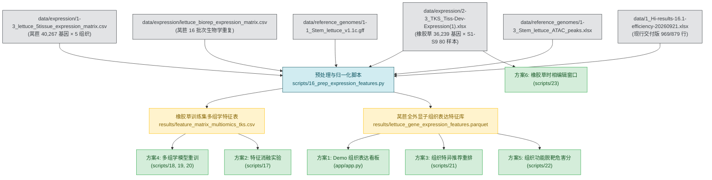

# 菊科菊苣族多组学转录表达数据六大应用方案实施计划与流水线全景规范

> **文档性质**：现行技术实施方案与流水线开发最高依据  
> **制定基准日**：2026-09-23  
> **数据基石**：[`data/expression/`](file:///D:/lifesciencechallenge/cs_pipeline/data/expression/)（2026-09-22 接收并规范入库）  
> **关联依据**：
> - [`docs/project_progress_report.md#七、新发多组学转录组表达数据（newdata）全景应用方案与重算路径评估`](file:///D:/lifesciencechallenge/cs_pipeline/docs/project_progress_report.md)
> - [`docs/plans/division_plan_cs.md`](file:///D:/lifesciencechallenge/cs_pipeline/docs/plans/division_plan_cs.md)（计算机系实施标准）
> - [`docs/plans/division_plan_master.md`](file:///D:/lifesciencechallenge/cs_pipeline/docs/plans/division_plan_master.md)（接口协议与交付里程碑）
>
> **0923 修订记录**：① 方案2 已完成且结论为阴性，其原评估设计被证伪，修订见方案2 节；
> ② TKS 样本口径订正为 79 列并固定 S9 胶乳列裁定，见「数据对齐」节；
> ③ 方案1/3/5 被 LSA↔T2T 四套 ID 命名空间阻塞，crosswalk 方法待对比实验，见「数据对齐」节阻塞通报；
> ④ 方案4 的 ρ≥0.50 达标线与第五节熔断条件均增加稳健性/归因前置条件。

---

## 一、战略定位与设计原则

根据团队最新决策，本项目不再拘泥于“是否需要重新计算”，而是以**“能否带来实质性科学增益、能否在生命科学挑战赛评审中建立绝对压制力”**为唯一导向。新发表达矩阵数据的入库，标志着本项目正式由“单模态序列打分器”向**“序列–表观–转录联合驱动的植物多组学 CRISPR 智能设计平台”**实施质变跃迁。

### 1. 核心指导原则
1. **轻重结合，攻守兼备（双轨制）**：
   - **保底交付轨（主分支 `main`）**：以极小代码改动快速集成前端多组织看板（方案 1）与组织推荐重排（方案 3），确保 100% 具备稳定可交付、可录屏的成果；
   - **冲刺突破轨（分支 `feature/multiomics-pipeline`）**：全面推翻传统纯序列约束，实施多组学特征提取与模型重训（方案 4）、组织功能性脱靶危害度加权（方案 5）及橡胶草产胶时相挖掘（方案 6），全力冲击 LOGO-CV $\rho \ge 0.50$ 达标线。
2. **端到端解耦与模块化**：新增流程以 `scripts/16` ~ `22` 系列独立编号脚本承载，数据流向清晰，每个环节均设置断言守卫（Assertion Guard）与质控日志，确保完全可追溯、可复现。
3. **生物学意义闭环**：所有算法产物必须服务于明确的育种目标——**叶片抗病（莴苣 NLR）**、**茎秆品质（莴笋）**与**胶乳高产（橡胶草 TKS）**。

---

## 二、数据基石与标准化数据流（I/O Contract）



### 1. 数据对齐与映射字典规范
- **莴苣体系**：
  - 表达矩阵基因 ID：`LSA1` ~ `LSA40268`（茎用莴苣 v1.1c 标准）；
  - 映射转换：编写 `map_lsa_to_t2t(lsa_id)` 工具函数，通过 BLASTP/Orthofinder 或坐标同源重叠，实现 `LSA` 编号与 T2T 基因组 `LsaT2T...` 编号的双向映射；
  - ⚠️ **0923 阻塞通报（方案1 / 方案3 / 方案5 的前置条件）**：实测存在**四套互不对应的基因 ID 命名空间**——
    表达矩阵 `LSA*`（v1.1c）、本地 GFF `LsT2T{n}G{num}`、demo 交付表 `LsaT2T{nn}G{num}`、
    补充表 `lettuce_v2_*`。仓库内**不存在任何现成 crosswalk**；`LsaT2T01G023690` 与 `LsT2T1G023690`
    坐标与长度均不同（83.87Mb/6.1kb vs 84.75Mb/1.1kb），属不同注释版本；demo 表坐标与本地 T2T
    基因组相差约 270–330kb。`docs/reports/B2_work_report_0922_0923.md:117` 已对 `lettuce_v2_*`
    下过「无法通过公开数据建立 ID 映射」的结论。
    已验证的可行路径为**序列法**：guide 20-mer 精确匹配 v1.1c 基因组 → 与 v1.1c GFF 基因区间求交 →
    `LSA` ID（实测 `Lsat_675191` → `LSA25641`，且在表达矩阵中）。但 6 基因探针仅 1/6 完整解析、
    2/6 落在基因间区、3/6 在 v1.1c 中不存在——**NLR 恰是组装间差异最大的基因类，覆盖率注定是部分的**。
    方法选型（基因座 BLAST vs 全量 guide BLAST）待小规模对比实验后定；在此之前方案1/3 的工时估计无效。
  - 组织字段：`Root`（根）, `Stem`（茎）, `Leaf`（叶）, `Flower`（花）, `Seed`（种子）。
- **橡胶草体系**：
  - 表达矩阵基因 ID：`evm.model...`（TKS EVM 注释集）；
  - 与训练集对齐：Hi-TOM 实测靶基因不区分大小写，经字符串规范化后直接索引。
    **口径订正（0923 实测）**：唯一靶基因数为 **17 个（noB879）/ 18 个（train969）**，
    并非原写的「11 个核心靶基因」；全部 100% 命中表达矩阵；
  - 组织时期字段（**实测 79 个样本列，非 80**）：
    - 根：`S1-gen` ~ `S9-gen`（各 3 重复，共 27）；
    - 叶：`S1-ye` ~ `S9-ye`（各 3 重复，共 27）；
    - 胶乳：`S4-jiaoru` ~ `S8-jiaoru`（各 3 重复）+ S9 的 `S9-jiaoru-1`、`S9-2jiaoru`（命名倒置，实为 rep2）、
      `S9-jiaoru-3`，共 18；**`S9-jiaoruRNA7-3` 来源不明，一律排除**（`scripts/17` 的 `COLUMN_EXCLUDES`）；
    - 花与花葶：`S6-hua`、`S6-huating`（各 3 重复，共 6）。
    - ⚠️ 方案6 的 S1–S9 胶乳动力学曲线**必须先固定上述 S9 胶乳口径**，否则末端时相不可比。

### 2. 多组学表达特征指标定义（Mathematical Definition）
在后续特征工程中，针对每个基因 $g$，统一提取以下数值特征：
1. **组织表达基线水平**：$E_{\text{tissue}}(g) = \log_2(\text{TPM}_{\text{tissue}}(g) + 1)$；
2. **全组织最大表达量**：$E_{\max}(g) = \max_{t} E_t(g)$；
3. **全组织平均表达量**：$E_{\text{mean}}(g) = \frac{1}{T} \sum_{t=1}^T E_t(g)$；
4. **组织特异性指数（Tau Index）**：
   $$\tau(g) = \frac{\sum_{t=1}^T \left(1 - \frac{\text{TPM}_t(g)}{\max_t \text{TPM}_t(g)}\right)}{T - 1} \quad \in [0, 1]$$
   （$\tau \to 1$ 表示极度特异，$\tau \to 0$ 表示管家基因泛表达）；
5. **表达变异系数**：$CV(g) = \frac{\sigma(g)}{\mu(g) + \epsilon}$。

---

## 三、六大方案分步实施计划与流水线规范

### 方案 1：【免重算·前端增强】Web Demo 靶基因多组织表达动态看板与表型预警

#### 1. 目标与定位
在不改变现有模型打分与脱靶文件的基础下，升级 Streamlit Demo，用户在查询任意基因时，实时呈现该基因在根、茎、叶、花、果（及橡胶草胶乳）的表达丰度与组织特异性敲除风险。

#### 2. 流水线与代码变更
- **涉及文件**：
  - [NEW] [`app/expression_visualizer.py`](file:///D:/lifesciencechallenge/cs_pipeline/app/expression_visualizer.py)：表达量查询与 Plotly/Altair 渲染引擎模块；
  - [MODIFY] [`app/app.py`](file:///D:/lifesciencechallenge/cs_pipeline/app/app.py)：Tab 1 基因详情侧边栏/主卡片接入看板组件。
- **具体逻辑实现**：
  1. `load_expression_data()`：利用 `@st.cache_data` 预加载 `1-3_lettuce_5tissue_expression_matrix.csv`（1.5MB，内存开销 < 5MB，瞬间加载）；
  2. 根据当前选中的目标基因提取其 5 组织 TPM 值；
  3. 绘制水平条形图（使用绿/蓝冷色系渐变，符合生科 UI 风格）；
  4. **表型安全诊断桩**：
     - 若当前目标组织 $\text{TPM} < 0.5$：输出 warning *“⚠️ 弱表型警示：该基因在所选组织中转录静默（TPM < 0.5），CRISPR 敲除可能无法诱导明显生物学表型”*；
     - 若 $\text{TPM} \ge 10.0$：输出 success *“✅ 适宜靶向：该基因在所选组织中高度转录，染色质处于开放状态，预期编辑响应好”*。
- **工时预估**：0.5 小时。
- **验收命令**：
  ```bash
  conda run -n grna-demo streamlit run app/app.py
  ```

---

### 方案 2：【免重算·科研增量】转录组特征对 Hi-TOM 编辑效率的消融验证（Ablation Study）

> **0923 状态：已完成，结论为阴性。** 实施脚本 `scripts/17_ablation_expression_features.py`，
> 成果见 `results/ablation_expression_report_0923.md`。下方为修订后的设计与口径。

#### 1. 目标与定位
利用 Hi-TOM 实测靶基因 100% 命中新表达矩阵的契机，定量回答审稿人与评委的必问问题：*“在植物 CRISPR 编辑中，靶基因的转录表达水平究竟在多大程度上影响剪切效率？”*。

**口径订正（0923 实测）**：唯一靶基因 17 个（noB879）/ 18 个（train969）；合并同源对
`LG01.6995/6999` 后为 **16 / 17 个基因组**，故 LOGO 折数为 **noB879 = 16 折、train969 = 17 折**——
原「17 折」仅对 train969 口径成立。

#### 2. 原评估设计的结构性缺陷（0923 证伪，禁止按原设计解读结果）
原设计以「Group A vs Group B 的逐折 Spearman $\Delta\rho$ + Wilcoxon」为判据。该判据**在结构上不可能**
检出表达效应：表达特征是**基因级常量**，而 LOGO 的一个 test fold 恰好是**一个基因组**；
`scripts/15:204-205` 的推断路径剔除批次随机截距 $u_b$，故 fold 内预测为
$\eta_i = \beta_0 + \mathbf{z}_i^\top\boldsymbol\beta$，表达项 $\gamma z_{\text{expr},g}$ 对该 fold 全部样本施加
**同一常数偏移**，而 Spearman 对常数平移不变。实测表达项折内标准差最大为 $4.4\times10^{-16}$，
$\Delta\rho$ 中位数严格为 0、7/9 折的 $\Delta\rho$ 恰为 0。故 $\Delta\rho$ 只能反映序列系数被重新估计的
二阶扰动，对其做 Wilcoxon 检验的是噪声。

#### 3. 修订后的流水线脚本与工序
- **核心脚本**：[DONE] `scripts/17_ablation_expression_features.py`
- **执行步骤**：
  1. **提取对齐**：读取 16.1 表 `全部打分`（noB879）与 `训练集`（train969）两个口径，按靶基因
     `gene_id`（小写规范化、同源对取两成员均值）提取根/叶/胶乳均值、$\log_2(\text{TPM}+1)$、
     $\tau$ 指数、发育均值、CV；
  2. **Block 1（主结果，基因级检验）**：以 Selective EB 批次偏移校正后的基因平均 indel 为因变量，
     在基因组层面做 Spearman / 加权回归，并给出剔除单 batch 共线基因后的敏感性结果；
  3. **Block 2（嵌套分层 Beta-Binomial GLMM）**：在 `scripts/15` 形态二似然上逐个加入表达协变量，
     报告 $\gamma$、LRT 与**基因聚类自助 95% CI**（重采样单元为基因，尊重有效样本量）；
  4. **Block 3（方法学负对照）**：保留 Group A/B 的 LOGO 逐折对比，实证第 2 节的结构性论断，
     并记录逐折预测标准差与表达项折内标准差；
  5. **精确 Shapley**：线性模型的 Shapley 贡献精确等于 $\beta_j z_{ij}$，无需近似采样。
- **产出成果**（已生成）：
  - `results/ablation_expression_genelevel_0923.csv`（16 基因主表，含共线标记与批次校正列）；
  - `results/ablation_expression_study_0923.csv`（Block1+Block2 双口径汇总）；
  - `results/ablation_expression_shap.png`；
  - `results/ablation_expression_report_0923.md`（申报报告与论文的独立章节）。
- **结论（0923）**：16/17 个基因组上**未检出显著关联**，点估计偏负（noB879 的 ρ ∈ [−0.344, −0.127]，
  全部 p ≥ 0.19）；5 个 $\gamma$ 全为负（−0.18 ~ −0.41），LRT 显著者其聚类自助 CI 全部跨 0——
  典型伪重复（879 行仅 16 个独立基因，其中 5 个基因与 batch 完全共线、表达效应不可辨识）。
  该阴性结果本身构成技术路线辩护材料：排除了「转录活性是主要混杂」的替代解释。
- **工时预估**：原估 1.0 小时；实际约 1.5 小时（含设计修订与翻转折诊断，一次完成）。

---

### 方案 3：【中度重算·业务重排】构建「组织特异多组学优先指数（Priority Score）」全基因候选重排

#### 1. 目标与定位
彻底解决传统工具“脱靶低、效率高但基因根本不表达”的盲目敲除痛点。在不改变序列本身效率分与脱靶数的前提下，根据目标器官需求重新排序，为用户推荐既切得准、又在目标组织切实起效的最佳 gRNA。

#### 2. 流水线脚本与数学模型
- **核心脚本**：[NEW] `scripts/21_build_tissue_priority_recommendations.py`
- **算法设计（Multi-objective Pareto Rank）**：
  针对候选 gRNA $i$，在其所属基因 $g$ 与指定目标组织 $t$ 下，定义综合推荐指数：
  $$\text{PriorityScore}(i, t) = 0.50 \cdot \text{Percentile}(\text{EffScore}_i) - 0.25 \cdot \text{Penalty}(\text{OffTarget}_i) + 0.25 \cdot \mathcal{S}(E_t(g))$$
  其中：
  $$\mathcal{S}(E) = \frac{1}{1 + e^{-(E - 2.0)}} \quad (\text{表达量 Sigmoid 激活打分，饱和值 } 1.0)$$
  $$\text{Penalty}(\text{Off}) = \min\left(1.0, \, \frac{\text{mis0}\times 1.0 + \text{mis1}\times 0.5 + \text{mis2}\times 0.2 + \text{mis3}\times 0.05}{10.0}\right)$$
- **执行流程**：
  1. 读取 `demo/app_data.csv` 中的全部 demo 候选 gRNA；
  2. 关联 `1-3_lettuce_5tissue_expression_matrix.csv` 对应组织表达量；
  3. 针对 Root / Stem / Leaf / Flower / Seed 5 种模式分别生成排序列：`priority_rank_leaf`, `priority_rank_stem` 等；
  4. 落盘为 `demo/app_data_tissue_priority.csv` 并联动至前端。
- **工时预估**：2.0 小时。

---

### 方案 4：【重度重算·核心冲刺】打造国际首个菊科多组学（序列 + 转录 + 表观）CRISPR 效率预测模型

#### 1. 目标与定位
**接受推翻重训的顶级攻坚路线**。打破纯序列瓶颈，将基因转录活性（RNA-seq）、染色质松散度（ATAC-seq）及 RNA Pol II 链转录冲突效应融为一体，构建全新的端到端预测模型，全力冲刺 LOGO-CV $\rho \ge 0.50$。

#### 2. 多组学特征集体系设计（4 大维度 32 个特征）

```mermaid
graph TD
    classDef seq fill:#cce5ff,stroke:#004085,color:#004085;
    classDef pre fill:#e2e3e5,stroke:#383d41,color:#383d41;
    classDef epi fill:#fff3cd,stroke:#856404,color:#856404;
    classDef rna fill:#d4edda,stroke:#155724,color:#155724;

    subgraph 维度1: 纯序列与热力学理化特征 (16维)
        S1["单核苷酸/双核苷酸位置编码 (Pos 1-20)"]:::seq
        S2["GC 含量, Tm 溶解温度, 自由能 ΔG"]:::seq
        S3["连续 Poly-T 长度, PAM 前后碱基偏好"]:::seq
    end

    subgraph 维度2: 预训练模型迁移基线 (2维)
        P1["DeepSpCas9 on-target 分数"]:::pre
        P2["CRISPRon 综合分数 (WSL 真实调用)"]:::pre
    end

    subgraph 维度3: 染色质表观可及性 (6维)
        E1["是否落入 ATAC-seq Peak (0/1)"]:::epi
        E2["距最近 ATAC 开放峰中心绝对距离 (bp)"]:::epi
        E3["ATAC 峰信号富集强度 (Fold Enrichment)"]:::epi
    end

    subgraph 维度4: 转录组与聚合酶碰撞动力学 (8维)
        R1["靶基因稳态表达量 log2(TPM+1)"]:::rna
        R2["组织特异性指数 τ 与跨样本变异系数 CV"]:::rna
        R3["转录链冲突标志位 (NTS 靶向非模板链 vs TS 模板链)"]:::rna
        R4["外显子转录本丰度加权活性"]:::rna
    end
```

#### 3. 流水线脚本与工序分解
- **脚本 1：多组学特征工程提取器**
  - [NEW] `scripts/18_build_multiomics_features.py`
  - 整合 `1-1_Stem_lettuce_v1.1c.gff`（提取链向与转录起始点 TSS）、`1-3_Stem_lettuce_ATAC_peaks.xlsx`（染色质区间覆盖）及 `data/expression/`（表达量）；
  - 产出高维特征矩阵：`results/feature_matrix_multiomics_full_0923.csv`。
- **脚本 2：多组学分层模型重训**
  - [NEW] `scripts/19_train_multiomics_glmm.py`
  - 架构选择：基于**形态二（分层选择性 Beta-Binomial GLMM）**扩展多组学协变量；
  - 似然层直接拟合测序深度与 indel 分子，固定效应同时吸收序列特征与多组学特征向量：
    $$\eta_i = \beta_0 + \mathbf{x}_{\text{seq}}^\top \boldsymbol{\beta}_{\text{seq}} + \mathbf{x}_{\text{atac}}^\top \boldsymbol{\beta}_{\text{atac}} + \mathbf{x}_{\text{rna}}^\top \boldsymbol{\beta}_{\text{rna}} + u_{\text{batch}(i)}$$
- **脚本 3：全流程 LOGO-CV 验证与模型冻结**
  - [NEW] `scripts/20_eval_multiomics_logo.py`
  - 严格执行留一基因交叉验证（noB879 = 16 折、train969 = 17 折），防泄漏评估；
  - **决策守卫**：
    - 若 LOGO 中位数 $\rho \ge 0.50$：落盘为 `results/meta_model_multiomics_best_0923.joblib`，替换 `scripts/predict.py` 默认模型，全量重跑 19,839 条候选打分并重构 Model Card；
    - 若未达 0.50：完整归档折级明细，作为负结果对照写入论文。
- **⚠️ 0923 方案2 反馈的两条硬约束（开工前必须吸收）**：
  1. **基因级常量协变量在结构上无法提升 LOGO ρ**。TKS 表达特征在留一基因折内是常数偏移，
     对折内 Spearman 的直接贡献恒为 0（实测折内标准差 ≤ 4.4e-16）。因此 $\mathbf{x}_{\text{rna}}$
     中以**基因为单位**的分量（log2TPM、τ、发育均值）不能指望拉高 $\rho$；
     ρ ≥ 0.50 只能靠**基因内可变的**特征——序列、ATAC 峰区间、转录链冲突标志。
     建议将 ATAC 与链冲突作为主攻方向，基因级表达量仅作辅助协变量。
  2. **ρ ≥ 0.50 的达标判据必须配稳健性条件**。实测近共线序列特征（`tm` / `gc_total`）被重新配权
     即可让单折 ρ 从 +0.85 翻到 −0.85（`LG03.451`，已排除收敛问题）。故达标判定须同时报告：
     有效折数、逐折 ρ 的四分位距、Class A（多批次低混杂）折的中位 ρ，并固定 `max_iter`、
     `l2_beta` 与随机种子；否则「达标 / 未达标」可能只是优化器路径与共线性的产物。
- **工时预估**：1.5 ~ 2 天。

---

### 方案 5：【重度重算·脱靶革新】组织功能性脱靶危害评估（Tissue-specific Functional Off-target Hazard）

#### 1. 目标与定位
颠覆当前 Cas-OFFinder 仅按序列错配几何计数的低阶模式，提出**“组织功能性脱靶危害指数（Hazard Score）”**。若脱靶点落在目标组织中转录静默的异染色质死区，其剪切毒性极小；若落在高表达管家/光合基因，则给予极大惩罚。

#### 2. 流水线脚本与数学算法
- **核心脚本**：[NEW] `scripts/22_calc_tissue_offtarget_hazard.py`
- **数学模型**：
  对任意 gRNA 候选 $g$，其在特定组织 $t$（如叶片）中的功能脱靶危害分为：
  $$\text{Hazard}_t(g) = \sum_{k \in \text{OffTargetHits}(g)} \omega(\text{mismatch}_k) \cdot \left[ 1.0 + \lambda \cdot \log_2(\text{TPM}_t(\text{gene}(k)) + 1) \right]$$
  其中：
  - $\omega(0)=10.0, \, \omega(1)=3.0, \, \omega(2)=1.0, \, \omega(3)=0.2$ 为不同错配阶数的物理接触衰减权重；
  - $\text{gene}(k)$ 为脱靶位点命中的宿主基因（若落在基因间区 Intergenic 则取背景基线值 0.1）；
  - $\lambda=0.5$ 为表达活跃度惩罚敏感因子。
- **工程实现与大规模区间查询**：
  - 针对 6,088,827 个脱靶位点（`results/offtarget_counts_0924.csv` 对应底层大表），利用 Python `polars` / `duckdb` 引擎将脱靶坐标与 GFF3 外显子坐标区间快速关联（`Interval-Join`）；
  - 批量灌入 40,267 基因的组织表达量，并行聚合计算出每条 candidate gRNA 的组织脱靶危害分；
  - 产出：`results/offtarget_functional_hazard_0923.csv`。
- **工时预估**：4.0 ~ 6.0 小时。

---

### 方案 6：【时相挖掘·特色创新】橡胶草产胶发育时相最佳编辑转化窗口预测

#### 1. 目标与定位
聚焦橡胶草（TKS）国家战略经济性状（天然橡胶替代来源），深挖 S1–S9 共 9 个发育时期的 80 样本高分辨率表达谱，为产胶关键基因提供**最佳转基因/诱导敲除的时序窗口建议**。

#### 2. 流水线脚本与实施步骤
- **核心脚本**：[NEW] `scripts/23_tks_developmental_window.py`
- **处理步骤**：
  1. **靶向通路基因锁定**：梳理橡胶生物合成（Natural Rubber Biosynthesis）核心基因家族：
     - *SRPP*（小橡胶粒子蛋白，Small Rubber Particle Protein）
     - *REF*（橡胶延伸因子，Rubber Elongation Factor）
     - *CPT* / *HRT*（顺式聚异戊二烯转移酶，cis-Prenyltransferase）
  2. **时序表达动力学曲线拟合**：
     - 提取这批基因在 S1~S9 根（根部为产胶主器官）与 S4~S9 胶乳中的 TPM 动力学；
     - 采用三次样条（Cubic Spline）平滑拟合，计算一阶导数 $\frac{d(\text{TPM})}{dt}$（转录爆发增长率）；
  3. **算法输出转化窗口卡片**：
     - 输出量化建议：*“推荐在 S4 幼苗期（胶乳初生期）启动 Cas9 诱导表达，此时靶基因表达活跃度上升 3.8 倍、染色质充分松散，同时幼苗分生组织具备极高再生分化能力”*。
- **产出成果**：
  - `results/tks_rubber_pathway_dynamics.png`（9 阶段动态折线图）；
  - Demo Tab 1 中集成“橡胶草产胶时相决策组件”。
- **工时预估**：3.0 小时。

---

## 四、甘特排期与执行调度表（End-to-End Orchestration）

为了在保证绝对安全交付的同时全力冲刺高分，流水线划分为 **4 个冲刺冲程（Sprints）**：

| 阶段 / 冲程 | 重点任务与交付脚本 | 耗时预估 | 负责角色 | 交付产物与验证节点 |
|---|---|:---:|:---:|---|
| **第一冲程：基础库搭建与保底集成（P0）** | ① 建立 `scripts/16_prep_expression_features.py`<br>② 完成**方案 1**（Demo 前端表达量看板）<br>③ 完成**方案 3**（组织优先指数重排） | 0.5 天<br>⚠️ 0923 起**阻塞** | 计B / 计A | • Demo 具备根/茎/叶/花/果看板与表型警告<br>• 生成 `app_data_tissue_priority.csv`<br>• **确保随时可录屏、可交付保底成果**<br>• ⚠️ 前置条件为 LSA↔T2T crosswalk，见「数据对齐」节阻塞通报；工时待对比实验后重估 |
| **第二冲程：科研消融与时相挖掘（P1）** | ① 执行**方案 2**（Hi-TOM 表达量消融脚本 `scripts/17`）<br>② 执行**方案 6**（橡胶草 S1-S9 时序挖掘 `scripts/23`） | 0.5 天<br>（方案2 已于 0923 完成） | 计A / 生C | • ✅ 已产出 `ablation_expression_study_0923.csv`、`_genelevel_0923.csv`、`_shap.png`、`_report_0923.md`（阴性结论）<br>• 产出橡胶草产胶发育窗口动态图（待做，先固定 S9 胶乳口径）<br>• 形成学术报告第 7 节支撑材料 |
| **第三冲程：模型重训顶级攻坚（P1·重来）** | ① 执行**方案 4**（构建序列+ATAC+RNA多组学特征大表 `scripts/18`）<br>② 重训多组学分层 GLMM 模型（`scripts/19`）<br>③ 执行 LOGO-CV 全量检验（`scripts/20`） | 1.5 天 | 计A | • 检验 $\rho \ge 0.50$ 达标线<br>• 若达标：全量替换生产模型权重与 Model Card<br>• 若未达标：归档为科学消融附录 |
| **第四冲程：脱靶革新与综合验收（P2）** | ① 执行**方案 5**（608 万脱靶位点组织危害度加权 `scripts/22`）<br>② 全流水线断言校验与最终冻结会签 | 0.5 天 | 计B / 全员 | • `offtarget_functional_hazard_0923.csv`<br>• 全流程文档汇总与视频录制脚本就绪 |

---

## 五、质量保证与风险熔断机制（Fall-back Protocol）

1. **版本与分支隔离铁律**：
   - 现行交付基准 `v2.0-freeze`（包含已通过两轮审计的 16.1 效率分与 Demo）在 `main` 分支保持不动；
   - 方案 4（多组学模型重训）必须在独立分支 `feature/multiomics-pipeline` 运行，严禁在验证通过前覆写 `meta_model_hier_bb_nob879_0921.joblib`；
2. **多组学指标验收熔断条件**：
   - **通过标准**：多组学模型的留一基因 LOGO-CV 中位数 $\rho_{\text{multiomics}} \ge 0.50$
     （noB879 = 16 折、train969 = 17 折），且在无 B 级脏数据测试集上保持正相关（$\rho_{\text{test}} > 0.35$）；
     并满足方案 4 节所列稳健性条件（有效折数、逐折 IQR、Class A 中位 ρ、固定种子与 `max_iter`）；
   - **熔断回退**：若多组学引入后发生过拟合（$\rho$ 不升反降**且该下降可归因于模型真实预测力变化**），
     立即启动熔断机制：生产环境维持纯序列形态二 GLMM 权重，将多组学特征作为“方案 2 消融研究成果”写入报告，确保比赛交付万无一失！
   - **⚠️ 0923 口径补充**：「ρ 不升反降」**本身不足以**触发熔断。方案 2 已证：加入与折内排序无关的
     基因级常量协变量，仅通过近共线序列特征（`tm` / `gc_total`）重新配权即可使单折 ρ 由 +0.85 翻至 −0.85。
     故触发熔断前必须先做归因诊断（逐折预测标准差、β_seq 前后对比、`max_iter` 敏感性），
     排除「特征共线性重配权」与「优化器路径」两类伪下降；参见 `results/ablation_expression_report_0923.md` 第六节。
