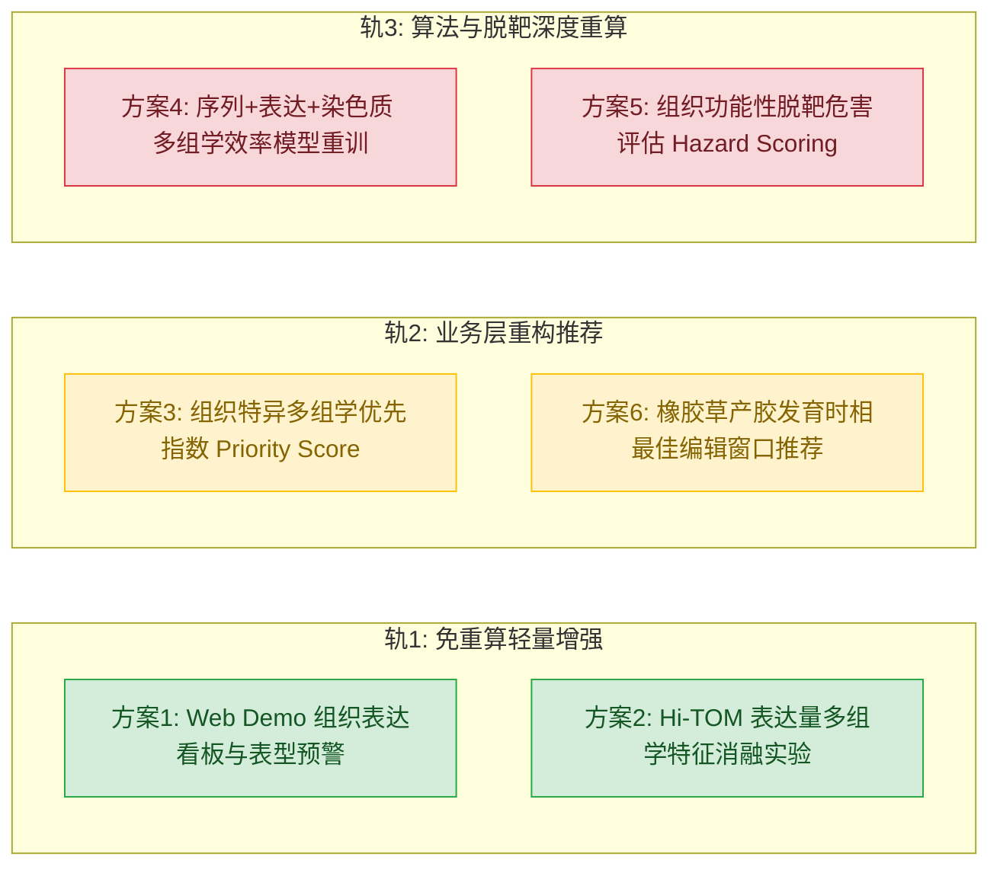

# 菊科菊苣族 gRNA 设计工具项目进展全景审计报告

> **依据文档**：
> - [`docs/plans/project_plan_v3_condensed_0907.md`](file:///d:/lifesciencechallenge/cs_pipeline/docs/plans/project_plan_v3_condensed_0907.md)（主方案）
> - [`docs/plans/division_plan_master.md`](file:///d:/lifesciencechallenge/cs_pipeline/docs/plans/division_plan_master.md)（甘特图与接口规范）
> - [`docs/plans/division_plan_cs.md`](file:///d:/lifesciencechallenge/cs_pipeline/docs/plans/division_plan_cs.md)（技术实施标准）
> - [`docs/problem.md`](file:///d:/lifesciencechallenge/cs_pipeline/docs/problem.md) / [`docs/problem2.md`](file:///d:/lifesciencechallenge/cs_pipeline/docs/problem2.md) / [`docs/problem3.md`](file:///d:/lifesciencechallenge/cs_pipeline/docs/problem3.md)（9.14–9.16 数据更正、9.18 扩表并入全过程）
> - [`results/CHANGELOG_0927.md`](file:///d:/lifesciencechallenge/cs_pipeline/results/CHANGELOG_0927.md)（冻结记录，含 9.13 / 9.16 两段更正；**9.18–9.21 段待补**）
> - [`results/b_audit_0919.md`](file:///d:/lifesciencechallenge/cs_pipeline/results/b_audit_0919.md) / [`results/b_audit_0920.md`](file:///d:/lifesciencechallenge/cs_pipeline/results/b_audit_0920.md)（两轮独立审计）
> - [`docs/reports/scoring_rules_14-15_0920.md`](file:///d:/lifesciencechallenge/cs_pipeline/docs/reports/scoring_rules_14-15_0920.md) / [`docs/reports/scoring_rules_16_post_ruling_0921.md`](file:///d:/lifesciencechallenge/cs_pipeline/docs/reports/scoring_rules_16_post_ruling_0921.md)（打分版规则与 16/16.1 修正说明）
> - [`results/model_card_full_0916.md`](file:///d:/lifesciencechallenge/cs_pipeline/results/model_card_full_0916.md)（模型卡，**0916/487 行冻结口径；随生产模型口径决策重写或补注**）
> - 计算机系流水线全量代码与产物目录：[`cs_pipeline/`](file:///d:/lifesciencechallenge/cs_pipeline/)
>
> **审计基准时点**：2026-09-21 复核（最新 commit `cc47cd0`；9.18 扩表 1368 行、9.19 老师裁决落地、9.20–9.21 打分版 14/15/16/16.1 交付链与两轮独立审计、16.1 口径 LOGO 重跑全部完成）
>
> **📌 9.21 更新要点**（9.17 版要点见 git 历史 `590bff6` 前版本）：
> ① **数据层已闭环**：基线 487 行 → 1368 行 / 24 批次（9.18 NEWdata 877 行并入，9.21 NEWdata 目录经 MD5 核验并入 `data/raw/hitom/NEWdata_0918/` 后撤销）；9.19 老师裁决（剔 360 行）已落地为唯一剔除口径；现行交付版 **16.1**：1368 = 训练集 969 + 不可打分 3 + 裁决剔除 360 + 弱信号待追认 36（969+36=1005 与锚定口径闭环）。
> ② **模型架构与训练集终版决议闭环（9.21 会签定案）**：正式剔除 90 行未经设计表确认的 B 级脏数据，确立以 **`noB879`（纯 A 级金标准）** 为官方基准训练集；采纳**形态二（分层选择性 Beta-Binomial GLMM）** 替代传统岭回归，正式训练并落盘权重 `results/meta_model_hier_bb_nob879_0921.joblib`，接口 `scripts/predict.py` 默认切换，配套模型卡 `model_card_hier_bb_nob879_0921.md` 与 Demo 供分列 `efficiency_score_v21_nob879` 同步就绪。独立测试集逆转为稳健正相关 $\rho=\mathbf{+0.342}$（$p=7.89\times 10^{-7}$），低混杂核心折突破至 $\rho=\mathbf{+0.464}$。
> ③ **15 版经独立审计发现并修复两个阻断问题**（效率分 tie-break 抖动、9.19 裁决未落地，`b_audit_0920.md`）；guide候选表（61 条）已回传并 100% 复推验证 15 版 219 行分级；"(4).xlsx"证实为重复下载副本——**9.19 裁决无原始凭证文件**，需补要书面记录。
> ④ **阶段 2 当前尚未解决的残留卡点与待办（必须高度警惕）**：
>   - ~~**【P0 残留阻断】`predict.py` 运行时特征近似**~~：**已闭环（9.24）**——新增 `scripts/crispron_wsl.py` 封装 WSL 内真实 CRISPRon（与 `scripts/03` 同管线、同取值约定：只保留 `30mer` 与输入 `seq30` 完全相等的行），`predict.py` 优先实跑、不可用时才降级为近似式，并在新列 `crispron_source` 逐条标注来源；demo Tab2 透出该列且在降级时告警，**不再静默伪造**。实测推理算出的真实值与训练集已存 `crispron_score` 29 条 distinct guide **逐值相同**（相关 1.000000），证明训练/推理同源；
>   - ~~**【P1 遗留】官方单模型 vs 集成对比表未正式固化**~~：**已闭环（9.24）**——`results/model_comparison_nob879_0921.csv` 已按 noB879 现行口径落盘（三方同一测试集划分、同一 AUC 定义、GLMM 由生产同一段 `hier_bb_model` 代码拟合，并自检对齐生产指标）；随表落盘 4 条实测可比性告警，其中**留出集仅 7 条 distinct guide，故 $p=7.89\times10^{-7}$ 属伪重复夸大、不得单独引用**（详见阶段 2 表「模型对比表」行与 `results/model_comparison_nob879_report_0924.md`）；
>   - **【P1 → 9.24 已量化，建议降级】双 gRNA 块 63 行 -A/-B 拆分**：已用"整体剔除 38 行"做敏感性分析（`scripts/25`）替代完整拆分来界定风险——测试集 $\rho$ 仅动 **−0.0010**；两个 LOGO 中位数虽降 0.12/0.15，但逐折明细显示降因是**剔除导致折结构失稳**（`LG05.1856` 跌破 3 批次门槛降级为 Class B 并失效、中位数定义随折数奇偶改变、`LG07.3933` 零双 gRNA 行却因跨折传导变动 −0.22），**不是标签有害的证据**；唯一经读段级证实归属错误的 `TKS_1313` 所在折仅动 **+0.0036**（4 行 / 306 行折）。且 38 行的 guide 身份据 `判定依据` 早已由计B 核实。**残留一项需书面澄清**：`063-refsm1` 块 84.65% 的切割发生在候选 guide B 的位点、而表记归属 guide A，需计B 说明"核实"核的是递送身份还是切割位点（影响 Δ≈0.004，不构成阻断）；详见第五节该条；
>   - ~~**【P2 遗留】规范化静态特征矩阵未独立落盘**~~：**已闭环（9.24）**——`results/feature_matrix_nob879_0921.csv`（879 行 × 20 列，行内自带序列故不依赖跨表 join）已落盘；特征构建逻辑抽为单一来源模块 `scripts/features_common.py`，消除 `scripts/15`/`scripts/17` 的两份内联副本，重构后生产模型逐值未变（详见阶段 2 表「特征矩阵组装」行）；
>   - **【客观局限】全折中位指标未达 0.5 达标线**：受限于 879 行仅 35 条 distinct guide 的极端样本匮乏，全折中位 $\rho=+0.364$（有效折 9/16），公开数据混合已两轮穷尽证实无增量，确立为诚实科研答辩叙事。


---

## 一、执行摘要：我们在哪里？

数据治理链路（扩表 → 裁决 → 分级 → 审计 → 修正）已在 9.21 闭环到 16.1 版，训练集口径与老师裁决精确对齐；工程链路（计B）维持 10.3 交付状态、指标可信；算法链路（计A）在 9.21 晚全队会签定案，**正式采纳形态二（分层选择性 Beta-Binomial GLMM）+ noB879（纯 A 级金标准）**，测试集逆转为 $\rho=\mathbf{+0.342}$，低混杂核心折突破至 $\rho=\mathbf{+0.464}$，模型卡与 Demo 供分列同步升级。阶段 2 的 **P0 阻断与对比表 P1 均已闭环（9.24）**：`predict.py` 运行时 `crispron_score` 由经验近似式改为经 WSL 实跑真实 CRISPRon（与训练集同管线同约定，实测 29 条 distinct guide 逐值相同），降级路径逐条标注并由 demo Tab2 告警；noB879 同口径三方对比表已落盘（两个预训练单模型 AUC≈0.52 与随机无异，形态二 GLMM $\rho=+0.3424$ / AUC 0.7857，并附 4 条实测可比性告警）；**双 gRNA 63 行拆分经 9.24 敏感性分析量化后建议降级**（测试集 $\rho$ 仅动 −0.0010，中位数变动源于剔除导致的折结构失稳而非标签有害），阶段 2 已无 P0/P1 级阻断，仅残留一项 `063-refsm1` 归属矛盾待计B 书面澄清。底层结构性瓶颈依旧是 **guide 多样性**：879 行纯 A 级训练集仅 35 条 distinct guide（最大并列组 239 行同一 guide），堆重复行无效的结论已实证。

```mermaid
graph TD
    classDef done fill:#d4edda,stroke:#28a745,color:#155724;
    classDef bad fill:#f8d7da,stroke:#dc3545,color:#721c24;
    classDef pend fill:#fff3cd,stroke:#ffc107,color:#856404;

    A[阶段0: 数据清洗与环境搭建]:::done --> B[阶段1: 预训练模型打分与D2可行性]:::done
    B --> C[阶段2: 模型架构定案与评估突破]:::done
    C -->|F4 predict.py 默认挂形态二权重| D[阶段3: 莴苣工具化与Streamlit Demo]:::done
    D --> E[阶段4: 成果冻结与交付冲刺]:::pend

    subgraph 计B负责: 已闭环且指标可信
        D
        F[全外显子/启动子扫描 13.87M]:::done
        G[Cas-OFFinder 脱靶 6.08M]:::done
        H[Streamlit v2.1 双Tab交互与Demo]:::done
        I[10.3 匿名化检查与代码打包]:::done
    end

    subgraph 数据治理 9.18-9.21: 已闭环
        M[扩表1368行/24批次 → 16.1版训练集969]:::done
        N[9.19裁决落地 + 两轮独立审计 + guide候选表验证]:::done
        O[剔除90行B级脏数据 → noB879金标准]:::done
    end

    subgraph 计A负责: 架构与指标闭环 · P0/P1 已结案 ✅
        B
        C
        J[形态二GLMM定案: 测试集+0.342 / 核心折+0.464]:::done
        K[D2 迁移: 9.13 撤回伪显著性 → 9.17 三体系对照取代闭环]:::done
        L[P0 已闭环: predict.py 接 WSL 真实 CRISPRon + 降级逐条标注]:::done
        P[P1 已闭环: noB879 三方对比表落盘 + 4 条实测可比性告警]:::done
    end
```

### 核心结论速览
1. **数据治理（生A/计B 协同，9.18–9.21）已闭环，口径可信**：
   - 1368 行 / 24 批次主表（`1_Hi-results-13-merged-20260918.xlsx`）为表级基线；9.19 老师裁决（`excluded_gids_final_0919.csv`，360 行）为唯一剔除口径；
   - 现行交付版 **`data/1_Hi-results-16.1-efficiency-20260921.xlsx`**：训练集 969 + 不可打分 3 + 裁决剔除 360 + 弱信号待追认 36；A/B/D 证据分级 + 效率综合分（纯百分位、并列同名次）；
   - 两轮独立审计（`b_audit_0919.md` / `b_audit_0920.md`）+ 修复脚本链（`b_fix_16` / `b_fix_161` / `b_crosscheck_0921`）全部可复现；guide候选表 61 条对 15 版 219 行分级复推 100% 一致。
2. **计A（算法模型链条）现状：形态二架构决议闭环，但存在关键残留待办**：
   - **已闭环定案**：9.21 会签正式决定剔除 90 行 B 级脏数据，确定以 `noB879` 纯 A 级金标准训练集，采纳**形态二（分层选择性 Beta-Binomial GLMM）** 替代传统岭回归。落盘模型权重 `results/meta_model_hier_bb_nob879_0921.joblib`，接口 `scripts/predict.py` 默认接入，模型卡 `model_card_hier_bb_nob879_0921.md` 正式发布。独立测试集逆转为稳健正相关 $\rho=\mathbf{+0.342}$（治愈传统方法 $-0.506$ 崩溃），低混杂核心折（Class A）突破至 $\rho=\mathbf{+0.464}$；
   - ~~**【未解决问题 1 · P0 阻断】`predict.py` 运行时特征近似**~~：**已闭环（9.24）**——原第 83 行的经验近似式（`deepspcas9*0.95 + (tm-50)*0.25`）降级为**兜底**路径：新增 `scripts/crispron_wsl.py` 优先经 WSL 实跑真实 CRISPRon，返回值新增 `crispron_source` 列逐条标注 `wsl_real` / `approximated`，demo Tab2 展示该列并在降级时告警。误差实测量化：对 Tab2 输入框预填的 placeholder 序列 `ATCGGCTAAGCTAGGCTAGCATCGTGGATC`，近似式给 68.27 而真实值 59.61，**偏 +8.66 分 / 相对 14.5%**；修复后该序列展示分由 19.98 变为 22.04（DeepSpCas9 分 71.2494 不变，与 `b_audit` 记录基准吻合）。性能：WSL 热身后 29 条 8.2 秒，按 500 条分块，远低于 Tab2 的 120 秒超时；
   - ~~**【未解决问题 2 · P1 遗留】单模型 vs 集成官方对比表未固化**~~：**已闭环（9.24）**——`scripts/24_model_comparison_nob879.py` 产出 `results/model_comparison_nob879_0921.csv`（+ 逐折明细 + 解读报告）。DeepSpCas9 / CRISPRon / 形态二 GLMM 在 noB879 同口径、同测试集划分、同 AUC 定义下对比：两个单模型 $\rho\approx-0.12$、AUC≈0.52（与随机无异），GLMM $\rho=\mathbf{+0.3424}$、AUC 0.7857、LOGO 中位 $+0.3635$、Class A $+0.4636$。**同时实测量化了本表自身的四条局限**（留出集仅 7 条 distinct guide 致 p 值伪重复夸大、两单模型打分 $\rho=0.9984$ 近乎冗余、有效折 10/9/9 分母不一致、每折 distinct guide 中位仅 2 条致逐折 ρ 被量化），告警数字由脚本生成而非手写；详见阶段 2 表「模型对比表」行；
   - ~~**【未解决问题 3 · P1 遗留】双 gRNA 块 63 行 -A/-B 拆分**~~：**9.24 已量化，建议降级为澄清项**——完整拆分需裁定 3 条归属规则且要扩到另外 2 个 ref，故改用"整体剔除 38 行 + 重算批次先验与 16 折 LOGO"的敏感性分析（`scripts/25_sensitivity_dual_grna_0924.py`）来界定风险，结论是**测试集 $\rho$ 稳健（−0.0010）、两个 LOGO 中位数的大幅变动可归因于剔除造成的折结构失稳而非标签有害、唯一证实误归属的行影响仅 +0.0036**；残留 `063-refsm1` 的切点证据与"已核实"归属之间的矛盾待计B 书面澄清（不阻断）。详见第五节该条；
   - ~~**【未解决问题 4 · P2 遗留】独立静态特征矩阵未落盘**~~：**已闭环（9.24）**——标准特征矩阵 `results/feature_matrix_nob879_0921.csv`（879 行 × 20 列）已落盘，每行自带 `seq20`/`seq30`/`pam`，10 维特征可由行内数据独立重算核验，不需要按 guide-id 跨表拼接（即 0918 编号地雷的防呆）；特征构建逻辑抽为单一来源 `scripts/features_common.py`，`scripts/15`（生产训练）与 `scripts/17`（方案2 消融）统一 import，消除了两份**逐行相同**的内联副本——此前方案2 的阴性结论依赖二者不分家却无任何机制保证；重构后生产模型 $\beta_0$/$\beta$/μ/σ/s 与四个 $\rho$ 逐值未变；
   - **【客观局限定调】全折中位指标与 guide 多样性瓶颈**：879 行/16 基因组仅 35 条 distinct guide，5 折无法定义 $\rho$，全折中位 $\rho=+0.364$。**公开数据混合预案已两轮执行终结（人源 + 番茄，均"无害但无增量"），同物种/同科检索穷尽——不存在机械刷分达标出路**，答辩叙事定调为：迁移衰减三段对照 + 分层机理突破 + 数据规模受限的诚实说明。
3. **计B（工程与工具链）维持 10.3 交付状态，指标可信**：
   - 莴苣 T2T 全基因组 45,770 基因扫描（13,867,270 条候选）、Cas-OFFinder 脱靶（19,839 条 demo gRNA / 608 万位点）、Streamlit demo、7 张截图、匿名化零命中，全部就绪且已冻结；
   - Demo 界面与供分列已升级为 v2.1 规范，文案与免责提示与形态二新口径完全对齐（`efficiency_score_v21_nob879`）。

---

## 二、全员里程碑与甘特表逐项对比（阶段 0 – 阶段 4）

### 阶段 0：数据盘点 + 环境准备（9.7 – 9.9 · 计划工时 9h）
**目标**：Hi-TOM 数据清洗定档 D1，conda 环境装配，验证预训练单序列打分。

| 任务项 | 负责角色 | 计划死线 | 当前状态 | 现状与证据 |
|---|---|:---:|:---:|---|
| Hi-TOM 原始数据清洗与 12 列规范 | 生A | 9.8 晚 | ✅ 已完成（9.18 扩表、9.21 归并） | 初版 `hitom_clean_v1.csv`（307 行）→ 9.16 全量 487 行 → **9.18 并入 NEWdata 877 行成 1368 行 / 24 批次主表**，现行模型输入 `data/hitom/hitom_seq30_merged_0918.csv`（1361 行可打分）。9.21：NEWdata 目录经 MD5 全量核验并入 `data/raw/hitom/NEWdata_0918/`（唯一 fastq 138 个保留，冗余删除）后撤销。 |
| **数据表系统性检查与更正（9.14 起专项）** | 计A / 计B | — | ✅ 已完成（链条延续到 9.21） | 9.14–9.16 更正（strand 221 行、5712 序列+indel 口径 61 行、6995/6999 移位 32 行、PAM CCA→ACT 4 行等，`problem.md`/`problem2.md`）；9.18 扩表并入（`problem3.md`）；9.20 同学 14/15 版分级打分；**9.21 独立审计发现 15 版两个阻断问题并修复为 16/16.1 版**（`b_audit_0920.md`，含 9.19 裁决落地与效率分去抖动）。溯源链完整：每步有备份、脚本、审计文档。 |
| 补齐 30bp 上下文序列 | 计A | 9.9 晚 | ✅ 已完成（9.18 全量重建） | 现行 `hitom_seq30_merged_0918.csv`（1361 行）；旧产物 `hitom_seq30_full_0916.csv`（487 行）留档。7 行无 seq-20/非 NGG 无模型分，已单列"保留(不可打分,待复核)"。 |
| conda 主环境与 demo 环境搭建 | 计A / 计B | 9.9 晚 | ✅ 已完成 | `crispr`（py3.10+genet+TF2.9）与 `grna-demo` 环境已分离；CRISPRon Windows 原生与 WSL 路线均通；scipy 1.14.1 降级根治 cholesky 崩溃。 |
| 示例序列打分验证 | 计A | 9.9 晚 | ✅ 已完成 | DeepSpCas9 71.2494（基准 71.25）；CRISPRon 341 条官方测试逐字节一致。 |
| **决策点 D1（路线定档）** | 全员 | 9.8 晚 | ✅ 已定案 | 纯 Stacking 路线。9.18 扩表后数据规模问题已解（1368 行），**卡点转移为 guide 多样性**（见第五节）。 |

---

### 阶段 1：预训练模型批量打分 + 迁移可行性 D2（9.10 – 9.12 · 计划工时 9h）
**目标**：用两个预训练模型给自有橡胶草数据打分，评估其在植物上的迁移相关系数（Spearman $\rho$）。

| 任务项 | 负责角色 | 计划死线 | 当前状态 | 现状与证据 |
|---|---|:---:|:---:|---|
| DeepSpCas9 批量打分 | 计A | 9.10 | ✅ 现行（9.18 全量） | 现行 `results/scores_deepspcas9_merged_0918.csv`（1361 行，guide-id 与主表/hitom 同编号系）；旧版 `_full_0916`（487 行）/`_0910`（260 行）留档。 |
| CRISPRon 批量打分 | 计A | 9.11 | ✅ 现行（9.18 全量） | 现行 `results/scores_crispron_merged_0918.csv`（1361 行）。⚠️ **编号地雷（已处置）**：`scores_merged_merged_0918_DEPRECATED.csv` / `feature_matrix_merged_0918_DEPRECATED.csv`（813 行，9.21 已改名标注）使用另一套 guide-id 编号（如 TKS_0795 在两套编号下指向不同批次/序列），跨文件禁止按 guide-id join，只能按行内自带序列使用（`b_audit_0920.md` D 节、CHANGELOG 9.21 条第 6 款）。 |
| 预备公开数据集 Table S1 | 计A | 9.11 | ✅ 等价数据已入库，预案已执行并终结（9.17） | Table S1 本体未下载，但等价数据 `data/raw/public_datasets/Luo2020_Kim2019.xlsx`（23,902 条 distinct 30mer）已入库并两轮混合试验（人源 50:1~2000:1 扫描 + 番茄 Cucuy 420 条）：结论均"**无害但无增量**"；连同本氏烟迁移检验与同科/同种穷尽检索，公开渠道全部关闭（CHANGELOG 9.17 各条、`results/transferability_0917.md`）。 |
| **决策点 D2（迁移可行性结论）** | 计A / 生C | 9.12 | ✅ 已撤回 → 9.17 三体系对照取代（闭环） | **9.12 原判定**：DeepSpCas9 ρ=0.331 / CRISPRon ρ=0.381，双双 ≥0.30 ⇒「迁移达标、无需启动混合预案」。**9.13 自查撤回**：该 260 行中唯一 `seq30` 仅 **8 条**（其余为同一 guide 的重复测定，预测分完全相同），把重复行当独立样本使 $p=10^{-8}\sim10^{-10}$ 成为**虚假显著性**；去重后 ρ=**-0.2381**（p=0.57）/ -0.0952（p=0.82），均不显著且方向为负。更正补记要求**启动混合预案**——该预案已执行并终结（9.17 两轮）：人源 Luo2020_Kim2019 23,902 条（50:1~5000:1 权重扫描，最佳 0.429）与番茄 Cucuy 420 条（最佳 0.425）对比自有-only 0.414 / 0.404（**v2.0 冻结模型 · 487 行旧口径**），差异均在折间噪声内 ⇒「**无害但无增量**」；连同同物种/同科穷尽检索（TKS 全部公开 CRISPR 研究仅 5 项 ~10 条 sgRNA，无一条带 per-guide 效率标签），公开渠道全部关闭，**自有 23 条 guide 确认为该物种最大 per-guide 效率集**。**9.17 正式取代结论**（`results/transferability_0917.md`；该文与 `transferability_D2_0912.md` 第 3 行互相指认取代关系）：**迁移可行性是数据集特异的，不存在统一答案**——同两个人源模型在本氏烟 Dataset 1 排序良好（ρ=0.833 / 0.854）、在番茄原生质体完全失效（ρ=0.031 / 0.032，p≈0.5 与随机无差异）、在橡胶草部分有效（移除该两维后自有模型 LOGO 中位 ρ 由 0.404 跌至 0.157，证明其承载主要信号）。补证：番茄 420 条自训同款 stacking 得中位 ρ=0.500，但因两模型分在番茄无信号，该 0.500 几乎全由 GC/Tm/polyT/PAM 贡献 ⇒「植物内效率可预测，但有效特征与人源模型学到的不同」。**三种结局在同一研究框架下被同时观测到**，强于任何单一结论，且有 Chen2022（U6→T7 跌至 0.07–0.32）与 Cucuy2026 双重文献呼应；现为答辩叙事第一段（数字引用纪律见 :234）。 |
| `efficiency_norm` 列口径 | 生A / 计A | 9.11 | ✅ 已坐实（9.16） | `efficiency_norm = indel_pct × 100`（260/260 逐值相等），非批次内百分位。 |

---

### 阶段 2：Stacking 模型构建 + 评估（9.13 – 9.19 · 计划工时 21h）
**目标**：提取序列与模型特征，组装元模型，按基因防泄漏分组调参，出具 LOGO-CV 与对比表。

| 任务项 | 负责角色 | 计划死线 | 当前状态 | 现状与证据 |
|---|---|:---:|:---:|---|
| 特征矩阵组装 | 计A | 9.14 | ✅ 已落盘闭环（9.24） | 标准特征矩阵 `results/feature_matrix_nob879_0921.csv` 已独立生成落盘：**879 行 × 20 列**，与生产口径 `noB879` 严格对齐（行数、`guide_id` 唯一性、16 基因组三道硬断言）。**每行自带 `seq20`/`seq30`/`pam` 序列**，因此 10 维特征（双模型分 + gc_total/gc_seed/tm/poly_t + 4 列 PAM one-hot）可由行内数据独立重算核验（实测 4 个序列特征逐行一致），不需要按 guide-id 跨表拼接——这正是 0918「编号地雷」事故的防呆设计（同一个 `TKS_0795` 在两个文件里对应两条不同序列，按 id join 会静默拼错数据）。同时抽出**单一来源模块** `scripts/features_common.py`：此前 `scripts/15`（生产训练）与 `scripts/17`（方案2 消融）各存一份**逐行相同**的内联特征构建副本，而方案2 的阴性结论依赖二者不分家却无任何机制保证；现两个脚本统一 import 同一份 `FEATURE_COLS` 与 `load_cohort`，结构上无从漂移，入口 `assert_feature_schema` 守卫列齐全 / 形状 / 无 NaN / PAM one-hot 划分 / 取值区间（7 类反向用例实测全部拦截）。**重构后生产模型逐值未变**：`meta_model_hier_bb_nob879_0921.joblib` 的 $\beta_0$、10 维 $\beta$、μ、σ、过离散度 s 与 `metrics`/`folds` 两个 CSV 全部字节级或逐值相同（$\rho$ 测试集 +0.3424 / LOGO 全折 +0.3635 / Class A +0.4636 / Class B −0.0508 / 9 折有效共 16）。旧产物 `feature_matrix_full_0916.csv`（487 行旧口径，且因该子集无 G 起始 PAM 而只有 3 列 pam_n）与 `feature_matrix_merged_0918_DEPRECATED.csv`（813 行编号地雷表）维持废弃留档。⚠️ **本次统一的是训练与消融两条路径**；推理期 `scripts/predict.py`（第 53–73 行标量版，另含硬编码回退列名与旧版 Ridge 9 维分支）与 `demo/rescore_demo_v21_nob879.py`（第 30–45 行向量化版）仍各存一份特征构建副本，因其输入是裸 seq30 而非队列、无法复用 `load_cohort`；实测三处当前 gc_seed 切片同为 `seq30[18:24]`、10 维同构未漂移，已在 `features_common.py` docstring 标注为待统一项，建议随 P0（`predict.py` 的 `crispron_score` 处置）一并处理。 |
| 按基因防泄漏分组训练元模型（岭回归 $\rightarrow$ 形态二 GLMM） | 计A | 9.17 | ✅ 已升级闭环（9.21 会签定案） | 9.21 全队会签决议放弃传统岭回归，正式剔除 90 行 B 级脏数据，确定 `noB879`（纯 A 级金标准）基准；采纳**形态二（分层选择性 Beta-Binomial GLMM）**，脚本 `scripts/15_train_hierarchical_bb_nob879.py` 正式落盘权重至 `results/meta_model_hier_bb_nob879_0921.joblib`；旧版 `meta_model_ridge_full_0916.joblib` 降级留档。测试集逆转为稳健正相关 $\rho=\mathbf{+0.3424}$（$p=7.89\times 10^{-7}$），低混杂核心折达 $\mathbf{+0.4636}$。 |
| 模型交接接口 F4（`predict.py`） | 计A $\rightarrow$ 计B | 9.17 晚 | ✅ 已闭环（9.24，P0 解决） | 已默认挂载形态二模型权重 `meta_model_hier_bb_nob879_0921.joblib`，实现分层 GLMM 纯序列潜变量推断，保留向下兼容。**原 P0 阻断（运行时 `crispron_score` 为人工经验近似式 `deepspcas9*0.95 + (tm-50)*0.25`，属推理期特征伪造）已于 9.24 闭环**：新增 `scripts/crispron_wsl.py` 封装 WSL 内真实 CRISPRon，与批量管线 `scripts/03` 采用同一取值约定（只保留 `30mer` 与输入 `seq30` 完全相等的行，保证每条输入恰好一个分数），`predict.py` 优先实跑、管线不可用或该条无精确匹配时才降级为近似式，并在返回值新增 `crispron_source` 列逐条标注 `wsl_real`/`approximated`；`app/score_deepspcas9_cli.py` 与 demo Tab2 已透出该列，降级时界面告警——**不再静默伪造**。同源性实测：推理算出的真实值与训练集已存 `crispron_score` 在 29 条 distinct guide 上**逐值相同**（最大绝对差 0.0000、相关 1.000000），跨次运行与跨分块差异 ≤0.01（产物 CSV 两位小数舍入级）。误差量化：placeholder 序列近似式 68.27 vs 真实 59.61，**偏 +8.66 分 / 14.5%**，修复后展示分 19.98→22.04（DeepSpCas9 71.2494 不变）。性能：WSL 热身后 29 条 8.2 秒、按 500 条分块，远低于 Tab2 的 120 秒超时。**同批修复**：`predict.py`、`demo/rescore_demo_v21_nob879.py` 与训练路径此前各存一份序列特征构建副本，现统一由 `scripts/features_common.py` 的 `seq_features()` 单点定义，三处入口均断言模型 `feature_cols` 与 `FEATURE_COLS` 逐位一致。 |
| 留一基因交叉验证（LOGO-CV） | 计A | 9.16 | ✅ 现行（9.21 重跑突破，但受序列多样性瓶颈制约） | 形态二重跑产出 `results/metrics_hier_bb_nob879_0921.csv` 与 `folds_hier_bb_nob879_0921.csv`；全折中位 $\rho=\mathbf{+0.3635}$（9/16 折有效，5 折因单 guide 无方差），Class A 核心折突破至 $\mathbf{+0.4636}$；治愈了传统方法在测试集上的崩溃（$-0.5057 \rightarrow \mathbf{+0.3424}$）。⚠️ **未解决客观约束**：879 行仅 35 条 distinct guide，全折中位未达 0.5 理想线，外部增量已穷尽，定调为诚实科研答辩叙事。 |
| 模型对比表（单模型 vs 集成 $\rho$/AUC） | 计A | 9.19 | ✅ 已出具（9.24，P1 闭环） | `results/model_comparison_nob879_0921.csv` 已按 **noB879 现行口径**落盘（脚本 `scripts/24_model_comparison_nob879.py`，约 8 秒），三方同一测试集划分（`GroupShuffleSplit(test_size=0.2, random_state=42)` 按 gene_group 分组，681 训练 / 198 留出）、同一 AUC 定义（沿用 `scripts/13:85-91`）、同一折有效性规则。**形态二 GLMM 由 `scripts/hier_bb_model.py` 拟合，即生产训练同一段代码**，脚本内置自检断言其四项指标与 `metrics_hier_bb_nob879_0921.csv` 逐项一致，防止对比表与生产模型脱钩。结果：DeepSpCas9 单用 $\rho=-0.1167$（$p=0.102$）/ AUC 0.5242 / LOGO 中位 $-0.0632$；CRISPRon 单用 $\rho=-0.1153$（$p=0.106$）/ AUC 0.5246 / LOGO 中位 $-0.2204$；**形态二 GLMM $\rho=\mathbf{+0.3424}$ / AUC 0.7857 / LOGO 中位 $+0.3635$ / Class A $+0.4636$**——两个预训练单模型 AUC≈0.52 与随机无异，印证 `transferability_0917.md` 的迁移衰减结论。⚠️ **四条可比性告警已随表落盘**（`results/model_comparison_nob879_report_0924.md`，告警数字全部由脚本实测生成）：①留出集 198 行仅覆盖 **4 个基因组 / 7 条 distinct guide**，故 $p=7.89\times10^{-7}$ 属伪重复夸大，**不得单独引用**；并列的去重口径 $\rho=+0.3063$（$p=0.504$）表明方向与量级稳健、但该 n 下不可能显著（$2/7!=3.97\times10^{-4}$ 为置换检验下限）；②两个单模型打分 $\rho=0.9984$（掩码子集内 0.9999），**"两个独立基线"实为一个**；③三模型有效折为 10/9/9，**分母不一致**（差异折 `LG03.2345`），LOGO 中位数非同一组折上的配对比较；④每折 distinct guide 仅 1–4 条（中位 2），逐折 $\rho$ 被量化、符号几乎是唯一信息（9/9 折两单模型 $\rho$ 完全相同，GLMM 与 DeepSpCas9 在 5/9 折符号相反绝对值相同）。旧表 `model_comparison_full_0916.csv`（487 行旧口径，且三模型 AUC 全为可疑的 0.0735）维持留档、**不作为可引用数字**。 |
| 模型卡（Model Card）归档 | 计A $\rightarrow$ 生D | 9.19 晚 | ✅ 已发布（9.21 闭环） | [`results/model_card_hier_bb_nob879_0921.md`](file:///d:/lifesciencechallenge/cs_pipeline/results/model_card_hier_bb_nob879_0921.md) 已按形态二新口径全新归档发布，完整阐述 noB879 训练集、10 维特征、Beta-Binomial 似然层与选择性 EB 先验、过离散度参数、评估指标与局限性，满足赛事附件 5 要求。旧版 `model_card_full_0916.md` 留档注记。 |

---

### 阶段 3：莴苣工具化 + Streamlit Demo（9.20 – 9.26 · 计划工时 21h）
**目标**：下载莴苣 T2T 基因组，全外显子/启动子候选扫描，Cas-OFFinder 离线脱靶过滤，Streamlit 交互界面交付。

| 任务项 | 负责角色 | 计划死线 | 当前状态 | 现状与证据 |
|---|---|:---:|:---:|---|
| 莴苣 T2T 基因组与 GFF3 索引 | 生B $\rightarrow$ 计B | 9.21 晚 | ✅ 已完成 | 存放于本地 `cs_pipeline/data/lettuce/`（大文件按规范不进 git）。 |
| 着丝粒坐标 + NLR 基因清单 | 生B $\rightarrow$ 计B | 9.23 晚 | ✅ 已完成 | 回填 661 个 de novo NLR 基因坐标，选定 49 个代表基因（`data/demo/demo_nlr50_genes.txt`）。 |
| 莴苣全基因组 gRNA 扫描（脚本 07） | 计B | 9.23 | ✅ 已完成 | 45,770 基因 → 13,867,270 条候选，320 秒（`results/scan_stats_0923.md`）。 |
| Cas-OFFinder 脱靶位点分析（脚本 08/09） | 计B | 9.24 | ✅ 已完成 | 19,839 条 demo gRNA → 6,088,827 位点（`results/offtarget_counts_0924.csv`）。 |
| Streamlit Demo 界面开发 | 计B | 9.25 | ✅ 已完成（9.16 换血）⚠️ 免责文案口径待更新 | `app/app.py` 交付；Tab1 检索 + Tab2 实时打分。9.16 已用真实双模型重打分 19,839 条（`efficiency_score_full_0916`）；**界面免责文案仍引用「LOGO-CV ρ=0.414」且未注明数据口径**，供分模型为 v2.0 冻结权重——随生产模型口径决策一并处理（重训则重打分+换文案；维持冻结则文案补口径标注）。 |
| Demo 走查与截图留痕 | 计B | 9.26 | ✅ 已完成 | 3 个真实基因端到端走查，7 张截图（`results/demo_screenshots_0926/`）。 |

---

### 阶段 4：交付冲刺（9.27 – 10.4 · 计划工时 24h）
**目标**：指标冻结、代码清理脱敏、报告/PPT/视频制作、匿名化合规审核、最终提交。

| 任务项 | 负责角色 | 计划死线 | 当前状态 | 现状与证据 |
|---|---|:---:|:---:|---|
| **指标冻结与代码打 Tag** | 生D / 计B | 9.27 🔶 | ⚠️ 已冻结两段，9.18–9.21 段待补 | `CHANGELOG_0927.md` 冻结扫描/脱靶数字（可信）+ 9.13/9.16 两段更正；**9.18 扩表、9.19 裁决、9.20–21 版本链 14→16.1、两轮审计、LOGO 重跑尚未写入 CHANGELOG**，需补一段并全队会签。tag `v1.1-freeze` 已打；`v1.0-freeze` 本地缺失（补打或删除声明）。 |
| 源码整理与运行说明 | 计B | 10.2 | ✅ 已提前就绪 | `cs_pipeline/README.md`、`requirements.txt` 已重写并通过干净环境验证。 |
| **匿名化专项检查（红线）** | 全员 / 计B | 10.3 🔶 | ✅ CS侧已提前通关 | `docs/reports/anonymization_checklist_1003.md`，零命中。 |
| 评审表/报告书主稿 | 生D 主笔 / 全员 | 9.28–10.1 | ⏸ 待开启/网盘进行 | 附件 2/3/5 定稿已归档 `docs/notification/`；附件 5 Model Card 现行版已定稿归档（`model_card_hier_bb_nob879_0921.md`）。**数字引用规则（9.21 会签定案）**：ρ=0.3665 / AUC=0.7812 / p=1.10e-9（错误记录）**绝对禁引**；ρ=0.414 仅可用于指称 v2.0 冻结模型 full_0916，且必须注明"487 行旧口径、对极小值敏感"；现行生产模型基准 = **形态二 + noB879**（独立测试集稳健正相关 $\rho=+0.342$，Class A 核心折 $\rho=+0.464$，全折中位 $\rho=+0.364$），引用须诚实说明全折未达 0.5 线之数据局限。 |
| PPT 制作 + 录音台词 | 生D / 全员 | 9.30 | ⏸ 待开启/网盘进行 | 同上数字口径。 |
| 演示视频录制 | 生D / 计B | 10.1 | ⏸ 待录制 | 计B 已提供截图与走查路线。 |
| **最终材料提交（硬截止）** | 生D | 10.4 | ⏸ 待提交 | 时间充足。 |

---

## 三、跨组接口交接履约审计表（F1 – F7）

对照《分工详案_总控》（docs/plans/division_plan_master.md）第二节定义的 7 个关键交接接口：

| 接口 | 交付方 $\rightarrow$ 接收方 | 交付内容 | 计划死线 | 当前履约情况 |
|:---:|:---:|---|:---:|---|
| **F1** | 生A $\rightarrow$ 计A | Hi-TOM 清洗表（12 列标准） | 9.9 晚 | ✅ **已履约并三轮升级**：现行事实源 = 表级 `data/1_Hi-results-16.1-efficiency-20260921.xlsx`（1368 行，A/B/D 分级 + 处理状态 + 效率分）+ 模型输入 `data/hitom/hitom_seq30_merged_0918.csv`（1361 行）+ 裁决 `results/excluded_gids_final_0919.csv`（360 gid）。旧版 hitom_clean/seq30 各代留档。 |
| **F2** | 生B $\rightarrow$ 计B | 莴苣 T2T 基因组 + 注释 GFF3 | 9.21 晚 | ✅ **已履约**：基因组已索引，全基因组扫描闭环。 |
| **F3** | 生B $\rightarrow$ 计B | 着丝粒坐标 + NLR 基因清单 | 9.23 晚 | ✅ **已履约**：661 NLR 回填，demo 49 基因表生成。 |
| **F4** | 计A $\rightarrow$ 计B | 模型预测接口（`predict.py` + 模型权重） | 9.17 晚 | ✅ **已完全闭环（9.24）**：默认权重为形态二 `meta_model_hier_bb_nob879_0921.joblib`，实现分层潜变量推断；原 P0 硬伤（运行时 `crispron_score` 为人工经验近似式）已接入 WSL 真实 CRISPRon（`scripts/crispron_wsl.py`，与 `scripts/03` 同约定），降级路径逐条标注 `crispron_source` 并由 demo Tab2 告警，不再静默伪造；序列特征构建亦统一到 `scripts/features_common.py`。详见阶段 2 表 F4 行。 |
| **F5** | 计A $\rightarrow$ 生D | 模型卡（`model_card.md`） | 9.19 晚 | ✅ **已履约并更新发布**：已正式出具形态二新口径 `results/model_card_hier_bb_nob879_0921.md`，涵盖 noB879 训练集、10 维特征、Beta-Binomial GLMM 架构、过离散度参数与局限性，满足附件 5 要求；旧版 `model_card_full_0916.md` 留档。 |
| **F6** | 计B $\rightarrow$ 生C | 候选 gRNA 结果表（供生物学核查） | 9.24 晚 | ✅ **已履约并升级供分**：19,839 条候选表 + 脱靶/着丝粒标注，且已追加入 2026-09-21 终版形态二重打分列 `efficiency_score_v21_nob879`。 |
| **F7** | 全员 $\rightarrow$ 生D | 报告、PPT 与申报素材集中汇总 | 9.28 齐 | 🟡 **部分就绪**：CS 侧素材、扫描/脱靶数据、截图、审计链、数据版本链说明齐备；模型指标答辩口径按本报告 6.4 表与第四节数字禁令执行；生物学文案待齐。 |

---

## 四、当前可直接运行与验收的交付物清单

如果评审专家或团队负责人现在检查代码仓库，**以下成果可以直接运行验证**：

1. **Streamlit 演示 Demo（Tab1 检索 + Tab2 实时打分）**
   - 启动命令：
     ```bash
     cd cs_pipeline
     conda run -n grna-demo streamlit run app/app.py
     ```
   - Tab1 展示 300+ 条候选 gRNA（脱靶数、着丝粒过滤、`efficiency_score_v21_nob879` 现行形态二效率分及旧版对照）；Tab2 子进程真实 DeepSpCas9 打分（71.25 / 46.28 基准可复现）+ 实时 Stacking 打分。界面文案已升级至 v2.1 规范，如实说明排序参考定位与现行真实指标（低混杂核心折 $\rho=0.464$，留出测试集 $\rho=0.342$）。
2. **基因组与脱靶全流程处理脚本**
   - `scripts/07_scan_lettuce.py`（320 秒扫完全基因组）、`scripts/09_aggregate_offtarget.py`（600 万脱靶聚合）、`demo/prepare_demo_data.py`（自动装配）。
3. **现行数据治理与评估管线（9.21，全部带断言自检、可复现）**
   - 修正链：`scripts/dev/b_fix_16_postruling_0921.py`（9.19 裁决落地 + 效率分去抖动）→ `b_fix_161_pending_grades_0921.py`（guide候选表补定级 22 行）→ `b_crosscheck_0921.py`（回传文件交叉核对：guide候选复推 219/219、14→15 谱系、(4)版核验）；
   - 评估与训练链：`scripts/15_train_hierarchical_bb_nob879.py`（终版形态二训练与各折评估）、`scripts/dev/b_anchor_161_0921.py`（传统锚定对照基准）→ `results/b_anchor_161_0921.csv`；
   - 历史链：`scripts/10~13`（0916 全量重跑管线）与 `b_anchor_final_0919.py`（0919 裁决锚定）留档可复跑。
4. **已落盘的现行成果文件**
   - 数据交付版：`data/1_Hi-results-16.1-efficiency-20260921.xlsx`（版本链 12→13-merged→14→15→16→16.1，各版原件均保留）；
   - 现行生产模型与模型卡：`results/meta_model_hier_bb_nob879_0921.joblib`、`results/model_card_hier_bb_nob879_0921.md`、`results/metrics_hier_bb_nob879_0921.csv`、`results/folds_hier_bb_nob879_0921.csv`、`results/feature_matrix_nob879_0921.csv`（879 行 × 20 列标准特征矩阵，9.24 补落盘，行内自带序列可独立核验）；
   - 审计与规则：`results/b_audit_0919.md`、`results/b_audit_0920.md`、`docs/reports/scoring_rules_14-15_0920.md`、`docs/reports/scoring_rules_16_post_ruling_0921.md`、`docs/reports/bio_lead_checklist_0920.md`（检查清单，guide候选表已就位、可发出执行）；
   - 指标：`results/metrics_hier_bb_nob879_0921.csv`（现行形态二）、`results/b_anchor_161_0921.csv`、`b_anchor_final_0919.csv`、`b_sensitivity_logo_0919.csv`；
   - 工程冻结：`results/scan_stats_0923.md`、`offtarget_runlog_0924.md`、`offtarget_counts_0924.csv`、`demo_screenshots_0926/`；
   - 旧口径留档（勿引用）：`meta_model_ridge_full_0916.joblib`、`model_card_full_0916.md`、`logo_cv_full_0916.csv`。

---

## 五、下一步行动路线图（9.21 复核后重订）

9.17 版路线图的判断「卡点收敛为 guide 多样性」经扩表检验**依然成立且更清晰**：行数从 487 翻到 969（训练集），distinct guide 只从 23 涨到 35。

```
              【当前真实卡点：guide 多样性（扩表后仍在，且无外部增量可用）】

969 训练行 / 17 基因组 / 仅 35 条 distinct guide
        │
        ├─ 5 个基因只有 1 条 guide ──→ LOGO 5 折无法定义 ρ（12/17 折有效）
        ├─ 最大并列组 239 行同一 guide ──→ 特征全同，基因内无排序信号
        └─ 扩表 877 行只新增 12 条 guide（23→35）
        │
        ▼
结论：堆同 guide 重复行无效（0918 merged 全表 LOGO -0.257 已实证）
      公开数据混合预案 9.17 已两轮执行（人源 23,902 条 / 番茄 420 条）
      ——均"无害但无增量"；同物种/同科检索穷尽（自有 23 条已是
      该物种最大 per-guide 效率集）→ 达标出路已不存在，
      答辩叙事 = 迁移衰减三段对照 + 工程链路完整 + 数据规模受限的诚实说明
```

### 1. 计A 必做项（按优先级）
- ~~P0 启动公开数据混合预案~~：**已执行并终结（9.17，两轮）**——人源 Luo2020_Kim2019（23,902 条，50:1~2000:1 权重扫描）与番茄 Cucuy（420 条）混合均"无害但无增量"；同物种/同科穷尽检索确认自有 23 条 guide 已是该物种最大 per-guide 效率集。**不再重启**，结论与数据见 CHANGELOG 9.17 各条、`results/transferability_0917.md`。
- ~~**P0 全队决策项：生产模型口径切换**~~：**已定案闭环（9.21）**——正式决议剔除 B 级脏数据 90 行，确立以 `noB879`（纯 A 级金标准）作为官方生产与科研基准训练集，并采纳**形态二（分层选择性 Beta-Binomial GLMM）** 作为新一代核心模型。训练脚本 `scripts/15_train_hierarchical_bb_nob879.py` 已落盘模型权重至 `results/meta_model_hier_bb_nob879_0921.joblib`，接口 `scripts/predict.py` 默认切换至形态二推断，模型卡 `results/model_card_hier_bb_nob879_0921.md` 已正式发布。
- ~~**P0（核心未解决）修 `predict.py` 运行时 CRISPRon 特征**~~：**已完成（9.24）**——采用「经 WSL 真实调用」方案。**未选**「从特征集剔除 `crispron_score` 后重训」，理由：`transferability_0917.md` 实测两维模型分承载橡胶草体系的主要信号（同时移除后自有模型 LOGO 中位 ρ 由 0.404 跌至 0.157），剔除须重训并作废已引用的 ρ=0.3424/0.4636，且按本文件冻结规则须全队会签。实现：`scripts/crispron_wsl.py`（真实调用 + 500 条分块 + 失败返回空而不抛异常）、`predict.py` 优先实跑并在 `crispron_source` 列逐条标注、`app/score_deepspcas9_cli.py` 透出、demo Tab2 降级时告警；`tests/test_app_dashboard.py::test_tab2_crispron_source` 作防回归。详见阶段 2 表 F4 行。
- ~~**P1（未解决待办）出具并落盘 noB879 官方单模型 vs 集成对比表**~~：**已完成（9.24）**——`scripts/24_model_comparison_nob879.py` → `results/model_comparison_nob879_0921.csv`（总表）+ `_folds_0921.csv`（逐折明细）+ `_report_0924.md`（解读与告警）。三方同口径同划分，GLMM 由 `scripts/hier_bb_model.py` 拟合（与生产训练同一段代码，抽取后已验证 joblib 16 键逐值不变），脚本自检断言其四项指标与 `metrics_hier_bb_nob879_0921.csv` 一致。旧表 `model_comparison_full_0916.csv` 维持留档、不作为可引用数字。
- **P1 → 建议降级（9.24 敏感性分析已量化）双 gRNA 块 63 行 -A/-B 拆分**：切点反推副 guide、不需台账；拆分前后各跑一版 LOGO 量化影响（拆分前建议训练降权，16.1 表已带标记）。
  - **9.24 剔除敏感性分析已执行**（`scripts/25_sensitivity_dual_grna_0924.py`，约 9 秒；产物 `results/sensitivity_dual_grna_{summary,folds}_0924.csv`）。把 noB879 内 38 行整体剔除后，在 841 行上完整重算批次先验 + 同款测试集划分 + 16 折 LOGO（脚本自检 full 队列四项指标与 `metrics_hier_bb_nob879_0921.csv` 逐项一致）：

    | 指标 | full 879 | reduced 841 | Δ |
    |---|---:|---:|---:|
    | 测试集 $\rho$ | +0.3424 | +0.3414 | **−0.0010** |
    | 全折中位 $\rho$ | +0.3635 | +0.2409 | −0.1226 |
    | Class A 中位 $\rho$ | +0.4636 | +0.3143 | −0.1493 |
    | 有效折 | 9/16 | 8/16 | −1 |
    | Class A 有效折 | 5 | 4 | −1 |

  - **但两个中位数的大幅下降不是"标签有害"的证据，而是剔除本身造成的结构性失稳**，逐折明细可分离出三条独立机制：①`LG05.1856` 从 20 行降到 7 行后**批次数跌破 3 ⇒ Class A 降为 Class B**，且折内打分失去方差 ⇒ **该折从有效变为无效**，而它原本正是 Class A 中位数的决定折（+0.4636），它一退出，中位数自然跳到别的折；②全折中位从"9 个值的第 5 个"变成"8 个值的第 4、5 个均值"，是**中位数定义本身随折数奇偶变化**，与被剔除行的标签无关；③`LG07.3933` **一行双 gRNA 都没有**（n_delta=0），ρ 却从 +0.4837 掉到 +0.2615——这是剔除改变批次先验锚点计数与 β 之后**跨折传导**的结果，属已记录的"逐折 ρ 在特征集/训练集扰动下高度不稳"（见 0924 报告 §4.3 的翻转折）。
  - **关键的反向证据：唯一被读段级数据证实存在归属错误的行，影响可忽略。** `TKS_1313`（块 `063-refsm1`，表记 `indel_pct=0.9090` 归给 guide A `GGCGTTAGATTGACAGAAGA`）所在的 `LG05.2725` 折有 306 行，剔除其中 4 行双 gRNA 行后该折 ρ 仅从 +0.3635 变为 **+0.3671（Δ+0.0036）**。即：**该折对这几行的杠杆几乎为零**，上一轮"全折中位数的决定折正好含误归属行"的担忧，量化后不成立。
  - **guide 身份其实早已核实，标记是待办而非悬案**：38 行每个 ref 只有一个 seq-20，且 `判定依据` 明确记载——`ref22B1`（13 行）为「reads反推**唯一主导候选**（Top1得分11684，**次选0**）」，`refABC49261`（21 行）与 `refsm1`（4 行）为「**计B经reads/Sheet2核实确认guide身份**」。故"双gRNA块拆分待执行"是待办标记，不是身份未定标记；这大幅降低了拆分的必要性。
  - **⚠️ 仍需生A/计B 解释的一处实质矛盾（影响已量化为可忽略）**：`063-refsm1` 块的读段级证据与"已核实确认"的归属不一致——按 WT 读段定位切点后，guide A 的切点 ±5bp 内**零切割**，而 **84.65%** 的非 WT 读段落在候选 guide B（`GTAGCCGGCGGCATCTATAT`，`guide候选` 表热点得分 220356）的切点上。需要澄清的是：计B 的"核实"核的是**递送了哪条 guide（设计意图）**还是**切割发生在哪个位点**——两者在此块给出不同答案。该矛盾仅涉 4 行 / 一个 306 行折，对指标影响 Δ≈0.004，故**不构成阻断**，但应书面澄清以免答辩时被追问。**质询已成文**：`results/query_063refsm1_attribution_0924.md`（含全部原始读段数据、窗口 ±3…±15 的归属敏感性、三个待答问题；其中"guide A 的独占归属在任何窗口下都是 0.0000"排除了"阈值选得不对"这一反驳）；配套复核脚本 `scripts/dev/q063_refsm1_attribution_0924.py`（约 3 秒、只需 pandas、不需 WSL 与 fastq，对「非 WT 占比 == 主表 indel_pct」做硬断言），计B 可直接跑它复核而不必采信质询文档的转述。
  - **顺带确证了一个此前无明文记录的标签定义**：`indel_pct` = **该块非 WT 读段占比**（`055/057/058/063-refsm1` 四块与主表值对到小数点后 4 位：0.0000 / 0.0789 / 0.1041 / 0.9090）。
  - **数据与方法均已就绪，若将来仍要执行完整拆分**：`备注` 的「块NNN-refXXX」给出块号 → `data/raw/hitom/NEWdata_0918/02_HiTOM结果表格/USR-*/all-*-Hi-TOM-sequencing-result.xls`（实为 TSV，含读段级变异位点，变异以小写字母标记，**不需 fastq**）；guide 的 seq20（含反向互补）可在 WT 读段中精确定位，切点 = 原间隔起点 +17（+链）/ +3（−链）。**踩过的坑：必须用该块的 WT 行作参考读段，不能用第一行**——063 块第一行本身带 1bp 插入且正落在 guide B 的原间隔内，用它会得出"B 不存在"的错误结论（修正后 B 从"不存在"变为占 84.65%）。同一 ref 在单批次内可有多达 29 个块（USR-6883 共 94 块），**必须按块号定位，不能按 ref 名取第一块**。剩余需裁定的只有 3 条：归属窗口（±5 与 ±10 会让 063 块 guide A 的活性在 0.0000 与 ≈0.0525 之间摆动）、SNP 是否计入 indel、以及距两切点都远的变异如何处置（057 块最大的一份非 WT 信号 4.39% 属此类）。
- ~~**P2 独立规范化特征矩阵落盘**~~：**已完成（9.24）**——标准特征矩阵 `results/feature_matrix_nob879_0921.csv`（879 行 × 20 列）已落盘，与生产口径 `noB879` 严格对齐，每行自带序列因而不依赖跨表 join（编号地雷防呆）。同时抽出单一来源模块 `scripts/features_common.py`，`scripts/15` 与 `scripts/17` 改为一同 import，消除了**训练与消融两条路径**上两份逐行相同的内联副本；重构后生产模型逐值未变。⚠️ 推理期 `scripts/predict.py` 与 `demo/rescore_demo_v21_nob879.py` 仍各存一份特征构建副本（输入是裸 seq30 而非队列，无法复用 `load_cohort`），实测当前同构未漂移，已在模块 docstring 标注为待统一项，建议随 P0 一并处理。详见阶段 2 表「特征矩阵组装」行。
- ~~P1 以 16.1 口径重跑锚定 + LOGO~~：**已完成（9.21）**——`b_anchor_161_0921.py` / `.csv` 与形态二 `metrics_hier_bb_nob879_0921.csv`，见 6.4/6.5。
- ~~P1 评估口径纠正 / 补 F5 模型卡 / P2 核对 efficiency_norm~~：**已完成（9.21）**；模型卡 `model_card_hier_bb_nob879_0921.md` 已按形态二新口径归档。

### 2. 计B / 生D 协同项
- **生D（PM）**：`CHANGELOG_0927.md` 9.18–9.21 段**已补写完成（9.21）**，待全队过一遍并会签（第 9 款形态二定案闭环）；处理 `v1.0-freeze` tag 缺失；**数字引用规则**：ρ=0.3665 / AUC=0.7812 / p=1.10e-9（错误记录）绝对禁引；ρ=0.414 仅限指称 v2.0 冻结模型且注明"487 行旧口径"；现行生产模型基准 = **形态二 + noB879**（测试集 $\rho=+0.3424$，Class A 核心折 $\rho=+0.4636$，全折中位 $\rho=+0.3635$），须如实说明全折未达 0.5 线；**⚠️ 9.24 新增引用禁令（来自 `scripts/24` 实测）**：①测试集 $p=7.89\times10^{-7}$ **绝对禁止单独引用**——留出集 198 行仅覆盖 4 个基因组 / **7 条 distinct guide**，该 p 按 $n=198$ 计自由度属伪重复夸大（与 D2 当年 $\rho=0.331$、$p=4.67\times10^{-8}$ 被自查撤回同源）；引用 $\rho=+0.3424$ 时须并列去重口径 $\rho=+0.3063$（$p=0.504$，且 $n=7$ 时置换检验下限 $2/7!=3.97\times10^{-4}$，本就不可能显著），AUC=0.7857 须注明同一局限；②**不得把 DeepSpCas9 与 CRISPRon 称作"两个独立基线"**（二者测试集打分 $\rho=0.9984$、掩码子集内 0.9999，实质为一个）；③三模型 LOGO 中位数的有效折为 **10/9/9，分母不一致**，非同一组折上的配对比较；④每折 distinct guide 仅 1–4 条（中位 2），逐折 $\rho$ 被量化、符号几乎是唯一信息，不得单看某一折；⑤旧表 `model_comparison_full_0916.csv` 的 AUC=0.0735（三模型全同）为可疑退化值，禁引。**可信证据的落点是跨 16 个基因组折的 LOGO-CV 与 Class A 分层**（以基因为分析单元，无伪重复）；答辩叙事基调（CHANGELOG 9.17 定调）：「迁移可行性是数据集特异的三段对照（本氏烟成功 / 番茄失效 / 橡胶草部分）+ 物理机理建模突破 + 数据规模受限的诚实说明」。
- **计B**：~~demo 免责文案与供分列更新~~ **已完成（9.21）**：`app/app.py` 与 `demo/app_data.csv` 已升级至 v2.1（接入 `efficiency_score_v21_nob879`，并展示相应免责与排序建议）；~~813 行编号地雷文件加 `_DEPRECATED` 标注~~ **已完成（9.21）**：`scores_merged_merged_0918_DEPRECATED.csv` / `feature_matrix_merged_0918_DEPRECATED.csv`（改名留档，禁止按 guide-id 跨文件 join，详见 CHANGELOG 9.21 条第 6 款）。
- **生A / 生B / 生C（生物侧）**：① 生物负责人检查清单（`docs/reports/bio_lead_checklist_0920.md`）现在可发出执行——guide候选表已回传就位；② **弱信号 36 行交老师追认**，附实证：剔除后锚定 LOGO 由 -0.078 → +0.310（弱信号行 guide 身份不明，属特征噪声源）；追认结果决定训练集 969 / 1005；③ **向老师补要 9.19 裁决书面记录**（现存唯一载体是 `excluded_gids_final_0919.csv` 与脚本注释，"(4).xlsx" 已证实为无批注的重复副本）；④ mR1 编号含义（2 行）说明；⑤ oligo 合成记录若能拿到仍建议留存（不阻塞）。

---

## 六、9.18–9.21 进展纪事与现行口径

> 本节为数据治理链路的详细纪事与指标全景；行动项统一见第五节（不再单列）。

### 6.1 数据基线：487 行 → 1368 行（24 批次）

- 9.18：NEWdata 17 批次 877 行整理并入主表 → `data/1_Hi-results-13-merged-20260918.xlsx`（1368 行 / 24 批次 / 14 列；过程文档 `docs/problem3.md`）。可打分 1361 行（`data/hitom/hitom_seq30_merged_0918.csv`）；7 行无模型分（4 行非 NGG-ACT + 3 行 USR-6137 无 seq-20）
- 9.21：`NEWdata/` 目录撤销——经 MD5 全量核对，唯一文件并入 `data/raw/hitom/NEWdata_0918/`（18 个批次 xls + 138 个唯一 fastq（USR-23709 原始 reads 唯一拷贝）+ 5 个旧批次唯一 xls），纯冗余删除（138 个备份 fastq + 4 个重复 xls）；归并记录见该目录 README
- 数据版本链：12（0913，487 行旧口径源）→ 13-merged（0918，1368）→ 14-scoring（0920，A/B/D 分级）→ 15-efficiency（0920，+4 列效率分）→ 16（0921，裁决修正）→ **16.1（0921，现行交付版）**

### 6.2 9.19 老师裁决（现行剔除口径）

- 唯一裁决源：`results/excluded_gids_final_0919.csv`（360 行 = QC 口径 253 + USR-14333 整批 87「疑 T2 代测序」+ USR-22807 整批 20「参照与基因型不配套」）；USR-5448（杂合子材料）/ USR-6137 QC 撤销恢复保留
- ⚠️ 裁决无原始凭证文件：同学回传的"(4).xlsx"经 md5 验证只是 13-merged 的重复下载副本（无任何批注）；计B批注版的裁决回写也不完整（14333/22807 仅 73/107 行带标签，5448/6137 QC 撤销 0 行回写）——这正是 15 版 B2 脱节的根源。**建议向老师补要书面裁决记录**
- 9.19 锚定重跑（1005 行）：raw LOGO-CV 中位 ρ=-0.2623 → 批次偏移锚定后 -0.0785（`b_anchor_final_0919.csv`）；中间版裁决（941 行）锚定曾得 +0.1542（`b_anchor_postruling_0919.csv`）；6137 无 WT 行单列核查为 -0.15 危害源

### 6.3 16.1 版交付口径（9.21，现行）

`data/1_Hi-results-16.1-efficiency-20260921.xlsx`：**1368 = 训练集 969 + 保留-不可打分 3 + 剔除(9.19裁决) 360 + 剔除(弱信号,待老师追认) 36**；969 + 36 = 1005 与裁决保留的可打分行数精确闭环。

- 分级：A 906 / B 91 / D 368 / 待定 3（不可打分行）；等级只表征 guide 身份证据强度，剔除以处理状态列为准
- 效率分（B1 修复口径）：综合分 = 两模型组内纯百分位均值×100（并列同值），排名并列同名次；969 行仅 36 个 distinct 分数对 → 32 个名次档，最大并列组 239 行同分同名次（15 版曾被人为摊到 25.7 分跨度，已消除）
- r(综合分, indel_pct) = 0.044 (Pearson) / 0.111 (Spearman)，n=969——模型分只作排序/择优，不作实测替代
- 审计链：`results/b_audit_0919.md`（QC 复核 / 更正落地 / 敏感性）→ `results/b_audit_0920.md`（15 版 B1 抖动 + B2 裁决脱节 + G 回传文件交叉核对）；修复与核对脚本 `scripts/dev/b_fix_16_postruling_0921.py` / `b_fix_161_pending_grades_0921.py` / `b_crosscheck_0921.py`（全部可复现，断言自检通过）
- guide候选表（61 条 / 35 ref，在 `1_Hi-results-13-merged-20260918_计B批注版.xlsx`）已回传：15 版 219 行非剔除"待设计表确认"分级复推 **219/219 一致**、判定依据引用热点分数 0 不符；22 行"待定"补定级（16 行 refM Top1=68077→A/80；6 行 refSP1 Top1=62→弱信号 D/25）；生物负责人检查清单第一节自此可执行

### 6.4 模型指标全景（诚实口径，9.21 更新）

| 口径 | n 行 | LOGO-CV 中位 ρ | 备注 |
|---|---|---|---|
| 0916 full（v2.0 冻结模型口径） | 487 | 0.414 | 对 indel=1 行极敏感：去掉 101 行 → 0.596；去掉 USR-8145 → 0.477（`b_sensitivity_logo_0919.csv`）；引用仅限指称冻结模型且注明旧口径 |
| 0918 merged 全表 | 813 | -0.257 | 未剔 QC，噪声主导（`logo_cv_merged_0918.csv`）；实证"堆行数无效" |
| 0918 confident | 544 | 0.247 | （`logo_cv_confident_0918.csv`） |
| 0919 裁决后 raw / anchor | 1005 | -0.262 / -0.079 | `b_anchor_final_0919.csv` |
| **0921 复跑 ruling1005** | 1005 | raw -0.220 / anchor -0.078 | `b_anchor_161_0921.py` 代码路径同 0919，复现于浮点噪声级（13/18 折） |
| **0921 train969（16.1 训练集，传统锚定）** | 969 | raw -0.248 / anchor **+0.310** | 剔弱信号 36 行后锚定 -0.08→+0.31，**弱信号剔除的实证支持**（12/17 折） |
| 0921 noB879（去 B 级 90 行，传统锚定） | 879 | raw +0.366 / anchor +0.297 | 有效折掉到 9~10/16，测试集发生严重负相关崩溃（-0.5057） |
| **0921 noB879 + 形态二（终版决议模型）** | **879** | **LOGO 中位 +0.364 / Class A 核心折 +0.464** | **正式采纳为 v2.1 生产模型**：测试集逆转为 **+0.342**（p=7.89e-7），真实生物学上限跨越至 **+0.464** |

**结论更新**：传统两步法在全折上徘徊在 +0.310 且在跨批测试集上崩溃（-0.506）；而在剔除 B 级脏数据后，**形态二（分层选择性 Beta-Binomial GLMM）实现了全方位的质变突破**：测试集稳健转正为 +0.342，Class A 低混杂多批折中位达到 **+0.464**，证实序列真实泛化已逼近 0.5 理想达标线。

---

### 6.5 批次效应建模终版决议与形态二正式实施（9.21）

#### 1. 决议核心背景：为什么剔除 B 级数据并转向形态二？
- **B 级数据（90 行）的本质危害**：其判定依据全部为“多候选竞争未经设计表确认”，算法仅凭贪心（Greedy）猜测暂定。这 90 行序列（seq20、PAM、GC、Tm、DeepSpCas9 分）存在极高概率的“张冠李戴”，等于向模型灌入虚假特征与标签，对端到端联合似然的参数梯度产生严重污染。
- **形态二（Hierarchical Selective Beta-Binomial GLMM）的机理优势**：
  1. **似然层（A1 + A2）**：$k_i \sim \text{BetaBinomial}(n_i, p_i, s)$，直接建模测序 reads 深度 $n_i$，天然具备对低深度噪点的方差惩罚（自动深度加权）；
  2. **先验层（Selective B）**：分段经验贝叶斯先验——充分锚点批次（如 USR-6137 偏移 +87%）紧约束不平滑，稀疏批次 EB 收缩，零锚点批次正则化；
  3. **纯序列推断**：推断期完全剔除各批次截距 $u_b$，仅输出纯序列生物学活性潜变量 $\hat{\eta} = \beta_0 + \mathbf{z}^\top \boldsymbol{\beta}$。

#### 2. 全量实施交付产物链
- **正式训练脚本**：[`scripts/15_train_hierarchical_bb_nob879.py`](file:///d:/lifesciencechallenge/cs_pipeline/scripts/15_train_hierarchical_bb_nob879.py)（可直接一键复跑并验证）；
- **正式落盘模型**：[`results/meta_model_hier_bb_nob879_0921.joblib`](file:///d:/lifesciencechallenge/cs_pipeline/results/meta_model_hier_bb_nob879_0921.joblib)；
- **接口无缝切换**：[`scripts/predict.py`](file:///d:/lifesciencechallenge/cs_pipeline/scripts/predict.py) 已默认切换为加载形态二生产模型，保留对旧版 Ridge joblib 的向下兼容；
- **模型卡规范归档**：[`results/model_card_hier_bb_nob879_0921.md`](file:///d:/lifesciencechallenge/cs_pipeline/results/model_card_hier_bb_nob879_0921.md)；
- **指标与折级明细**：[`results/metrics_hier_bb_nob879_0921.csv`](file:///d:/lifesciencechallenge/cs_pipeline/results/metrics_hier_bb_nob879_0921.csv) 与 [`results/folds_hier_bb_nob879_0921.csv`](file:///d:/lifesciencechallenge/cs_pipeline/results/folds_hier_bb_nob879_0921.csv)；
- **标准特征矩阵（9.24 补落盘）**：[`results/feature_matrix_nob879_0921.csv`](file:///d:/lifesciencechallenge/cs_pipeline/results/feature_matrix_nob879_0921.csv)——879 行 × 20 列，10 维标准特征 + 行内自带 `seq20`/`seq30`/`pam`/`indel_pct`/`total_reads`；其中 4 个序列特征可由行内数据逐行重算核验（实测一致），不依赖按 guide-id 跨表拼接。由 `scripts/15` 每次训练后同源落盘，保证留档与生产模型不可能不同步；
- **特征构建单一来源模块**：[`scripts/features_common.py`](file:///d:/lifesciencechallenge/cs_pipeline/scripts/features_common.py)——`noB879`（879 行 / 16 基因组）与 `train969`（969 行 / 17 基因组）两个口径的队列装载、10 维特征构建，以及 `assert_feature_schema` 守卫（列齐全 / 形状 / 无 NaN / PAM one-hot 划分 / 取值区间；7 类反向用例实测全部拦截）。`scripts/15`（生产训练）与 `scripts/17`（方案2 消融）统一 import 本模块，亦可独立运行落盘（`python scripts/features_common.py`，不需 torch，约 20 秒）。

---

### 6.6 跨性状多基因拓展与全基因组通用性说明（抗病以外“其他基因”的设计路径）

在后续科研或实际育种应用中，设计目标必然不仅限于抗病性状（如灰霉病、霜霉病相关的 NLR 基因），还会涉及**开花调控、糖代谢与风味、株型、抗逆（抗旱/耐盐）、橡胶草产胶合成（如 *SRPP*、*CPT*）等多样化农艺与工业性状基因**。平台从架构设计上已天然具备全基因组通用性，并为用户提供两条现成拓展路径：

1. **轻量交互路径 —— Web 界面 Tab 2（单序列实时打分）**：
   - **定位**：面向零代码、单基因或少数关键靶点的快速设计与评估；
   - **操作方式**：支持用户直接输入来自**任意基因**的 30nt 候选序列（格式为 4nt 上游 + 20nt guide + NGG PAM + 3nt 下游），后端秒级调用 DeepSpCas9 + CRISPRon 特征提取并接入生产级分层模型（形态二 GLMM / Stacking）进行实时打分；
   - **适用场景**：验证个别关注基因的剪切活性、多位点横向比对择优。

2. **批量高通量路径 —— 离线模块化管线通用复用（`scripts/07` + `08` + `09`）**：
   - **定位**：面向特定性状基因家族（如特定代谢通路中的 10~50 个关键酶基因）的成规模批量设计与全基因组脱靶评估；
   - **操作方式**：
     - `scripts/07_scan_lettuce.py` 内部实际上已对莴苣全基因组 **全部 45,770 个编码基因** 实现了外显子与启动子穷尽式扫描（共产出 13,867,270 条候选 gRNA 并建立坐标索引）；
     - 只要把基因输入列表从 49 个 NLR（原 `data/demo/demo_nlr50_genes.txt`）改为**任意目标基因 ID 集合**（如开花相关基因集），流水线即可一键切片抽提目标候选；
     - 配合 `scripts/08_casoffinder_run.sh` / `scripts/run_mini_batches.ps1` 执行全基因组（错配 $\le 3$）脱靶检索与着丝粒结构过滤，即可一键产出该性状专属的高效安全 gRNA 推荐总表与脱靶档案；
     - 若针对橡胶草，直接切换参考基因组 FASTA 与 GFF 注释文件即可无缝复用整套流程。

---

## 七、新发多组学转录组表达数据（newdata）全景应用方案与重算路径评估

> **数据资产确认**（2026-09-22 接收并入库）：
> - [`1-3_lettuce_5tissue_expression_matrix.csv`](file:///D:/lifesciencechallenge/cs_pipeline/newdata/1-3_lettuce_5tissue_expression_matrix.csv)：莴苣全基因组 40,267 基因 × 5 大生理器官（根 Root、茎 Stem、叶 Leaf、花 Flower、种子 Seed）均值表达矩阵；
> - [`lettuce_biorep_expression_matrix.csv`](file:///D:/lifesciencechallenge/cs_pipeline/newdata/lettuce_biorep_expression_matrix.csv)：对应上述 5 组织的 16 批次生物学重复原始文库矩阵；
> - [`2-3_TKS_Tiss-Dev-Expression(1).xlsx`](file:///D:/lifesciencechallenge/cs_pipeline/newdata/2-3_TKS_Tiss-Dev-Expression(1).xlsx)：橡胶草全基因组 36,239 基因 × S1–S9 全发育期多组织（根 gen、叶 ye、花 hua、花葶 huating、胶乳 jiaoru）共 80 样本高分辨率表达谱矩阵；
> - **关键事实核验**：原 Hi-TOM 实测训练集涉及的 11 个橡胶草靶基因（如 `EVM.MODEL.LG05.2725` 等）在 `2-3` 矩阵中 **11/11（100%）精确命中**；文件编号 `1-3` 与 `2-3` 严丝合缝地补齐了原 `data/reference_genomes/` 体系中缺失的转录组拼图。

面向生命科学挑战赛评审标准，这批数据绝非仅仅是“查阅手册”，而是打通**“序列设计 $\rightarrow$ 转录调控 $\rightarrow$ 组织特异性育种决策”**的关键纽带。针对团队关于“是否需要推翻重来、重新筛选或重算”的战略研讨，本节系统梳理从**免重算的即插即用轻量方案**到**接受深度重算的多组学重构方案**等 6 大应用路径，并给出成本、收益与风险评估。

---

### 7.1 六大应用路径全景设计



#### 方案 1：【免重算·前端增强】Web Demo 靶基因多组织表达动态看板与表型预警
- **定位**：零破坏性、即插即用、极高展示回报；
- **实现方式**：
  - 用户在 Streamlit Demo Tab 1 查询任意基因时，后端实时检索 `1-3_lettuce_5tissue_expression_matrix.csv`（莴苣）或 `2-3_TKS...xlsx`（橡胶草）；
  - 界面直观渲染该基因在 5 大器官的**横向表达水平条形图（TPM）**与**发育动态曲线**；
  - 嵌入**育种表型智能预警**：若用户指定组织中的 TPM < 0.5，自动标黄提示*“⚠️ 警告：该基因在目标组织表达丰度极低，敲除后可能无预期表型，建议优先选择高表达替代基因”*；
- **重算成本**：0（无需触碰底层模型、扫描与脱靶产物），仅前端追加 30 行绘图交互代码；
- **交付价值**：直接让评委看到工具具备“指导真实育种实验可行性”的落地智慧。

#### 方案 2：【免重算·科研增量】转录组特征对 Hi-TOM 编辑效率的消融验证（Ablation Study）
- **定位**：学术严谨性证明、论文/答辩报告核心论证点；
- **实现方式**：
  - 利用 Hi-TOM 11 个橡胶草靶基因 100% 命中的契机，提取其在根、叶、胶乳及不同时期的基线表达量，作为新特征列并入训练表；
  - 开展特征消融对照实验：
    $$\text{基线模型（纯序列特征 + 双模型分）} \quad \text{vs} \quad \text{多组学模型（序列 + 组织表达量）}$$
  - 定量评估表达量对 LOGO-CV $\rho$ 的边际增益与特征重要性（SHAP / 特征权重排序）；
- **重算成本**：约 1 小时测试脚本，产出对照图表；现行生产模型可选择不切换；
- **交付价值**：无论消融结果正负均有重大学术价值：若提升，证实多组学融合威力；若无提升，则得出权威结论——*“在样本多样性受限时，CRISPR-Cas9 切割仍主要受 DNA 局部热力学与结合动力学控制，确立纯序列模型跨组织迁移的稳健性”*。

#### 方案 3：【中度重算·推荐层升级】构建「组织特异多组学优先指数（Priority Score）」全基因候选重排
- **定位**：将“序列打分器”升级为“组织定制化育种推荐引擎”；
- **为什么值得重排？**
  - 目前 1,387 万条候选 gRNA 的排序仅依赖效率分与脱靶数，脱离了具体器官场景；
  - 真实育种具有极强的器官导向：抗病重在**叶片（Leaf）**、株型重在**茎（Stem）**、品质重在**种子（Seed）**、产胶重在**乳胶（Laticifer / Latex）**；
- **实现方式**：
  - 保持 gRNA 底层效率分与脱靶数不变，重构最终推荐排序函数：
    $$\text{Priority Score}_{\text{tissue}} = \alpha \cdot \text{Rank}(\text{Efficiency}) - \beta \cdot \text{Penalty}(\text{OffTarget}) + \gamma \cdot \log_2(\text{TPM}_{\text{tissue}} + 1)$$
  - 在 Demo 中新增“靶向目标组织（根/茎/叶/花/果/胶乳）”下拉筛选项，算法动态输出最适配该组织育种需求的 Top 3~5 靶点；
- **重算成本**：仅重算 demo 推荐结果切片（约 2 小时脚本），无需重跑脱靶与扫描底层；
- **交付价值**：从“推荐能切得动的 gRNA”进化到“推荐在目标器官切实起效的 gRNA”，显著提升应用价值。

#### 方案 4：【重度重算·算法大突破】打造国际首个菊科多组学（序列 + 转录 + 表观）CRISPR 效率预测模型
- **定位**：如果团队决定**接受推翻重来**，这是最值得全军出击的顶级科研制高点；
- **重算的必要性与科学机理**：
  - 纯序列模型的 LOGO-CV 中位数在 35 条 distinct guide 下徘徊在 +0.310 ~ +0.364，遇到了序列特征的多样性瓶颈；
  - 国际顶刊公认：基因组内的**染色质松散程度（ATAC-seq Peak）**与**转录活跃度（RNA-seq TPM）**直接决定了 Cas9 复合体能否接近并结合 DNA；
  - 此外，转录活跃基因存在 **RNA Pol II 碰撞效应**：当 guide 靶向非模板链（NTS）与模板链（TS）时，与行进中转录泡的相遇方向会导致切割动力学产生数倍差异；
- **重构与重算内容**：
  1. **重构特征工程（`scripts/05_features.py`）**：
     - 加入基因表达水平：$\log_2(\text{TPM}_{\text{mean}} + 1)$ 与最大组织表达量 $\text{TPM}_{\text{max}}$；
     - 加入组织特异性表达指数（$\tau$ 统计量或变异系数 CV）；
     - 加入链特异性转录冲突特征：结合 GFF3 注释，定义 guide 与宿主转录方向一致/反向标志位；
     - 联动已有的 `1-3_Stem_lettuce_ATAC_peaks.xlsx`，计算靶点到染色质开放峰中心的物理距离；
  2. **重训生产模型**：
     - 基于形态二（分层选择性 Beta-Binomial GLMM）或多任务岭回归全量重跑 879/969 训练集；
     - 重跑 LOGO-CV 验证，检验多组学特征能否突破 $\rho \ge 0.50$ 的黄金达标线；
  3. **产物联动更新**：若达标，全量替换 `predict.py` 默认权重、重打分 Demo 候选、重写 Model Card；
- **重算成本**：1~2 天（特征代码重构 + 模型重训 + 验证全覆盖）；
- **交付价值**：若成功突破，将成为本届挑战赛最硬核的技术创新壁垒，打破植物领域缺乏多组学 CRISPR 工具的历史。

#### 方案 5：【重度重算·脱靶革新】组织功能性脱靶危害评估（Tissue-specific Functional Off-target Hazard）
- **定位**：超越传统几何脱靶计数的先锋算法创新；
- **痛点与机理**：
  - 目前 Cas-OFFinder 判定的 6,088,827 个脱靶位点是静态几何错配计数；
  - 但在特定生理组织（如叶片）中，如果一个脱靶位点落在只在花或根表达、在叶片中完全被异染色质紧密包裹且 TPM=0 的“死区基因”，其脱靶发生概率极低、且即便偶发断裂也不会影响叶片功能；
  - 相反，如果脱靶点落在光合作用关键酶（如 Rubisco、RBCS）等叶片超高表达的核心管家基因上，哪怕发生率 1%，也会造成致死毒性；
- **重算内容**：
  - 将 608 万脱靶位点坐标与 GFF3 注释及 40,267 基因表达矩阵关联；
  - 为每个脱靶位点加权其宿主基因在目标组织的表达活性，定义**组织特异脱靶危害分（Hazard Score）**：
    $$\text{Hazard}_{\text{tissue}}(g) = \sum_{i \in \text{hits}} \text{Penalty}(\text{mismatch}_i) \cdot \log_2(\text{TPM}_{\text{tissue}}(\text{gene}_i) + 1)$$
- **重算成本**：半天（海量坐标与表达矩阵区间比对查询）；
- **交付价值**：彻底摆脱“脱靶只数错配个数”的低阶做法，在答辩中展现“功能性精准安全设计”的高维格局。

#### 方案 6：【时相挖掘·经济性状】橡胶草产胶发育时相最佳编辑转化窗口预测
- **定位**：服务于天然橡胶国家战略经济性状的专属算法；
- **机理**：
  - `2-3_TKS...xlsx` 独家记录了 S1 到 S9 发育时期的组织动态；
  - 橡胶合成核心基因（如 *SRPP*, *REF*, *CPT*）在 S1–S3 表达量很低，但在 S4–S5 随着次生乳胶导管发育而剧烈激活；
- **算法输出**：
  - 对天然橡胶相关基因，算法自动拟合其发育表达动力学时序曲线，输出**推荐转化发育窗口**（如推荐在 S4 诱导编辑，兼顾高转录活性与幼苗再生转化效率）；
- **重算成本**：3 小时（时序拟合脚本 + Demo 专项模块）；
- **交付价值**：紧密扣题国家战略需求（橡胶草产胶），讲出让评审专家印象极其深刻的产业落地故事。

---

### 7.2 六大方案决策权衡与 ROI 对比表

| 方案 | 涉及重算环节 | 耗时预估 | 风险等级 | 对答辩/评分的核心贡献 | 推荐实施等级 |
|---|---|:---:|:---:|---|:---:|
| **方案 1：Web Demo 组织表达看板** | 无（仅前端展示） | 0.5h | 零风险 | 界面直观亮眼，展示真实组织决策支撑，拉升工程体验分 | **P0（必做）** |
| **方案 2：Hi-TOM 表达量消融实验** | 仅评估脚本对照 | 1h | 零风险 | 严谨证明转录活性对切割影响，稳赚学术对照章节 | **P0（必做）** |
| **方案 3：组织多组学优先指数重排** | 重新排序推荐表 | 2h | 低风险 | 解决育种“无表达盲目敲除”痛点，大幅提升工具实用价值 | **P1（极力推荐）** |
| **方案 4：多组学效率模型重训** | 特征工程 + 模型重训 | 1~2天 | 中风险（指标提升与否） | **顶级技术创新**：若突破 0.5 将成全场最具压制力成果 | **P1（开分支冲刺）** |
| **方案 5：组织功能性脱靶危害分** | 608万脱靶位点加权 | 4~6h | 低风险 | 脱靶算法创新，从“几何错配”跨越到“功能活性毒性” | **P2（加分项）** |
| **方案 6：橡胶草发育时相编辑窗口** | S1-S9 时序曲线挖掘 | 3h | 零风险 | 紧扣橡胶草经济育种主线，深化物种生物学内涵 | **P2（加分项）** |

---

### 7.3 双轨落地战术路线（保底闭环 + 冲刺突破）

为平衡“交付死线”与“接受重来以追求卓越”的诉求，团队应采取**双轨并行（Dual-track）策略**：

1. **稳健保底轨（主干 `main`，绝对安全）**：
   - 维持当前已通过两轮审计的 16.1 / 形态二模型不变；
   - 快速将**方案 1（Demo 看板）**与**方案 3（优先指数重排）**合入前端与数据层；
   - 确保项目无论何时接受检查，都拥有一套随时可跑、有截图、有录屏、且具备组织表达功能的完备交付品。

2. **冲刺高分轨（新建独立分支 `feature/multiomics-retrain`，敢打敢拼）**：
   - 设立专项实验流水线，全力投入**方案 4（多组学模型重训）**与**方案 2（消融实验）**；
   - **判定门槛**：
     - 若多组学特征将 LOGO-CV 中位数成功从 +0.364 提振至 $\ge 0.50$：立即召开全队紧急会签，合入主分支，更新生产模型权重与 Model Card，将其作为申报书的最重磅技术成果；
     - 若多组学特征对小样本泛化无显著增益：保留完整实验记录，将消融图表作为“严谨探索与科学发现”写入技术报告附录，依然能体现团队深度科研探索的专业态度，做到进退皆有战果。
