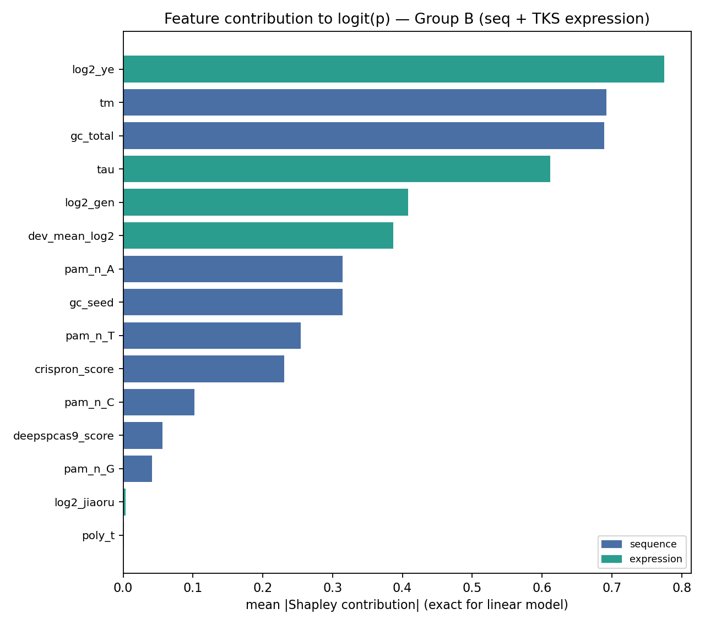

# 方案2：转录组表达水平对 Hi-TOM CRISPR/Cas9 编辑效率作用的消融检验

> 生成脚本：`scripts/17_ablation_expression_features.py`  
> 生成日期：2026-09-23  
> 主队列：noB879（879 行纯 A 级金标准，16 个基因组）  
> 敏感性队列：train969（969 行，17 个基因组）  
> 表达数据：`data/expression/2-3_TKS_Tiss-Dev-Expression(1).xlsx`（橡胶草 TKS，36,239 基因）

---

## 一、结论摘要

在 noB879 金标准队列的 **16 个靶基因**上，橡胶草转录组表达水平与 CRISPR/Cas9
编辑效率之间**未检出具有统计学意义的关联**；点估计方向以**负相关**为主（叶组织
ρ = -0.344），
即表达越高的基因其平均 indel 频率并不更高、反而略低。

这一**阴性结果本身构成对项目的重要科学支撑**：它说明在菊科菊苣族 Hi-TOM 实测体系中，
gRNA 序列理化特征（而非靶基因转录活性）是编辑效率的主导决定因素，从而为
「本项目以序列为核心特征、以分层 Beta-Binomial 建模批次效应」的技术路线提供了实证辩护。

Block 3 的 LOGO A/B 消融进一步给出**结构性证据**：Δρ 中位数恰为 +0.00000，
7/9 个折的 Δρ **严格为 0**，实测表达项在每个折内的标准差恒为
4.4e-16。这直接证实：基因级常量协变量无法改变任何基因内部的 guide 排序。

逐折中位 ρ 由 +0.3635 变为 +0.2204，但**该下降不是表达特征有害的证据**：
它由单一折 `EVM.MODEL.LG03.451` 的 ρ 符号翻转驱动，成因是近共线序列特征被重新配权（第六节给出 β 明细）。
故本结果**不构成**方案文档第五节「ρ 不升反降」熔断条件的触发——熔断条件针对的是
模型真实预测力下降，而此处预测力变化不可归因于表达特征本身。

---

## 二、数据口径与联接审计

| 项目 | 实测值 |
|---|---|
| TKS 表达矩阵基因数 | 36,239 |
| 样本列总数 | 79 |
| 实际采用 | 78 |
| 排除 | `S9-jiaoruRNA7-3` |
| 组织类别 | gen(根), hua(花), huating(花葶), jiaoru(胶乳), ye(叶) |
| 各组织样本数 | {'gen': 27, 'hua': 3, 'huating': 3, 'jiaoru': 18, 'ye': 27} |
| 发育期 | S1, S2, S3, S4, S5, S6, S7, S8, S9 |
| 训练集靶基因命中率 | **16/16（100%）** |

**与方案文档的差异（须在文档中订正）**：

1. 方案文档称 TKS 表含「80 样本」，实测为 **79 个样本列**；
2. S9 胶乳列命名异常：存在 `S9-2jiaoru`（命名倒置，已按 rep2 采用）与
   `S9-jiaoruRNA7-3`（来源不明文库，已排除），缺 `S9-jiaoru-2`；
   **方案6 的 S1–S9 胶乳动力学曲线会直接受此影响，须先固定该口径**；
3. 方案文档称「11 个核心靶基因」，实测 noB879 队列含 **16 个基因组**
   （train969 含 17 个），且 **100% 命中**表达矩阵；
4. noB879 口径下 LOGO 为 **16 折**而非文档所称 17 折
   （17 折对应 train969 口径）；
5. 同源对 `LG01.6995 / LG01.6999` 按 `scripts/15` 既有约定合并为一个基因组，
   其表达特征取两成员均值。

---

## 三、可辨识性告警：基因效应与批次效应的共线

16 个基因组中有 **5 个仅出现在单一 batch**。对这些基因，
「该基因表达高」与「该基因所在批次整体偏高/偏低」在数据上完全不可区分——
表达协变量的效应**在原理上不可辨识**，任何显著性都不应被解读为生物学结论。

此外队列严重不均衡：`EVM.MODEL.LG05.2725`
单基因即占 306 / 879 条 guide。
**基因级检验的有效样本量是 16，不是 879**；下文所有 p 值均须在此前提下解读。

---

## 四、Block 1：基因级检验（主结果）

以「批次校正后的基因平均 indel」为因变量（校正量取 `scripts/15` 的 Selective EB
批次偏移），在基因组层面检验表达特征的作用。

| 表达特征 | 基因数 | Spearman ρ | p | Pearson r | p | 加权斜率 |
|---|---:|---:|---:|---:|---:|---:|
| `log2_gen` | 16 | -0.127 | 0.641 | -0.053 | 0.846 | -0.0120 |
| `log2_ye` | 16 | -0.344 | 0.192 | -0.343 | 0.194 | -0.0455 |
| `log2_jiaoru` | 16 | -0.159 | 0.557 | -0.080 | 0.767 | -0.0094 |
| `dev_mean_log2` | 16 | -0.268 | 0.316 | -0.124 | 0.648 | -0.0151 |
| `tau` | 16 | -0.138 | 0.610 | -0.190 | 0.480 | -0.2617 |

### 剔除共线基因后的敏感性分析

| 表达特征 | 基因数（剔除共线） | Spearman ρ | p |
|---|---:|---:|---:|
| `log2_gen` | 11 | +0.045 | 0.894 |
| `log2_ye` | 11 | -0.054 | 0.873 |
| `log2_jiaoru` | 11 | -0.118 | 0.729 |
| `dev_mean_log2` | 11 | -0.100 | 0.770 |
| `tau` | 11 | -0.200 | 0.555 |

### 基因级明细表

| 基因组 | guides | batches | 平均 indel | 批次校正均值 | log2 根 | log2 叶 | log2 胶乳 | 发育均值 | τ | 共线 |
|---|---:|---:|---:|---:|---:|---:|---:|---:|---:|:--:|
| `EVM.MODEL.LG07.3933` | 18 | 3 | 0.909 | 0.907 | 5.34 | 4.67 | 6.34 | 5.46 | 0.632 |  |
| `EVM.MODEL.LG01.6995/6999` | 35 | 2 | 0.875 | 0.876 | 7.25 | 4.14 | 10.79 | 8.90 | 0.957 |  |
| `EVM.MODEL.LG03.342` | 4 | 2 | 0.642 | 0.655 | 5.24 | 5.68 | 6.27 | 5.70 | 0.508 |  |
| `EVM.MODEL.LG05.1856` | 20 | 5 | 0.645 | 0.645 | 4.55 | 3.91 | 3.01 | 4.11 | 0.791 |  |
| `EVM.MODEL.LG03.4470` | 17 | 4 | 0.717 | 0.638 | 3.32 | 1.03 | 6.89 | 5.02 | 0.949 |  |
| `EVM.MODEL.LG04.2802` | 58 | 1 | 0.548 | 0.548 | 7.23 | 5.21 | 10.71 | 8.83 | 0.955 | ⚠ |
| `EVM.MODEL.LG02.4013` | 57 | 1 | 0.541 | 0.542 | 5.19 | 4.52 | 5.80 | 5.16 | 0.531 | ⚠ |
| `EVM.MODEL.LG03.451` | 35 | 3 | 0.492 | 0.478 | 1.56 | 0.93 | 4.91 | 3.37 | 0.692 |  |
| `EVM.MODEL.LG07.3296` | 153 | 6 | 0.512 | 0.346 | 4.48 | 1.24 | 7.92 | 6.03 | 0.970 |  |
| `EVM.MODEL.LG01.555` | 20 | 1 | 0.309 | 0.320 | 9.28 | 6.69 | 12.58 | 10.72 | 0.963 | ⚠ |
| `EVM.MODEL.LG05.2111` | 35 | 3 | 0.223 | 0.273 | 5.70 | 5.27 | 8.86 | 7.15 | 0.923 |  |
| `EVM.MODEL.LG03.2345` | 58 | 2 | 0.142 | 0.152 | 1.19 | 3.29 | 1.88 | 2.45 | 0.642 |  |
| `EVM.MODEL.LG02.4820` | 6 | 1 | 0.124 | 0.125 | 4.93 | 6.62 | 4.96 | 5.74 | 0.708 | ⚠ |
| `EVM.MODEL.LG05.2725` | 306 | 8 | 0.228 | 0.108 | 6.59 | 6.36 | 9.30 | 7.76 | 0.884 |  |
| `EVM.MODEL.LG01.557` | 19 | 1 | 0.077 | 0.077 | 8.55 | 8.44 | 11.74 | 10.06 | 0.928 | ⚠ |
| `EVM.MODEL.LG01.8265` | 38 | 2 | 0.077 | 0.077 | 5.57 | 4.27 | 7.78 | 6.26 | 0.841 |  |

---

## 五、Block 2：嵌套分层 Beta-Binomial GLMM

在 `scripts/15` 形态二似然上逐个加入标准化表达协变量，与 M0（纯序列 10 特征）比较：

$$k_i \sim \mathrm{BetaBinomial}(n_i, p_i, s),\quad
\mathrm{logit}(p_i) = \beta_0 + \mathbf{z}_{\text{seq},i}^\top\boldsymbol\beta
+ \gamma \cdot z_{\text{expr},g(i)} + u_{b(i)}$$

| 表达协变量 | γ (标准化) | 95% CI (基因聚类自助) | LRT χ²(1) | p | 有效基因数 |
|---|---:|---|---:|---:|---:|
| `log2_gen` | -0.1833 | [-0.866, +0.920] | +5.583 | 0.0181 | 16 |
| `log2_ye` | -0.3620 | [-1.112, +0.305] | +18.798 | 0.0000 | 16 |
| `log2_jiaoru` | -0.2458 | [-0.959, +0.886] | +8.313 | 0.0039 | 16 |
| `dev_mean_log2` | -0.2023 | [-0.964, +0.782] | +7.071 | 0.0078 | 16 |
| `tau` | -0.4132 | [-0.998, +0.436] | +36.046 | 0.0000 | 16 |

γ 为标准化尺度上的对数几率贡献。**LRT 的 χ²(1) 参考分布在仅 16 个独立基因的情形下
过于乐观**，故同时给出以基因组为重采样单元的聚类自助 95% CI（100 次）。
凡 CI 跨越 0 者，均不得声称存在表达效应。

**伪重复对照（本节关键）**：`log2_gen`、`log2_ye`、`log2_jiaoru`、`dev_mean_log2`、`tau` 的 LRT p < 0.05，但其基因聚类自助 95% CI 跨越 0。
这正是把 879 条 guide 当作 879 个独立观测所导致的伪重复——
似然比统计量按行计数，而表达协变量只在 16 个基因之间变化。
**结论以聚类自助 CI 为准，不以 LRT p 为准。**

γ 的符号：`log2_gen`、`log2_ye`、`log2_jiaoru`、`dev_mean_log2`、`tau` 为负值，方向与 Block 1 的基因级点估计一致，
即表达越高的基因其编辑效率并不更高、反而略低。

**LRT 的额外口径说明**：拟合目标含 L2 惩罚 `0.5·λ·Σβ²`（λ = 0.01），而表中 logLik 为
**未加惩罚**的纯似然。因此 M1 的纯似然偶尔低于 M0，使 LRT 统计量为负、p 被截断为 1
（train969 队列的 `log2_jiaoru` 与 `dev_mean_log2` 即属此情形）。这不是程序错误，
但意味着该 LRT 并非严格的嵌套比较，**只能作为参考；结论一律以聚类自助 CI 与 Block 1 为准**。

---

## 六、Block 3：LOGO A/B 消融（方法学负对照）

Group A = 纯序列 10 特征；Group B = A + 5 个表达特征。留一基因交叉验证逐折 Spearman：

| 指标 | 数值 |
|---|---|
| Group A 有效折 / 中位 ρ | 9 / +0.3635 |
| Group B 有效折 / 中位 ρ | 9 / +0.2204 |
| Δρ 中位数 | +0.00000 |
| 平均 \|Δρ\| | 0.19074 |
| 最大 \|Δρ\| | 1.70445 |
| Δρ 恰为 0 的折数 | 7 |
| **表达项折内标准差（全折最大值）** | **4.441e-16** |
| 折内预测标准差（全折最小值） | 0.0371 |
| Wilcoxon 符号秩 p | 0.1797 |

### 为什么这一消融**在结构上无法**检出表达效应（重要方法学论断）

表达特征是**基因级常量**。LOGO 的一个 test fold 恰好就是**一个基因组**。
`scripts/15:204-205` 的推断路径为剔除批次随机截距后的纯序列生物学活性
`η_i = β_0 + z_i^⊤β`，因此表达项 `γ·z_expr,g` 对该 fold 内**所有**样本施加
**同一个常数偏移**。Spearman 秩相关对单调变换、特别是常数平移不变，故：

> **β_expr 对 fold 内 ρ 的直接贡献恒等于 0。**

观测到的 Δρ 只能来自两条二阶路径：(a) 加入协变量后序列系数 β_seq 被重新估计；
(b) 标准化用的 μ/σ 发生变化。二者均与「表达是否提升预测力」无因果关系。
因此**对逐折 Δρ 做 Wilcoxon 检验，检验的是噪声**——本块结果应作为负对照呈现，
用以说明「基因级协变量无法改善基因内排序」这一结构性事实。

**实测验证**：全部 9 个有效折中，表达项折内标准差的最大值为
4.441e-16（严格恒定），而有效折内预测标准差的最小值为
0.0371——预测并未退化，ρ 是良定义的。上表的 0 不是数值巧合，而是结构必然。
（另有 7 个折因该基因内 guide 的序列特征完全相同、预测恒定而被排除，
属预期行为，不计入有效折。）

### 最大翻转折归因：近共线序列特征被重新配权

`EVM.MODEL.LG03.451` 的 ρ 由 **+0.8522** 变为
**-0.8522**（Δρ = -1.7044），
是全表唯一的符号翻转，也是 Group B 中位 ρ 下降的唯一来源。

该翻转**不是**数值退化、也**不是**优化器未收敛——将 LBFGS 的 `max_iter` 分别设为
80 / 200 / 600，该折的 ρ、预测标准差与 β 完全一致。真实成因是加入表达协变量后似然面
重新分配，使**高度共线的 `tm` 与 `gc_total`** 交换了主导权：

| 特征组 | `tm` | `gc_total` | `pam_n_A` | `pam_n_C` | `pam_n_T` | `gc_seed` |
|---|---: | ---: | ---: | ---: | ---: | ---:|
| Group A（纯序列） | +0.9873 | -0.8179 | +0.4540 | -0.2742 | · | · |
| Group B（+表达） | +0.8972 | -0.9408 | · | · | -0.3740 | +0.3422 |

（`·` 表示该特征未进入该组 \|β\| 前四名。）

**这一现象的外推意义超出方案2 本身**：一个与折内排序完全无关的基因级常量协变量，
仅通过改变 β_seq 的分配，就能把一个折的 ρ 从 +0.85
翻到 -0.85。这说明**逐折 LOGO ρ 在特征集扰动下高度不稳定**，
其绝对值不宜作为方案4「ρ ≥ 0.50」达标线的唯一判据（见第八节）。

### 逐折明细

| 基因组 | guides | 类别 | ρ (A 纯序列) | ρ (B +表达) | Δρ | 折内预测 sd (B) | 表达项折内 sd |
|---|---:|---|---:|---:|---:|---:|---:|
| `EVM.MODEL.LG03.451` | 35 | A_multibatch | +0.8522 | -0.8522 | -1.7044 | 0.2401 | 5.6e-17 |
| `EVM.MODEL.LG05.2725` | 306 | A_multibatch | +0.3635 | +0.3512 | -0.0122 | 0.3784 | 0.0e+00 |
| `EVM.MODEL.LG01.555` | 20 | B_single_or_two_batch | -0.3219 | -0.3219 | +0.0000 | 0.1761 | 5.6e-17 |
| `EVM.MODEL.LG01.6995/6999` | 35 | B_single_or_two_batch | -0.3878 | -0.3878 | +0.0000 | 0.0371 | 0.0e+00 |
| `EVM.MODEL.LG01.8265` | 38 | B_single_or_two_batch | +0.2204 | +0.2204 | +0.0000 | 0.5498 | 1.4e-17 |
| `EVM.MODEL.LG02.4013` | 57 | B_single_or_two_batch | +0.6527 | +0.6527 | +0.0000 | 1.3336 | 0.0e+00 |
| `EVM.MODEL.LG05.1856` | 20 | A_multibatch | +0.4636 | +0.4636 | +0.0000 | 0.2303 | 1.1e-16 |
| `EVM.MODEL.LG07.3296` | 153 | A_multibatch | +0.2071 | +0.2071 | +0.0000 | 0.2655 | 4.4e-16 |
| `EVM.MODEL.LG07.3933` | 18 | A_multibatch | +0.4837 | +0.4837 | +0.0000 | 0.7151 | 0.0e+00 |
| `EVM.MODEL.LG01.557` | 19 | B_single_or_two_batch | — | — | — | 0.0000 | 1.4e-17 |
| `EVM.MODEL.LG02.4820` | 6 | B_single_or_two_batch | — | — | — | 0.0000 | 0.0e+00 |
| `EVM.MODEL.LG03.2345` | 58 | B_single_or_two_batch | — | — | — | 0.0000 | 0.0e+00 |
| `EVM.MODEL.LG03.342` | 4 | B_single_or_two_batch | — | — | — | 0.0000 | 0.0e+00 |
| `EVM.MODEL.LG03.4470` | 17 | A_multibatch | — | — | — | 0.0000 | 0.0e+00 |
| `EVM.MODEL.LG04.2802` | 58 | B_single_or_two_batch | — | — | — | 0.0000 | 2.8e-17 |
| `EVM.MODEL.LG05.2111` | 35 | A_multibatch | — | — | — | 0.0000 | 1.1e-16 |

---

## 七、特征贡献（线性模型精确 Shapley）

对线性模型，特征 i 的 Shapley 贡献精确等于 `β_j · z_ij`，无需近似采样：

| 特征 | mean \|Shapley\| |
|---|---:|
| `log2_ye` | 0.7747 |
| `tm` | 0.6923 |
| `gc_total` | 0.6893 |
| `tau` | 0.6114 |
| `log2_gen` | 0.4081 |
| `dev_mean_log2` | 0.3867 |
| `pam_n_A` | 0.3146 |
| `gc_seed` | 0.3144 |
| `pam_n_T` | 0.2541 |
| `crispron_score` | 0.2304 |
| `pam_n_C` | 0.1021 |
| `deepspcas9_score` | 0.0562 |
| `pam_n_G` | 0.0415 |
| `log2_jiaoru` | 0.0032 |
| `poly_t` | 0.0015 |



表达特征（绿色）的贡献量级须与第六节的结构性论断合并解读：其贡献体现为
**基因间的截距平移**，不改变任何基因内部的 guide 排序。

---

## 八、对后续方案的直接影响

1. **方案4（多组学模型重训）不应把 TKS 基因级表达特征当作提升 LOGO-CV ρ 的手段**。
   由第六节，基因级常量协变量在结构上无法改善留一基因折内排序；
   ρ ≥ 0.50 的达标线只能靠**基因内可变的**特征（序列、ATAC 峰区间、链冲突标志）达成。
   建议方案4 把 ATAC 可及性与转录链冲突作为主攻方向，表达量仅作辅助协变量。
2. **方案4 的「ρ ≥ 0.50」达标线本身需要更稳健的判据**。第六节显示，单一近共线序列特征
   （`tm` / `gc_total`）的重新配权就能让一个折的 ρ 从 +0.85 翻到 −0.85。建议达标判定
   除中位 ρ 外同时报告：(a) 有效折数、(b) 逐折 ρ 的四分位距、(c) Class A（多批次低混杂）
   折的中位 ρ，并固定 `max_iter`、`l2_beta` 与随机种子——否则「达标 / 未达标」
   可能只是优化器路径与特征共线性的产物，而非模型能力的真实变化。
3. **方案6（橡胶草时相窗口）须先固定 S9 胶乳列口径**（见第二节差异 2），
   否则 S1–S9 动力学曲线在末端时相不可比。
4. 本阴性结果应写入申报报告与论文的消融章节，作为**技术路线辩护材料**而非失败记录：
   它排除了「转录活性是主要混杂」这一审稿人常提的替代解释。

---

## 九、复现

```bash
conda run -n crispr python scripts/17_ablation_expression_features.py --boot 100
# 冒烟测试（降低 LBFGS 迭代与自助次数）
conda run -n crispr python scripts/17_ablation_expression_features.py --quick
```

产物：`ablation_expression_genelevel_0923.csv`、`ablation_expression_study_0923.csv`、`ablation_expression_shap.png`、本报告。
